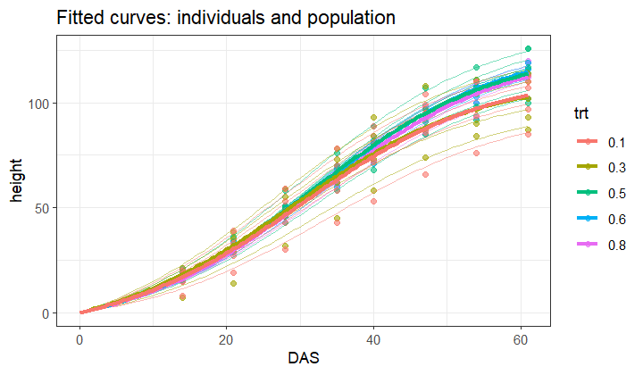

gcTMB
================

gcTMB fits non-linear growth curves over time by maximum likelihood with
the Template Model Builder ([TMB](https://github.com/kaskr/adcomp)). The
parameters of the curves can depend on covariates, have random effects
for repeated measurements of the same individuals, and the residuals can
be autocorrelated over time; the response can be continuous, a count or
a proportion. Derived quantities such as the time to reach 90% of the
asymptote or the maximum growth rate come with standard errors by
automatic differentiation.

## Features

- **Growth models**: logistic (Richards), Gompertz, Hill, Weibull,
  normal and gamma curves, each with an asymmetry parameter, and a
  straight line for comparison; optionally truncated at a threshold time
  before which the response is zero (e.g. emergence, or the first pods).
- **Interpretable parameters**: the asymptote (or the maximum growth
  rate, `b1type = "rate"`), the time of the maximum growth rate or of
  half the asymptote, a scale, slope or shape, the threshold and the
  asymmetry; each with an identity, log, logit or inverse link, and any
  of them can be fixed.
- **Distributions**: gaussian, lognormal, poisson, binomial,
  beta-binomial, beta, and negative binomial (`nbinom1`, `nbinom2`).
- **Fixed and random effects**: formulas for each parameter,
  e.g. `fform = b1 + b2 ~ treatment` and `rform = b1 + b2 ~ 1 | plant`,
  as in `nlme::nlme`; random effects correlated across parameters, with
  several terms, nested or crossed grouping factors and random slopes,
  integrated out by the Laplace approximation.
- **Autocorrelation**: AR(1) and continuous-time AR(1) residuals within
  individuals, `correlation = corCAR1(form = ~ day | plant)`, with the
  correlation structures of nlme.
- **Inference**: profile likelihood, Wald and parametric bootstrap
  confidence intervals; likelihood ratio tests with chi-square, F or
  parametric bootstrap p-values; information criteria; pairwise
  comparisons between curves with simultaneous confidence intervals;
  small-sample t and F inference for gaussian models without random
  effects.
- **Derived quantities**: times to reach a percentage of the asymptote
  or a given response (`timeto()`), and the maximum growth rate, its
  timing and the fraction of the asymptote reached then (`maxrate()`),
  with standard errors and confidence intervals.
- **Prediction and simulation**: predictions of the curves and their
  parameters with confidence and prediction intervals, validation plots,
  and simulation from the fitted model at new times and for new
  individuals, e.g. for simulation studies.

## Installation

gcTMB is installed from GitHub; it compiles its TMB model, so a C++
compiler is needed (Rtools on Windows).

``` r
pak::pak("EmilSkindersoe/gcTMB")
```

## Documentation

The vignettes introduce the package with worked examples on faba bean
data:

1.  [Growth models and their
    parameters](https://github.com/EmilSkindersoe/gcTMB/blob/main/vignettes/growth-models.pdf):
    the growth models, the meaning of their parameters, inflection
    points and maximum growth rates, model comparison, confidence
    intervals, and simple treatment effects.
2.  [Fixed and random
    effects](https://github.com/EmilSkindersoe/gcTMB/blob/main/vignettes/fixed-random-effects.pdf):
    covariates and random effects, and likelihood ratio and F-tests of
    their inclusion, for heights and counts.
3.  [Timing and maximum growth
    rates](https://github.com/EmilSkindersoe/gcTMB/blob/main/vignettes/timing-rates.pdf):
    `timeto()` and `maxrate()` with treatment and genotype effects, the
    maximum growth rate as a parameter, and pairwise comparisons, for
    normal and count data.
4.  [Autocorrelation and
    simulation](https://github.com/EmilSkindersoe/gcTMB/blob/main/vignettes/autocorrelation-simulation.pdf):
    autocorrelated residuals within individuals, and simulation studies,
    including the recovery of the autocorrelation parameter.

[The
overview](https://github.com/EmilSkindersoe/gcTMB/blob/main/vignettes/gcTMB.pdf)
shows most of the features in one document. Each function has a help
page, and `?gcTMB` describes the models in detail.

## Growth models

The main function is `gcTMB()`. The models are of the form f(t) = b1
F(z(t)), with a function F increasing from 0 to 1 and a transformed time
z(t):

| `model` | f(t) | b2 | b3 |
|----|----|----|----|
| `"logistic"` | b1 / (1 + exp(-(t - b2)/b3)) | inflection point | scale |
| `"gompertz"` | b1 exp(-exp(-(t - b2)/b3)) | inflection point | scale |
| `"hill"` | b1 / (1 + (b2/t)^b3) | time of half the asymptote | slope on the log time axis |
| `"weibull"` | b1 (1 - exp(-(b3 - 1)/b3 (t/b2)^b3)) | inflection point | shape, \> 1 |
| `"normal"` | b1 Phi((t - b2)/b3) | inflection point | scale |
| `"gamma"` | b1 F(t), with F the CDF of the gamma distribution with shape b3 and scale b2/(b3 - 1) | inflection point | shape, \> 1 |
| `"linear"` | b1 t + b2, for comparison | intercept | not used |

b1 is the asymptote approached at late times, and the slope of the
linear model, which has no asymptote and is not truncated. The Hill,
Weibull and gamma curves are for positive times. The links of the
parameters can be chosen, e.g. `link = c(b1 = "log", b3 = "inverse")`,
with the identity (default), log, logit (b1) or inverse (b3 of the
logistic and Gompertz models, the rate 1/b3) links.

By default, the curve is truncated at a threshold time b4, (F(z(t)) -
F(z(b4)))/(1 - F(z(b4))), so that the response is zero up to b4. b4 is
fixed at 0, so that the curve starts at zero at t = 0, unless estimated
with `fix = c(b4 = FALSE)`; `truncated = FALSE` gives the curves without
truncation.

Each model has an asymmetry parameter b5 \> 0, fixed at 1 (the curves
above) unless estimated with `fix = c(b5 = FALSE)`: the logistic model
becomes the Richards curve b1 / (1 + b5 exp(-(t - b2)/b3))^(1/b5), the
Hill model b1 / (1 + (b2/t)<sup>b3)</sup>b5, the Weibull, normal and
gamma models a power b5 of F, and the Gompertz model b1 (1 - (1 -
exp(-exp(-(t - b2)/b3)))^b5), a power of its survival function.

With `b1type = "rate"`, b1 is the maximum growth rate of the curve
instead of its asymptote, so that covariates and random effects on b1
act on the maximum growth rate.

Starting values come from a linearisation of the curve, Finv(y/b1) =
z(t), linear in t or log(t), profiled over the asymptote b1, or from a
grid search (`gcTMBstart()`).

## Examples

### A single curve

``` r
library(gcTMB)
set.seed(1)
d <- data.frame(day = rep(seq(0, 24, 2), each = 3))
d$weight <- 50 / (1 + exp(-(d$day - 10) / 2.5)) + rnorm(nrow(d), 0, 1.5)
fit <- gcTMB(weight ~ day, data = d, model = "logistic")
fit
#> Call:
#> gcTMB(form = weight ~ day, data = d, model = "logistic")
#> 
#> Model:  logistic, truncated at b4 = 0
#> Family: gaussian, identity link for all parameters
#> 
#> Coefficients:
#> b1:(Intercept)  b2:(Intercept)  b3:(Intercept)  
#>         50.099           9.770           2.647  
#> 
#> Residual standard deviation: 1.426
```

`timeto()` gives the times at which the curve reaches a percentage of
its asymptote, with standard errors from automatic differentiation and
profile likelihood intervals by `confint()`, and `maxrate()` the maximum
growth rate and its timing:

``` r
tt <- timeto(fit, level = c(10, 50, 90))
confint(tt)
#>         2.5 %    97.5 %
#> 10%  4.192012  4.902495
#> 50%  9.664311 10.137903
#> 90% 15.044105 16.338969
maxrate(fit)
#> Time of the maximum growth rate (tmax), maximum growth rate (rate) and proportion of total growth at inflection (fraction):
#> 
#>          Estimate Std.Error
#> tmax        9.770    0.1170
#> rate        4.850    0.1821
#> fraction    0.488    0.0022
```

### Treatment effects, random effects and autocorrelation

The data set `FabaHeights25` has the heights of 25 faba bean plants
under five treatments, measured on eight days after sowing. Treatment
effects on the asymptote and the time of the maximum growth rate,
correlated random effects of the plants on both, and continuous-time
AR(1) residuals within the plants:

``` r
FabaHeights25$trt <- factor(FabaHeights25$Treatment)
fit1 <- gcTMB(height ~ DAS, fform = b1 + b2 ~ trt, rform = b1 + b2 ~ 1 | plant_ID,
              data = FabaHeights25, correlation = corCAR1(form = ~ DAS | plant_ID))
summary(fit1)
#> Call:
#> gcTMB(form = height ~ DAS, fform = b1 + b2 ~ trt, rform = b1 + 
#>     b2 ~ 1 | plant_ID, data = FabaHeights25, correlation = corCAR1(form = ~DAS | 
#>     plant_ID))
#> 
#> Model:  logistic, truncated at b4 = 0
#> Family: gaussian, identity link for all parameters
#> 
#> Number of observations: 200, groups: plant_ID 25
#> Log-likelihood: -480.8 (df = 16), AIC: 993.5, BIC: 1046
#> 
#> Coefficients:
#>                Estimate Std. Error
#> b1:(Intercept)  114.315      4.209
#> b1:trt0.3        -1.967      5.796
#> b1:trt0.5        12.109      5.843
#> b1:trt0.6        13.840      5.862
#> b1:trt0.8        11.427      5.863
#> b2:(Intercept)   30.099      1.157
#> b2:trt0.3        -1.480      1.609
#> b2:trt0.5         1.212      1.610
#> b2:trt0.6         1.884      1.616
#> b2:trt0.8         2.224      1.627
#> b3:(Intercept)   12.948      0.363
#> 
#> Random effects:
#>  Groups   Name Std.Dev. Corr 
#>  plant_ID b1   8.256         
#>           b2   1.814    -0.54
#> 
#> Residual standard deviation: 3.29
#> 
#> Correlation structure: continuous-time AR(1) in DAS within plant_ID
#> rho: 0.9594
#> 
#> Optimiser: relative convergence (4), maximum absolute gradient 0.00024
```

Likelihood ratio tests of the treatment effects and of the
autocorrelation:

``` r
fit0 <- update(fit1, fform = NULL)
fit2 <- update(fit1, correlation = NULL)
anova(fit0, fit1)
#> Likelihood ratio tests of gcTMB models
#> 
#>      npar    AIC    BIC  logLik deviance     LR Df Pr(>LR)  
#> fit0    8 994.54 1020.9 -489.27   978.54                    
#> fit1   16 993.54 1046.3 -480.77   961.54 16.991  8  0.0302 *
#> ---
#> Signif. codes:  0 '***' 0.001 '**' 0.01 '*' 0.05 '.' 0.1 ' ' 1
anova(fit2, fit1)
#> Likelihood ratio tests of gcTMB models
#> 
#>      npar     AIC    BIC  logLik deviance     LR Df   Pr(>LR)    
#> fit2   15 1046.34 1095.8 -508.17  1016.34                        
#> fit1   16  993.54 1046.3 -480.77   961.54 54.799  1 1.335e-13 ***
#> ---
#> Signif. codes:  0 '***' 0.001 '**' 0.01 '*' 0.05 '.' 0.1 ' ' 1
```

The curves of the plants and the population curves of the treatments:

``` r
plot(fit1, type = "curves", times = seq(0, 61, by = 0.5))
```

<!-- -->

The times to reach 90% of the asymptote for each treatment:

``` r
timeto(fit1, level = 90, newdata = data.frame(trt = levels(FabaHeights25$trt)), random = FALSE)
#> Times to reach the percentages of the asymptote:
#> 
#>             Estimate Std.Error
#> 90%:trt=0.1     59.9      1.36
#> 90%:trt=0.3     58.6      1.32
#> 90%:trt=0.5     61.0      1.37
#> 90%:trt=0.6     61.6      1.39
#> 90%:trt=0.8     61.9      1.40
```

### Counts

The data set `FabaCounts23` has the numbers of pods of 22 plants of six
genotypes. A Poisson model with an estimated threshold, the time of the
first pods, and the maximum growth rate as the parameter b1, so that the
genotypes are compared by their maximum growth rates:

``` r
genotypes <- data.frame(Genotype = sort(unique(FabaCounts23$Genotype)))
fitp <- gcTMB(pods ~ DAS, fform = b1 + b2 ~ Genotype, rform = b1 ~ 1 | Tube_ID, data = FabaCounts23,
              family = "poisson", fix = c(b4 = FALSE), b1type = "rate", link = c(b1 = "log"))
pairwise(fitp, newdata = genotypes)
#> Pairwise differences of b1 (maximum growth rate) on the scale of its log link:
#> 
#>                                    Estimate Std.Error z value p.value  lower
#> Genotype=Aurora - Genotype=Capri     0.3002     0.232   1.296 0.78767 -0.360
#> Genotype=Aurora - Genotype=ILB938    0.4572     0.231   1.976 0.35585 -0.202
#> Genotype=Aurora - Genotype=Lynx     -0.2753     0.231  -1.192 0.84195 -0.933
#> Genotype=Aurora - Genotype=Melodie  -0.5368     0.245  -2.191 0.24139 -1.235
#> Genotype=Aurora - Genotype=Navara   -0.1767     0.232  -0.762 0.97484 -0.838
#> Genotype=Capri - Genotype=ILB938     0.1570     0.218   0.722 0.98021 -0.463
#> Genotype=Capri - Genotype=Lynx      -0.5755     0.217  -2.650 0.08513 -1.194
#> Genotype=Capri - Genotype=Melodie   -0.8370     0.232  -3.610 0.00444 -1.498
#> Genotype=Capri - Genotype=Navara    -0.4769     0.218  -2.186 0.24384 -1.099
#> Genotype=ILB938 - Genotype=Lynx     -0.7324     0.217  -3.376 0.00970 -1.351
#> Genotype=ILB938 - Genotype=Melodie  -0.9940     0.232  -4.288 0.00032 -1.655
#> Genotype=ILB938 - Genotype=Navara   -0.6339     0.218  -2.907 0.04185 -1.255
#> Genotype=Lynx - Genotype=Melodie    -0.2616     0.231  -1.130 0.87005 -0.921
#> Genotype=Lynx - Genotype=Navara      0.0985     0.218   0.453 0.99757 -0.521
#> Genotype=Melodie - Genotype=Navara   0.3601     0.232   1.549 0.63191 -0.302
#>                                      upper ratio ratio.lower ratio.upper
#> Genotype=Aurora - Genotype=Capri    0.9600 1.350       0.698       2.612
#> Genotype=Aurora - Genotype=ILB938   1.1164 1.580       0.817       3.054
#> Genotype=Aurora - Genotype=Lynx     0.3828 0.759       0.393       1.466
#> Genotype=Aurora - Genotype=Melodie  0.1613 0.585       0.291       1.175
#> Genotype=Aurora - Genotype=Navara   0.4841 0.838       0.433       1.623
#> Genotype=Capri - Genotype=ILB938    0.7769 1.170       0.629       2.175
#> Genotype=Capri - Genotype=Lynx      0.0434 0.562       0.303       1.044
#> Genotype=Capri - Genotype=Melodie  -0.1763 0.433       0.224       0.838
#> Genotype=Capri - Genotype=Navara    0.1448 0.621       0.333       1.156
#> Genotype=ILB938 - Genotype=Lynx    -0.1142 0.481       0.259       0.892
#> Genotype=ILB938 - Genotype=Melodie -0.3335 0.370       0.191       0.716
#> Genotype=ILB938 - Genotype=Navara  -0.0127 0.531       0.285       0.987
#> Genotype=Lynx - Genotype=Melodie    0.3978 0.770       0.398       1.489
#> Genotype=Lynx - Genotype=Navara     0.7185 1.104       0.594       2.051
#> Genotype=Melodie - Genotype=Navara  1.0223 1.433       0.739       2.780
#> 
#> Wald z tests; p-values and confidence limits adjusted by the single-step (Tukey) method, 95% confidence limits, and ratios.
```

## Functions and methods

| Purpose | Functions |
|----|----|
| Fitting | `gcTMB()`, `gcTMBstart()`, `gcTMBcontrol()`, `corAR1()`, `corCAR1()`, `update()` |
| Results | `summary()`, `coef()`, `vcov()`, `logLik()`, `converged()`, `fixef()`, `ranef()`, `VarCorr()`, `sigma()`, `corpars()` |
| Confidence intervals | `confint()`, `profile()`, `bootstrap()` |
| Tests and model choice | `anova()`, `criteria()`, `pairwise()` |
| Derived quantities | `timeto()`, `maxrate()` |
| Prediction and diagnostics | `predict()`, `fitted()`, `residuals()`, `plot()` |
| Simulation | `simulate()`, `update()` |

The extractors `fixef()`, `ranef()` and `VarCorr()` work for gcTMB, nlme
and lme4 fits alike, and the formulas of the effects and the correlation
structures follow nlme; gcTMB fits by maximum likelihood, so its
likelihoods compare with nlme fits with `method = "ML"`. See `?gcTMB`,
*Relation to nlme*.

## License

GPL (\>= 2).
