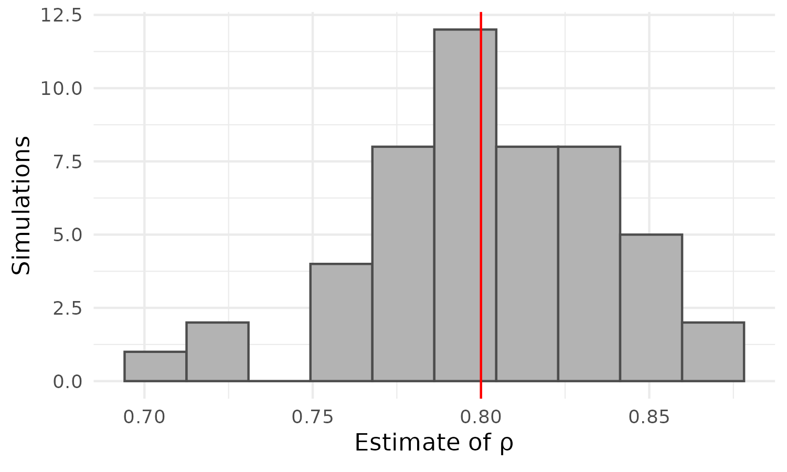

# Autocorrelation and simulation

This vignette covers the autocorrelation of the residuals of a plot over
time, and simulation studies: simulating data from a fitted model,
refitting it, and comparing the estimates with the true parameters,
including the autocorrelation parameter.

## The sorghum and maize data

The data set `SorghumMaize` contains the above-ground biomass (Mg/ha) of
fiber sorghum, sweet sorghum and maize at two input levels of water and
nitrogen, in four blocks, sampled on 11 days of the year from sowing,
day 141, to day 303 (Danalatos et al., 2009; Miguez, 2025). Each
combination of crop, input level and block is a plot, sampled repeatedly
over the season. The growth of a crop over a season is determinate: it
stops at maturity, after which the biomass may decline as leaves are
lost. The beta growth function of Yin et al. (2003), `model = "beta"`,
describes this, from the start of growth $`b_4`$, here fixed at sowing,
to the maximum $`b_1`$ at the end of growth $`b_3`$, with the time of
the fastest growth $`b_2`$, and back towards zero after $`b_3`$,
reaching it at $`2 b_3 - b_2`$ (see the vignette *Growth models and
their parameters*; `model = "beta_capped"` stays at the maximum
instead).

The biomass varies little between the plots while it is small, and more
as it grows. A gaussian model has a constant residual variance, as large
at sowing as at maturity, and data simulated from it are often negative
early in the season. The lognormal family, `family = "lognormal"`, has a
constant coefficient of variation instead: $`\log(y)`$ is normal with
mean $`\log f(t)`$ and standard deviation $`\sigma`$, so that the curve
$`f`$ is the median of the biomass, and the residuals are relative
deviations from it. It needs positive responses, so the zero biomass at
sowing is left out; the beta curve is zero at sowing, $`b_4 = 141`$,
anyway. The asymptote and the time of the fastest growth depend on the
crop and the input level, and each plot has a random asymptote:

``` r

library(gcTMB)
library(ggplot2)
SorghumMaize$plot <- interaction(SorghumMaize$Crop, SorghumMaize$Input, SorghumMaize$Block, drop = TRUE)
sm <- subset(SorghumMaize, Biomass > 0)
fitre <- gcTMB(Biomass ~ DOY, fform = b1 + b2 ~ Crop * Input, rform = b1 ~ 1 | plot, data = sm,
               model = "beta", start = c(b4 = 141), family = "lognormal")
ggplot(SorghumMaize, aes(x = DOY, y = Biomass, group = plot, colour = Input)) +
  geom_line() +
  geom_point() +
  facet_wrap(~ Crop) +
  labs(x = "Day of the year", y = "Biomass (Mg/ha)", colour = "Input") +
  theme_minimal()
```


## Autocorrelation of the residuals

A plot that is above its curve at one sampling may stay above it at the
next. The `correlation` argument models this autocorrelation of the
residuals within a group over time, with the same correlation structures
as the package nlme (Pinheiro and Bates, 2000; Zuur et al., 2009,
Chapter 6). The residuals $`\varepsilon`$ of a group are normal with the
residual variance $`\sigma^2`$ and

``` math
\mathrm{cor}(\varepsilon_s, \varepsilon_t) = \rho^{|t - s|},
```

with $`\rho`$ the correlation of residuals one unit of time apart.
[`corAR1()`](https://emilskindersoe.github.io/gcTMB/reference/corStruct.md)
is the autoregressive process of order 1 at integer times (or at the
positions of the observations, with `form = ~ 1 | group`), with
$`-1 < \rho < 1`$;
[`corCAR1()`](https://emilskindersoe.github.io/gcTMB/reference/corStruct.md)
its continuous-time version, for unequally spaced times, with
$`0 < \rho < 1`$. Residuals of different groups are independent, and the
correlation is available for the gaussian and lognormal (on the log
scale) families. As the process is Markov, each residual given the
previous one of its group, $`dt`$ earlier, is normal with mean
$`\rho^{dt} \varepsilon_{\mathrm{prev}}`$ and variance
$`\sigma^2 (1 - \rho^{2 dt})`$, so the likelihood is exact and its cost
linear in the number of observations; with random effects, the Laplace
approximation integrates them out as before.

The parameter $`\rho`$ is estimated on an unconstrained scale, as in
nlme. For
[`corCAR1()`](https://emilskindersoe.github.io/gcTMB/reference/corStruct.md),
with $`0 < \rho < 1`$, this is the logit link,
$`\log(\rho/(1 - \rho))`$. For
[`corAR1()`](https://emilskindersoe.github.io/gcTMB/reference/corStruct.md),
with $`-1 < \rho < 1`$, it is $`\log((1 + \rho)/(1 - \rho))`$, the logit
of $`(1 + \rho)/2`$, which maps the interval $`(-1, 1)`$ to the real
line (twice Fisher’s $`z`$-transformation, $`2\,\mathrm{atanh}(\rho)`$).
[`coef()`](https://rdrr.io/r/stats/coef.html) reports the parameter on
this scale, as `cor_par:CAR1` or `cor_par:AR1`, and
[`corpars()`](https://emilskindersoe.github.io/gcTMB/reference/gcTMB-extract.md),
[`summary()`](https://rdrr.io/r/base/summary.html) and
[`confint()`](https://rdrr.io/r/stats/confint.html) report $`\rho`$
itself.

The plots are sampled about every 15 days, at unequal intervals, so
`corCAR1(form = ~ DOY | plot)` is the structure to use, with $`\rho`$
the correlation per day. Its starting value is $`\rho = 0.2`$ by
default, as in nlme, which is a correlation of $`0.2^{15}`$, practically
zero, between consecutive samplings; there the likelihood hardly changes
with $`\rho`$, and the optimiser stays near the starting value. A
starting value close to 1, `value = 0.9`, starts from a correlation of
$`0.9^{15} \approx 0.2`$ between samplings. For the lognormal family,
the correlation is that of the residuals of $`\log(y)`$, the relative
deviations from the curve:

``` r

fitrec <- gcTMB(Biomass ~ DOY, fform = b1 + b2 ~ Crop * Input, rform = b1 ~ 1 | plot, data = sm,
                model = "beta", start = c(b4 = 141), family = "lognormal",
                correlation = corCAR1(value = 0.9, form = ~ DOY | plot))
summary(fitrec)
#> Call:
#> gcTMB(form = Biomass ~ DOY, fform = b1 + b2 ~ Crop * Input, rform = b1 ~ 
#>     1 | plot, data = sm, start = c(b4 = 141), correlation = corCAR1(value = 0.9, 
#>     form = ~DOY | plot), family = "lognormal", model = "beta")
#> 
#> Model:  beta
#> Family: lognormal, identity link for all parameters
#> 
#> Number of observations: 212, groups: plot 24
#> Log-likelihood: -466.3 (df = 16), AIC: 964.5, BIC: 1018
#> 
#> Coefficients:
#>                                Estimate Std. Error z value Pr(>|z|)    
#> b1:(Intercept)                  32.6795     2.3532  13.887  < 2e-16 ***
#> b1:CropMaize                   -13.0754     2.9466  -4.437  9.1e-06 ***
#> b1:CropSweet sorghum            -0.1908     3.3406  -0.057   0.9545    
#> b1:InputHigh                     7.1624     3.6936   1.939   0.0525 .  
#> b1:CropMaize:InputHigh           1.2994     4.7927   0.271   0.7863    
#> b1:CropSweet sorghum:InputHigh   2.2539     5.3285   0.423   0.6723    
#> b2:(Intercept)                 237.4210     1.4388 165.012  < 2e-16 ***
#> b2:CropMaize                    -5.3300     2.3608  -2.258   0.0240 *  
#> b2:CropSweet sorghum             2.3127     1.7981   1.286   0.1984    
#> b2:InputHigh                    -0.6375     1.8354  -0.347   0.7283    
#> b2:CropMaize:InputHigh           0.5966     3.2051   0.186   0.8523    
#> b2:CropSweet sorghum:InputHigh   0.5322     2.4436   0.218   0.8276    
#> b3:(Intercept)                 278.3070     1.0786 258.028  < 2e-16 ***
#> ---
#> Signif. codes:  0 '***' 0.001 '**' 0.01 '*' 0.05 '.' 0.1 ' ' 1
#> Unadjusted Wald tests; tests of the differences between curves adjusted for their number: partest().
#> Fixed: b4:(Intercept) = 141
#> 
#> Random effects:
#>  Groups Name Std.Dev. 
#>  plot   b1   0.0002202
#> Standard deviations close to zero (singular fit): plot b1
#> 
#> Residual standard deviation of log(y): 0.2904
#> 
#> Correlation structure: continuous-time AR(1) in DOY within plot
#> rho: 0.04809
#> 
#> Optimiser: relative convergence (4), maximum absolute gradient 2.2e-05
corpars(fitrec)^15
#>          rho 
#> 1.702408e-20
anova(fitre, fitrec)
#> Likelihood ratio tests of gcTMB models
#> 
#>        npar    AIC    BIC  logLik deviance         LR Df Pr(>LR)
#> fitre    15 962.53 1012.9 -466.27   932.53                      
#> fitrec   16 964.53 1018.2 -466.27   932.53 2.8823e-08  1  0.9999
```

The estimate of $`\rho`$ moves far down from its starting value, to a
correlation of practically zero between consecutive samplings, and the
likelihood ratio test finds no autocorrelation: the relative deviations
of a plot from its curve are independent over the season. The random
asymptotes of the plots are not needed either, as their standard
deviation is close to zero once the crops and the input levels have
their own curves. With the gaussian family, both appear to be needed;
this is not a feature of the plots, but of the constant residual
variance, which misfits the small deviations early in the season and the
large ones late. Below, simulations with a true autocorrelation show
that the model finds it when it is there.

[`confint()`](https://rdrr.io/r/stats/confint.html) gives the profile
likelihood interval of $`\rho`$, or with `method = "wald"` a Wald
interval computed on the logit scale and transformed back. Here it spans
the whole range from 0 to 1: without autocorrelation in the data, the
likelihood is flat in $`\rho`$, and the data say nothing about its
value.

``` r

confint(fitrec, parm = "cor_par:CAR1", method = "wald")
#>     2.5 % 97.5 %
#> rho     0      1
```

## Simulation

A simulation study has four steps: fit a model to data, simulate new
data sets from the fitted model, refit the model to the simulated data,
and compare the estimates with the true parameters, the estimates of the
original fit.

### The true model

We fit the lognormal beta growth function to the biomass, with an
asymptote and a time of the fastest growth for each crop, and a random
asymptote of each plot. The start of growth is fixed at sowing,
$`b_4 = 141`$; the beta curve has no asymmetry $`b_5`$.

``` r

fitsim <- gcTMB(Biomass ~ DOY, fform = b1 + b2 ~ Crop, rform = b1 ~ 1 | plot, data = sm,
                model = "beta", start = c(b4 = 141), family = "lognormal")
fitsim
#> Call:
#> gcTMB(form = Biomass ~ DOY, fform = b1 + b2 ~ Crop, rform = b1 ~ 
#>     1 | plot, data = sm, start = c(b4 = 141), family = "lognormal", 
#>     model = "beta")
#> 
#> Model:  beta
#> Family: lognormal, identity link for all parameters
#> 
#> Coefficients:
#>       b1:(Intercept)          b1:CropMaize  b1:CropSweet sorghum  
#>              36.2386              -12.5753                0.6892  
#>       b2:(Intercept)          b2:CropMaize  b2:CropSweet sorghum  
#>             236.9786               -5.0948                2.5446  
#>       b3:(Intercept)  
#>             278.2859  
#> Fixed: b4:(Intercept) = 141
#> 
#> Random effects:
#>  Groups Name Std.Dev.
#>  plot   b1   3.582   
#> 
#> Residual standard deviation of log(y): 0.3006
converged(fitsim)
#> [1] TRUE
```

The fitted model is the true model of the simulation. Its parameters
are:

``` r

fixef(fitsim)
#>       b1:(Intercept)         b1:CropMaize b1:CropSweet sorghum 
#>            36.238579           -12.575316             0.689162 
#>       b2:(Intercept)         b2:CropMaize b2:CropSweet sorghum 
#>           236.978644            -5.094775             2.544621 
#>       b3:(Intercept)       b4:(Intercept) 
#>           278.285857           141.000000
VarCorr(fitsim)
#> $plot
#>          b1
#> b1 12.82913
#> attr(,"stddev")
#>       b1 
#> 3.581777 
#> attr(,"correlation")
#>    b1
#> b1  1
#> 
#> attr(,"sc")
#> [1] 0.300555
sigma(fitsim)
#> [1] 0.300555
```

Other true models can be made from it with
[`update()`](https://rdrr.io/r/stats/update.html),
e.g. `update(fitsim, fixef = c("b1:(Intercept)" = 30))` for a larger
asymptote of fiber sorghum, `update(fitsim, VarCorr = ...)` for another
variance of the random effects, or `update(fit, rho = ...)` for another
autocorrelation, as below.

### Simulating new plots

We simulate 20 new plots of each crop, each sampled every 10 days from
day 150 to day 300. Each plot in `newdata` is a new curve, with its own
random effect drawn from the fitted variance.

``` r

simdata <- expand.grid(DOY = seq(150, 300, by = 10), plot = paste("plot", 1:60, sep = ""))
simdata$Crop <- rep(levels(SorghumMaize$Crop), each = 20)[as.integer(simdata$plot)]
simdata$Biomass <- simulate(fitsim, nsim = 1, seed = 1, newdata = simdata)[[1]]
head(simdata)
#>   DOY  plot          Crop    Biomass
#> 1 150 plot1 Fiber sorghum 0.03351686
#> 2 160 plot1 Fiber sorghum 0.18146325
#> 3 170 plot1 Fiber sorghum 0.86335105
#> 4 180 plot1 Fiber sorghum 1.76762973
#> 5 190 plot1 Fiber sorghum 2.77908468
#> 6 200 plot1 Fiber sorghum 6.29144684
```

### Refitting the model

The same model is fitted to the simulated data.

``` r

simfit <- gcTMB(Biomass ~ DOY, fform = b1 + b2 ~ Crop, rform = b1 ~ 1 | plot, data = simdata,
                model = "beta", start = c(b4 = 141), family = "lognormal")
converged(simfit)
#> [1] TRUE
```

[`converged()`](https://emilskindersoe.github.io/gcTMB/reference/converged.md)
checks that the log-likelihood is finite, that the optimiser reports
convergence with a largest absolute gradient below $`10^{-3}`$, and that
the Hessian is positive definite. With few groups and several correlated
random effects, the likelihood is often so flat in some directions that
`nlminb` reports “singular convergence” or “false convergence”, or stops
with a gradient slightly above $`10^{-3}`$, although it is at the
maximum. With `control = list(restart = TRUE)`, such a fit is optimised
once more from its estimates. The fit keeps the better optimum, and
`fit$restart$improvement` holds the improvement of the log-likelihood.
[`converged()`](https://emilskindersoe.github.io/gcTMB/reference/converged.md)
accepts a fit that the restart improved by less than `lltol`
($`10^{-6}`$ by default), since its maximum is stable. In a simulation
study that does not need standard errors, `sdreport = FALSE` also saves
about a quarter of the time of each fit, but then the Hessian is not
checked. Here, with three plots of each crop, the fit converges at once,
so that the restart is not needed and `f1$restart` is `NULL`:

``` r

small <- subset(simdata, plot %in% paste0("plot", c(1:3, 21:23, 41:43)))
f0 <- gcTMB(Biomass ~ DOY, fform = b1 + b2 ~ Crop, rform = b1 ~ 1 | plot, data = small,
            model = "beta", start = c(b4 = 141), family = "lognormal", control = list(sdreport = FALSE))
converged(f0)
#> [1] TRUE
f1 <- gcTMB(Biomass ~ DOY, fform = b1 + b2 ~ Crop, rform = b1 ~ 1 | plot, data = small,
            model = "beta", start = c(b4 = 141), family = "lognormal", control = list(sdreport = FALSE, restart = TRUE))
f1$restart$improvement
#> NULL
converged(f1)
#> [1] TRUE
```

The 95% parametric bootstrap confidence intervals of the coefficients
and the variance parameters are compared with the true values, the
estimates of the original fit. `confint` reports the standard deviation
of the random effects and the residual standard deviation on their
natural scale, while `coef` has them on the log scale, so the true
values and the estimates are transformed in the same way.

``` r

ci <- confint(simfit, method = "boot", nsim = 50, seed = 1)
#> Computing bootstrap confidence intervals (50 simulations) ...
natural <- function(p){
  lg <- grepl("^log_", names(p))
  p[lg] <- exp(p[lg])
  p
}
truth <- natural(coef(fitsim))
tab <- data.frame(true = truth, estimate = natural(coef(simfit)), ci,
                  covered = truth >= ci[, 1] & truth <= ci[, 2],
                  check.names = FALSE)
# the standard deviations are on their natural scale: drop "log_" from their names
rownames(tab) <- sub("^log_", "", rownames(tab))
tab
#>                            true    estimate       2.5 %     97.5 % covered
#> b1:(Intercept)        36.238579  36.6773045  34.4540358  39.383038    TRUE
#> b1:CropMaize         -12.575316 -13.7901623 -17.3929057 -10.632215    TRUE
#> b1:CropSweet sorghum   0.689162   0.6887544  -1.6154944   3.621184    TRUE
#> b2:(Intercept)       236.978644 236.8807942 235.7555052 238.389181    TRUE
#> b2:CropMaize          -5.094775  -5.0449933  -5.8784815  -4.022029    TRUE
#> b2:CropSweet sorghum   2.544621   2.8495607   2.0070857   3.596094    TRUE
#> b3:(Intercept)       278.285857 278.6153925 277.1445230 280.234416    TRUE
#> sd:b1|plot             3.581777   2.8538480   1.7905491   3.450739   FALSE
#> sigma                  0.300555   0.3154057   0.3011981   0.331147   FALSE
```

The simulated biomass and the estimated curves of the 60 plots:

``` r

grid <- expand.grid(DOY = seq(141, 300, length.out = 200), plot = unique(simdata$plot))
grid$Crop <- rep(levels(SorghumMaize$Crop), each = 20)[as.integer(grid$plot)]
grid$Biomass <- predict(simfit, newdata = grid)
ggplot(simdata, aes(DOY, Biomass, group = plot)) +
  geom_line(data = grid, colour = "grey50", linewidth = 0.3) +
  geom_point(size = 0.8) +
  facet_wrap(~ Crop) +
  labs(x = "Day of the year", y = "Biomass (Mg/ha)") +
  theme_bw()
```


The simulated biomass is positive, and varies with the size of the
plants, as the observed biomass does: the lognormal residual standard
deviation, 0.3 on the log scale, is a coefficient of variation of about
30%. A simulation study reproduces the fitted model, not the process
that generated the data, so its conclusions only carry over to the real
data as far as the model describes them; with the gaussian family, about
a tenth of the simulated biomass values would be negative.

In a full simulation study, these steps are repeated for many simulated
data sets, e.g. to estimate the coverage of the confidence intervals or
to compare growth models with
[`criteria()`](https://emilskindersoe.github.io/gcTMB/reference/criteria.md),
as below for the autocorrelation.

### Recovering the autocorrelation

With a correlation structure,
[`simulate()`](https://rdrr.io/r/stats/simulate.html) draws the
residuals of each group with the autocorrelation of the fit: within a
plot in `newdata`, ordered in time, each residual given the previous
one, $`dt`$ earlier, is normal with mean $`\rho^{dt}`$ times the
previous residual and variance $`\sigma^2 (1 - \rho^{2 dt})`$.
[`update()`](https://rdrr.io/r/stats/update.html) is designed for
simulation studies like this one: it sets some of the parameters of a
fitted model to chosen values and keeps the others, without refitting,
so that the result can serve as the true model of the simulation. Its
arguments are `fixef` for the coefficients, `VarCorr` for the covariance
matrices of the random effects, `sigma` for the residual standard
deviation, and `rho` for the autocorrelation.

Here the true model is the lognormal fit `fitrec` from above, with crop
and input effects, random asymptotes of the plots and continuous-time
AR(1) residuals of $`\log(y)`$. Its autocorrelation, $`\rho = 0.05`$ per
day, is set to $`\rho = 0.8`$ with
[`update()`](https://rdrr.io/r/stats/update.html), a correlation of
$`0.8^{10} \approx 0.11`$ between samplings 10 days apart, and all other
parameters keep their estimates:

``` r

rho0 <- 0.8
fitcar <- update(fitrec, rho = rho0)
```

[`update()`](https://rdrr.io/r/stats/update.html) changes $`\rho`$ and
nothing else, so the other parameters are those estimated together with
$`\rho = 0.05`$. Alternatively, a new fit with $`\rho`$ fixed at 0.8,
`corCAR1(value = 0.8, fixed = TRUE)`, estimates the other parameters
given $`\rho = 0.8`$. This is the way to go when the true model should
fit the data as well as possible with the chosen $`\rho`$, and it has
the higher log-likelihood;
[`update()`](https://rdrr.io/r/stats/update.html) is the way to go when
only $`\rho`$ should differ from the fitted model, e.g. to compare
simulations with different autocorrelations and otherwise the same
parameters.

``` r

fitfix <- gcTMB(Biomass ~ DOY, fform = b1 + b2 ~ Crop * Input, rform = b1 ~ 1 | plot, data = sm,
                model = "beta", start = c(b4 = 141), family = "lognormal",
                correlation = corCAR1(value = rho0, form = ~ DOY | plot, fixed = TRUE))
pars <- function(f) c(fixef(f)[c("b1:(Intercept)", "b2:(Intercept)", "b3:(Intercept)")],
                      sigma = sigma(f), corpars(f), logLik = as.numeric(logLik(f)))
rbind(estimated = pars(fitrec), updated = pars(fitcar), refitted = pars(fitfix))
#>           b1:(Intercept) b2:(Intercept) b3:(Intercept)     sigma        rho
#> estimated       32.67953       237.4210       278.3070 0.2904355 0.04809179
#> updated         32.67953       237.4210       278.3070 0.2904355 0.80000000
#> refitted        32.60736       237.4475       278.3419 0.2938295 0.80000000
#>              logLik
#> estimated -466.2650
#> updated   -468.4116
#> refitted  -468.3100
```

We simulate from the updated model: 50 data sets of 10 new plots of each
combination of crop and input level, each sampled every 10 days from day
150 to day 300. We fit the model to each data set, now with $`\rho`$
estimated. [`confint()`](https://rdrr.io/r/stats/confint.html) computes
the Wald interval of $`\rho`$ on the logit scale and transforms it back.

``` r

design <- expand.grid(DOY = seq(150, 300, by = 10), rep = 1:10, Crop = levels(SorghumMaize$Crop),
                      Input = levels(SorghumMaize$Input))
design$plot <- interaction(design$rep, design$Crop, design$Input, drop = TRUE)
sims <- simulate(fitcar, nsim = 50, seed = 1, newdata = design)
carsim <- do.call(rbind, lapply(sims, function(y){
  dat <- cbind(design, Biomass = y)
  f1 <- gcTMB(Biomass ~ DOY, fform = b1 + b2 ~ Crop * Input, rform = b1 ~ 1 | plot, data = dat,
              model = "beta", start = c(b4 = 141), family = "lognormal",
              correlation = corCAR1(value = 0.9, form = ~ DOY | plot))
  ci <- confint(f1, parm = "cor_par:CAR1", method = "wald")
  data.frame(rho = corpars(f1)[["rho"]], lower = ci[1], upper = ci[2],
             covered = ci[1] <= rho0 & rho0 <= ci[2])
}))
```

The means of the estimates of $`\rho`$ and of the bounds of their 95%
Wald intervals, and the coverage of the intervals, against the true
value 0.8:

``` r

colMeans(carsim[, c("rho", "lower", "upper", "covered")])
#>       rho     lower     upper   covered 
#> 0.7869091 0.7205922 0.8409081 0.9800000
```

``` r

ggplot(carsim, aes(x = rho)) +
  geom_histogram(bins = 10, fill = "grey70", colour = "grey30") +
  geom_vline(xintercept = rho0, colour = "red") +
  labs(x = expression(paste("Estimate of ", rho)), y = "Simulations") +
  theme_minimal()
```



## References

Danalatos, N.G., Archontoulis, S.V. and Tsiboukas, K. (2009).
Comparative analysis of sorghum versus corn growing under optimum and
under water/nitrogen limited conditions in central Greece. In:
*Proceedings of the 17th European Biomass Conference*, Hamburg, 538–544.

Miguez, F. (2025). *nlraa: Nonlinear Regression for Agricultural
Applications*. R package, <https://CRAN.R-project.org/package=nlraa>.

Pinheiro, J.C. and Bates, D.M. (2000). *Mixed-Effects Models in S and
S-PLUS*. Springer, New York.

Zuur, A.F., Ieno, E.N., Walker, N.J., Saveliev, A.A. and Smith, G.M.
(2009). *Mixed Effects Models and Extensions in Ecology with R*.
Springer, New York.

Yin, X., Goudriaan, J., Lantinga, E.A., Vos, J. and Spiertz, H.J.
(2003). A flexible sigmoid function of determinate growth. *Annals of
Botany* 91, 361–371.
