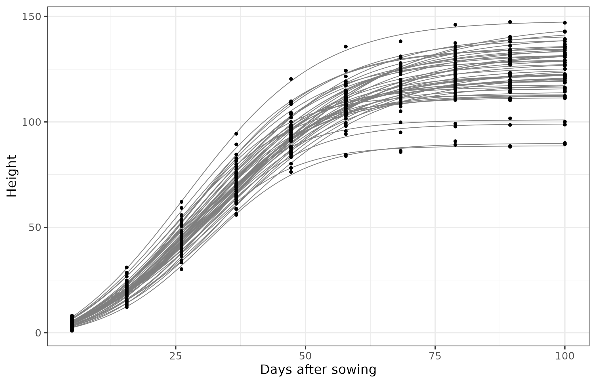

# Autocorrelation and simulation

This vignette covers the autocorrelation of the residuals of a plant
over time, and simulation studies: simulating data from a fitted model,
refitting it, and comparing the estimates with the true parameters,
including the autocorrelation parameter.

A logistic growth curve with correlated random effects of the plants on
the asymptote and the time of the maximum growth rate, as in the
vignette *Fixed and random effects*, here without treatment effects:

``` r

library(gcTMB)
library(ggplot2)
fitre <- gcTMB(height ~ DAS, rform = b1 + b2 ~ 1 | plant_ID, data = FabaHeights25)
```

## Autocorrelation of the residuals

The random effects shift the whole curve of a plant, but a plant that is
above its curve at one measurement often stays above it at the next. The
`correlation` argument models this autocorrelation of the residuals
within a group over time, with the same correlation structures as the
package nlme (Pinheiro and Bates, 2000; Zuur et al., 2009, Chapter 6).
The residuals $`\varepsilon`$ of a group are normal with the residual
variance $`\sigma^2`$ and

``` math
\mathrm{cor}(\varepsilon_s, \varepsilon_t) = \rho^{|t - s|},
```

with $`\rho`$ the correlation of residuals one unit of time apart.
[`corAR1()`](https://emilskindersoe.github.io/gcTMB/reference/corStruct.md)
is the autoregressive process of order 1 at integer times (or at the
positions of the observations, with `form = ~ 1 | group`), with
$`-1 < \rho < 1`$;
[`corCAR1()`](https://emilskindersoe.github.io/gcTMB/reference/corStruct.md)
its continuous-time version, for unequally spaced times, with
$`0 < \rho < 1`$. Residuals of different groups are independent, and the
correlation is available for the gaussian and lognormal (on the log
scale) families. As the process is Markov, each residual given the
previous one of its group, $`dt`$ earlier, is normal with mean
$`\rho^{dt} \varepsilon_{\mathrm{prev}}`$ and variance
$`\sigma^2 (1 - \rho^{2 dt})`$, so the likelihood is exact and its cost
linear in the number of observations; with random effects, the Laplace
approximation integrates them out as before.

The parameter $`\rho`$ is estimated on an unconstrained scale, as in
nlme. For
[`corCAR1()`](https://emilskindersoe.github.io/gcTMB/reference/corStruct.md),
with $`0 < \rho < 1`$, this is the logit link,
$`\log(\rho/(1 - \rho))`$. For
[`corAR1()`](https://emilskindersoe.github.io/gcTMB/reference/corStruct.md),
with $`-1 < \rho < 1`$, it is $`\log((1 + \rho)/(1 - \rho))`$, the logit
of $`(1 + \rho)/2`$, which maps the interval $`(-1, 1)`$ to the real
line (twice Fisher’s $`z`$-transformation, $`2\,\mathrm{atanh}(\rho)`$).
[`coef()`](https://rdrr.io/r/stats/coef.html) reports the parameter on
this scale, as `cor_par:CAR1` or `cor_par:AR1`, and
[`corpars()`](https://emilskindersoe.github.io/gcTMB/reference/gcTMB-extract.md),
[`summary()`](https://rdrr.io/r/base/summary.html) and
[`confint()`](https://rdrr.io/r/stats/confint.html) report $`\rho`$
itself.

The heights are measured every 7 days, so with
`corCAR1(form = ~ DAS | plant_ID)` $`\rho`$ is the correlation per day,
and $`\rho^7`$ that of consecutive measurements:

``` r

fitrec <- gcTMB(height ~ DAS, rform = b1 + b2 ~ 1 | plant_ID, data = FabaHeights25,
                correlation = corCAR1(form = ~ DAS | plant_ID))
summary(fitrec)
#> Call:
#> gcTMB(form = height ~ DAS, rform = b1 + b2 ~ 1 | plant_ID, data = FabaHeights25, 
#>     correlation = corCAR1(form = ~DAS | plant_ID))
#> 
#> Model:  logistic, truncated at b4 = 0
#> Family: gaussian, identity link for all parameters
#> 
#> Number of observations: 200, groups: plant_ID 25
#> Log-likelihood: -489.3 (df = 8), AIC: 994.5, BIC: 1021
#> 
#> Coefficients:
#>                Estimate Std. Error
#> b1:(Intercept)   121.30      2.481
#> b2:(Intercept)    30.85      0.579
#> b3:(Intercept)    12.92      0.354
#> 
#> Random effects:
#>  Groups   Name Std.Dev. Corr   
#>  plant_ID b1   10.623          
#>           b2    2.361   0.00032
#> 
#> Residual standard deviation: 3.097
#> 
#> Correlation structure: continuous-time AR(1) in DAS within plant_ID
#> rho: 0.9536
#> 
#> Optimiser: relative convergence (4), maximum absolute gradient 7.8e-05
corpars(fitrec)^7
#>       rho 
#> 0.7171103
anova(fitre, fitrec)
#> Likelihood ratio tests of gcTMB models
#> 
#>        npar     AIC    BIC  logLik deviance     LR Df   Pr(>LR)    
#> fitre     7 1041.35 1064.4 -513.67  1027.35                        
#> fitrec    8  994.54 1020.9 -489.27   978.54 48.814  1 2.815e-12 ***
#> ---
#> Signif. codes:  0 '***' 0.001 '**' 0.01 '*' 0.05 '.' 0.1 ' ' 1
```

[`confint()`](https://rdrr.io/r/stats/confint.html) gives the profile
likelihood interval of $`\rho`$, or with `method = "wald"` a Wald
interval computed on the logit scale and transformed back:

``` r

confint(fitrec, parm = "cor_par:CAR1")
#> Computing profile confidence intervals ...
#>         2.5 %    97.5 %
#> rho 0.9126283 0.9786432
```

## Simulation

A simulation study has four steps: fit a model to data, simulate new
data sets from the fitted model, refit the model to the simulated data,
and compare the estimates with the true parameters, the estimates of the
original fit.

### The true model

We fit a logistic growth curve to the heights of the faba beans in
`FabaHeights25`, with random effects on the asymptote $`b_1`$, the time
of the maximum growth rate $`b_2`$ and the scale $`b_3`$ of each plant.
The random effects of a plant are correlated: their covariance matrix is
unstructured. The threshold $`b_4`$ and the asymmetry $`b_5`$ are fixed
at their defaults, $`b_4 = 0`$ (the curve starts at zero at time 0) and
$`b_5 = 1`$ (the symmetric curve).

``` r

fitsim <- gcTMB(height ~ DAS, rform = b1 + b2 + b3 ~ 1 | plant_ID, data = FabaHeights25)
fitsim
#> Call:
#> gcTMB(form = height ~ DAS, rform = b1 + b2 + b3 ~ 1 | plant_ID, 
#>     data = FabaHeights25)
#> 
#> Model:  logistic, truncated at b4 = 0
#> Family: gaussian, identity link for all parameters
#> 
#> Coefficients:
#> b1:(Intercept)  b2:(Intercept)  b3:(Intercept)  
#>         123.26           31.23           13.14  
#> 
#> Random effects:
#>  Groups   Name Std.Dev. Corr     
#>  plant_ID b1   15.959            
#>           b2    2.939   0.40     
#>           b3    2.314   0.79 0.66
#> 
#> Residual standard deviation: 1.425
converged(fitsim)
#> [1] TRUE
```

The fitted model is the true model of the simulation. Its parameters
are:

``` r

fixef(fitsim)
#> b1:(Intercept) b2:(Intercept) b3:(Intercept) 
#>      123.25579       31.23392       13.14102
VarCorr(fitsim)
#> $plant_ID
#>           b1        b2        b3
#> b1 254.67912 18.597356 29.125050
#> b2  18.59736  8.638855  4.482818
#> b3  29.12505  4.482818  5.355880
#> attr(,"stddev")
#>        b1        b2        b3 
#> 15.958669  2.939193  2.314277 
#> attr(,"correlation")
#>           b1        b2        b3
#> b1 1.0000000 0.3964847 0.7885960
#> b2 0.3964847 1.0000000 0.6590337
#> b3 0.7885960 0.6590337 1.0000000
#> 
#> attr(,"sc")
#> [1] 1.425242
sigma(fitsim)
#> [1] 1.425242
```

Other true models can be made from it with
[`update()`](https://rdrr.io/r/stats/update.html),
e.g. `update(fitsim, fixef = c(b1 = 150))` for a larger asymptote,
`update(fitsim, VarCorr = ...)` for other covariance matrices of the
random effects, or `update(fit, rho = ...)` for another autocorrelation,
as below.

### Simulating new plants

We simulate 50 new plants, each measured at 10 equidistant days from day
5 to day 100. Each plant in `newdata` is a new curve, with its own
random effects drawn from the fitted covariance matrix.

``` r

simdata <- expand.grid(DAS = seq(5, 100, length.out = 10),
                       plant_ID = paste("plant", 1:50, sep = ""))
simdata$height <- simulate(fitsim, nsim = 1, seed = 1, newdata = simdata)[[1]]
head(simdata)
#>        DAS plant_ID     height
#> 1  5.00000   plant1   4.616344
#> 2 15.55556   plant1  18.614698
#> 3 26.11111   plant1  42.784774
#> 4 36.66667   plant1  70.291639
#> 5 47.22222   plant1  90.988424
#> 6 57.77778   plant1 103.232752
```

### Refitting the model

The same model is fitted to the simulated data.

``` r

simfit <- gcTMB(height ~ DAS, rform = b1 + b2 + b3 ~ 1 | plant_ID, data = simdata)
converged(simfit)
#> [1] TRUE
```

[`converged()`](https://emilskindersoe.github.io/gcTMB/reference/converged.md)
checks that the log-likelihood is finite, that the optimiser reports
convergence with a largest absolute gradient below $`10^{-3}`$, and that
the Hessian is positive definite. With few individuals and several
correlated random effects, the likelihood is often so flat in some
directions that `nlminb` reports “singular convergence” or “false
convergence”, or stops with a gradient slightly above $`10^{-3}`$,
although it is at the maximum. With `control = list(restart = TRUE)`,
such a fit is optimised once more from its estimates. The fit keeps the
better optimum, and `fit$restart$improvement` holds the improvement of
the log-likelihood.
[`converged()`](https://emilskindersoe.github.io/gcTMB/reference/converged.md)
accepts a fit that the restart improved by less than `lltol`
($`10^{-6}`$ by default), since its maximum is stable. In a simulation
study that does not need standard errors, `sdreport = FALSE` also saves
about a quarter of the time of each fit, but then the Hessian is not
checked. Here, with three plants:

``` r

small <- expand.grid(DAS = seq(10, 80, length.out = 8), plant_ID = paste0("p", 1:3))
small$height <- simulate(fitsim, newdata = small, seed = 1)[[1]]
f0 <- gcTMB(height ~ DAS, rform = b1 + b2 + b3 ~ 1 | plant_ID, data = small,
            control = list(sdreport = FALSE))
converged(f0)
#> [1] TRUE
f1 <- gcTMB(height ~ DAS, rform = b1 + b2 + b3 ~ 1 | plant_ID, data = small,
            control = list(sdreport = FALSE, restart = TRUE))
f1$restart$improvement
#> NULL
converged(f1)
#> [1] TRUE
```

The 95% parametric bootstrap confidence intervals of the coefficients
and the variance parameters are compared with the true values, the
estimates of the original fit. `confint` reports the standard deviations
of the random effects and the residual standard deviation on their
natural scale, while `coef` has them on the log scale, so the true
values and the estimates are transformed in the same way. The
correlations of the three random effects stay on the unconstrained scale
of `coef`.

``` r

ci <- confint(simfit, method = "boot", nsim = 50, seed = 1)
#> Computing bootstrap confidence intervals (50 simulations) ...
natural <- function(p){
  lg <- grepl("^log_", names(p))
  p[lg] <- exp(p[lg])
  p
}
truth <- natural(coef(fitsim))
tab <- data.frame(true = truth, estimate = natural(coef(simfit)), ci,
                  covered = truth >= ci[, 1] & truth <= ci[, 2],
                  check.names = FALSE)
# the standard deviations are on their natural scale: drop "log_" from their names
rownames(tab) <- sub("^log_", "", rownames(tab))
tab
#>                                true    estimate       2.5 %      97.5 % covered
#> b1:(Intercept)          123.2557884 124.7046225 122.0663680 128.4934417    TRUE
#> b2:(Intercept)           31.2339180  31.0178958  30.3393128  31.7475657    TRUE
#> b3:(Intercept)           13.1410201  13.0178543  12.5337589  13.5044439    TRUE
#> sd:b1|plant_ID           15.9586691  12.9573092  10.4295490  15.6065557   FALSE
#> sd:b2|plant_ID            2.9391929   2.8380119   2.1096368   3.3180830    TRUE
#> sd:b3|plant_ID            2.3142774   1.8670908   1.3425639   2.2129696   FALSE
#> corr_par:b2,b1|plant_ID   0.4318811   0.3693471   0.1306010   0.6497686    TRUE
#> corr_par:b3,b1|plant_ID   1.6240947   1.4339582   0.9735193   2.2815465    TRUE
#> corr_par:b3,b2|plant_ID   0.7770189   0.6994179   0.3455368   1.1851682    TRUE
#> sigma                     1.4252424   1.5088877   1.4035895   1.6334311    TRUE
```

The simulated heights and the estimated curves of the 50 plants:

``` r

grid <- expand.grid(DAS = seq(5, 100, length.out = 200), plant_ID = unique(simdata$plant_ID))
grid$height <- predict(simfit, newdata = grid)
ggplot(simdata, aes(DAS, height, group = plant_ID)) +
  geom_line(data = grid, colour = "grey50", linewidth = 0.3) +
  geom_point(size = 0.8) +
  labs(x = "Days after sowing", y = "Height") +
  theme_bw()
```



In a full simulation study, these steps are repeated for many simulated
data sets, e.g. to estimate the coverage of the confidence intervals or
to compare growth models with
[`criteria()`](https://emilskindersoe.github.io/gcTMB/reference/criteria.md),
as below for the autocorrelation.

### Recovering the autocorrelation

With a correlation structure,
[`simulate()`](https://rdrr.io/r/stats/simulate.html) draws the
residuals of each group with the autocorrelation of the fit: within a
plant in `newdata`, ordered in time, each residual given the previous
one, $`dt`$ earlier, is normal with mean $`\rho^{dt}`$ times the
previous residual and variance $`\sigma^2 (1 - \rho^{2 dt})`$.
[`update()`](https://rdrr.io/r/stats/update.html) is designed for
simulation studies like this one: it sets some of the parameters of a
fitted model to chosen values and keeps the others, without refitting,
so that the result can serve as the true model of the simulation. Its
arguments are `fixef` for the coefficients, `VarCorr` for the covariance
matrices of the random effects, `sigma` for the residual standard
deviation, and `rho` for the autocorrelation.

Here the true model is the fit `fitrec` from above, with correlated
random effects of the plants on $`b_1`$ and $`b_2`$ and continuous-time
AR(1) residuals. Its autocorrelation, $`\rho = 0.95`$ per day, is set to
$`\rho = 0.8`$ with [`update()`](https://rdrr.io/r/stats/update.html),
and all other parameters keep their estimates:

``` r

rho0 <- 0.8
fitcar <- update(fitrec, rho = rho0)
```

[`update()`](https://rdrr.io/r/stats/update.html) changes $`\rho`$ and
nothing else, so the other parameters are those estimated together with
$`\rho = 0.95`$. Alternatively, a new fit with $`\rho`$ fixed at 0.8,
`corCAR1(value = 0.8, fixed = TRUE)`, estimates the other parameters
given $`\rho = 0.8`$. This is the way to go when the true model should
fit the data as well as possible with the chosen $`\rho`$, and it has
the higher log-likelihood;
[`update()`](https://rdrr.io/r/stats/update.html) is the way to go when
only $`\rho`$ should differ from the fitted model, e.g. to compare
simulations with different autocorrelations and otherwise the same
parameters.

``` r

fitfix <- gcTMB(height ~ DAS, rform = b1 + b2 ~ 1 | plant_ID, data = FabaHeights25,
                correlation = corCAR1(value = rho0, form = ~ DAS | plant_ID, fixed = TRUE))
pars <- function(f) c(fixef(f)[c("b1:(Intercept)", "b2:(Intercept)", "b3:(Intercept)")],
                      sigma = sigma(f), corpars(f), logLik = as.numeric(logLik(f)))
rbind(estimated = pars(fitrec), updated = pars(fitcar), refitted = pars(fitfix))
#>           b1:(Intercept) b2:(Intercept) b3:(Intercept)    sigma      rho
#> estimated       121.3037       30.85266       12.91934 3.096797 0.953607
#> updated         121.3037       30.85266       12.91934 3.096797 0.800000
#> refitted        121.0881       30.85452       12.84211 2.077088 0.800000
#>              logLik
#> estimated -489.2680
#> updated   -520.4286
#> refitted  -501.4697
```

We simulate from the updated model: 50 data sets of 30 new plants, each
measured at 12 unequally spaced days between day 10 and day 63. We fit
the model to each data set, now with $`\rho`$ estimated.
[`confint()`](https://rdrr.io/r/stats/confint.html) computes the Wald
interval of $`\rho`$ on the logit scale and transforms it back.

``` r

days <- c(10, 13, 17, 21, 24, 28, 35, 38, 42, 49, 56, 63)
design <- expand.grid(DAS = days, plant_ID = paste0("p", 1:30))
sims <- simulate(fitcar, nsim = 50, seed = 1, newdata = design)
carsim <- do.call(rbind, lapply(sims, function(y){
  dat <- cbind(design, height = y)
  f1 <- gcTMB(height ~ DAS, rform = b1 + b2 ~ 1 | plant_ID, data = dat,
              correlation = corCAR1(form = ~ DAS | plant_ID))
  ci <- confint(f1, parm = "cor_par:CAR1", method = "wald")
  data.frame(rho = corpars(f1)[["rho"]], lower = ci[1], upper = ci[2],
             covered = ci[1] <= rho0 & rho0 <= ci[2])
}))
```

The means of the estimates of $`\rho`$ and of the bounds of their 95%
Wald intervals, and the coverage of the intervals, against the true
value 0.8:

``` r

colMeans(carsim[, c("rho", "lower", "upper", "covered")])
#>       rho     lower     upper   covered 
#> 0.8008316 0.7197344 0.8630185 0.9600000
```

``` r

ggplot(carsim, aes(x = rho)) +
  geom_histogram(bins = 10, fill = "grey70", colour = "grey30") +
  geom_vline(xintercept = rho0, colour = "red") +
  labs(x = expression(paste("Estimate of ", rho)), y = "Simulations") +
  theme_minimal()
```


## References

Pinheiro, J.C. and Bates, D.M. (2000). *Mixed-Effects Models in S and
S-PLUS*. Springer, New York.

Zuur, A.F., Ieno, E.N., Walker, N.J., Saveliev, A.A. and Smith, G.M.
(2009). *Mixed Effects Models and Extensions in Ecology with R*.
Springer, New York.
