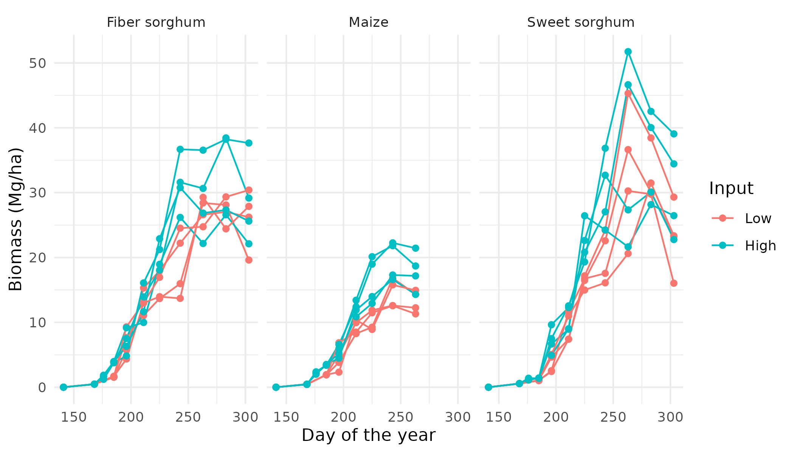
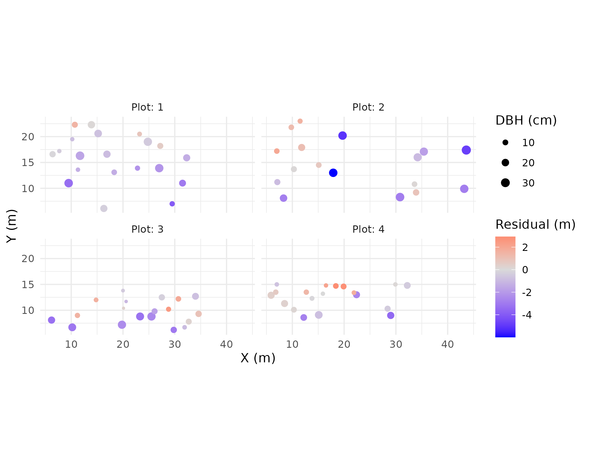

# Correlation structures

This vignette covers correlation structures of the residuals, temporal
and spatial. Temporal correlation is the autocorrelation of the
residuals of an individual over time, here the biomass of a plot sampled
over a season; spatial correlation is the correlation of the residuals
of observations close to each other in space, here the heights of
neighbouring trees. The vignette *Simulation* shows how to check by
simulation that the autocorrelation is recovered when it is there.

## Temporal correlation

### The model

The biomass of `SorghumMaize` (see
[`?SorghumMaize`](https://emilskindersoe.github.io/gcTMB/reference/SorghumMaize.md))
is fitted with the beta growth function from sowing, $`b_4 = 141`$, and
the lognormal family, whose residuals are relative deviations from the
curve; the zero biomass at sowing is left out. Each combination of crop,
input level and block is a plot, with a random asymptote:

``` r

library(gcTMB)
library(ggplot2)
SorghumMaize$plot <- interaction(SorghumMaize$Crop, SorghumMaize$Input, SorghumMaize$Block, drop = TRUE)
sm <- subset(SorghumMaize, Biomass > 0)
fitre <- gcTMB(Biomass ~ DOY, fform = b1 + b2 ~ Crop * Input, rform = b1 ~ 1 | plot, data = sm,
               model = "beta", start = c(b4 = 141), family = "lognormal")
ggplot(SorghumMaize, aes(x = DOY, y = Biomass, group = plot, colour = Input)) +
  geom_line() +
  geom_point() +
  facet_wrap(~ Crop) +
  labs(x = "Day of the year", y = "Biomass (Mg/ha)", colour = "Input") +
  theme_minimal()
```



### Autocorrelation of the residuals

A plot that is above its curve at one sampling may stay above it at the
next. With the `correlation` argument, the residuals $`\varepsilon`$ of
a group have the correlation

``` math
\mathrm{cor}(\varepsilon_s, \varepsilon_t) = \rho^{|t - s|},
```

with $`\rho`$ the correlation of residuals one unit of time apart:
[`corAR1()`](https://emilskindersoe.github.io/gcTMB/reference/corStruct.md)
for integer times, with $`-1 < \rho < 1`$, and
[`corCAR1()`](https://emilskindersoe.github.io/gcTMB/reference/corStruct.md)
for continuous, unequally spaced times, with $`0 < \rho < 1`$. Residuals
of different groups are independent.
[`coef()`](https://rdrr.io/r/stats/coef.html) reports $`\rho`$ on an
unconstrained scale, e.g. `cor_par:CAR1`, the logit of $`\rho`$, and
[`corpars()`](https://emilskindersoe.github.io/gcTMB/reference/gcTMB-extract.md),
[`summary()`](https://rdrr.io/r/base/summary.html) and
[`confint()`](https://rdrr.io/r/stats/confint.html) report $`\rho`$
itself.

The plots are sampled about every 15 days, at unequal intervals, so
`corCAR1(form = ~ DOY | plot)` is the structure to use, with $`\rho`$
the correlation per day. Its starting value is $`\rho = 0.2`$ by
default, which is a correlation of $`0.2^{15}`$, practically zero,
between consecutive samplings; there the likelihood hardly changes with
$`\rho`$, and the optimiser stays near the starting value. A starting
value close to 1, `value = 0.9`, starts from a correlation of
$`0.9^{15} \approx 0.2`$ between samplings. For the lognormal family,
the correlation is that of the residuals of $`\log(y)`$, the relative
deviations from the curve:

``` r

fitrec <- gcTMB(Biomass ~ DOY, fform = b1 + b2 ~ Crop * Input, rform = b1 ~ 1 | plot, data = sm,
                model = "beta", start = c(b4 = 141), family = "lognormal",
                correlation = corCAR1(value = 0.9, form = ~ DOY | plot))
summary(fitrec)
#> Call:
#> gcTMB(form = Biomass ~ DOY, fform = b1 + b2 ~ Crop * Input, rform = b1 ~ 
#>     1 | plot, data = sm, start = c(b4 = 141), correlation = corCAR1(value = 0.9, 
#>     form = ~DOY | plot), family = "lognormal", model = "beta")
#> 
#> Model:  beta
#> Family: lognormal, identity link for all parameters
#> 
#> Number of observations: 212, groups: plot 24
#> Log-likelihood: -466.3 (df = 16), AIC: 964.5, BIC: 1018
#> 
#> Coefficients:
#>                                Estimate Std. Error z value Pr(>|z|)    
#> b1:(Intercept)                  32.6795     2.3532  13.887  < 2e-16 ***
#> b1:CropMaize                   -13.0754     2.9466  -4.437  9.1e-06 ***
#> b1:CropSweet sorghum            -0.1908     3.3406  -0.057   0.9545    
#> b1:InputHigh                     7.1624     3.6936   1.939   0.0525 .  
#> b1:CropMaize:InputHigh           1.2994     4.7927   0.271   0.7863    
#> b1:CropSweet sorghum:InputHigh   2.2539     5.3285   0.423   0.6723    
#> b2:(Intercept)                 237.4210     1.4388 165.012  < 2e-16 ***
#> b2:CropMaize                    -5.3300     2.3608  -2.258   0.0240 *  
#> b2:CropSweet sorghum             2.3127     1.7981   1.286   0.1984    
#> b2:InputHigh                    -0.6375     1.8354  -0.347   0.7283    
#> b2:CropMaize:InputHigh           0.5966     3.2051   0.186   0.8523    
#> b2:CropSweet sorghum:InputHigh   0.5322     2.4436   0.218   0.8276    
#> b3:(Intercept)                 278.3070     1.0786 258.028  < 2e-16 ***
#> ---
#> Signif. codes:  0 '***' 0.001 '**' 0.01 '*' 0.05 '.' 0.1 ' ' 1
#> Unadjusted Wald tests; tests of the differences between curves adjusted for their number: partest().
#> Fixed: b4:(Intercept) = 141
#> 
#> Random effects:
#>  Groups Name Std.Dev. 
#>  plot   b1   0.0002202
#> Standard deviations close to zero (singular fit): plot b1
#> 
#> Residual standard deviation of log(y): 0.2904
#> 
#> Correlation structure: continuous-time AR(1) in DOY within plot
#> rho: 0.04809
#> 
#> Optimiser: relative convergence (4), maximum absolute gradient 2.2e-05
corpars(fitrec)^15
#>          rho 
#> 1.702408e-20
anova(fitre, fitrec)
#> Likelihood ratio tests of gcTMB models
#> 
#>        npar    AIC    BIC  logLik deviance         LR Df Pr(>LR)
#> fitre    15 962.53 1012.9 -466.27   932.53                      
#> fitrec   16 964.53 1018.2 -466.27   932.53 2.8823e-08  1  0.9999
```

The estimate of $`\rho`$ moves far down from its starting value, to a
correlation of practically zero between consecutive samplings, and the
likelihood ratio test finds no autocorrelation. The Wald interval of
$`\rho`$, computed on the logit scale, spans the whole range from 0 to
1: the likelihood is flat in $`\rho`$.

``` r

confint(fitrec, parm = "cor_par:CAR1", method = "wald")
#>     2.5 % 97.5 %
#> rho     0      1
```

## Spatial correlation

### The model

The heights of the pines of `PineHeightDiameter` (see
[`?PineHeightDiameter`](https://emilskindersoe.github.io/gcTMB/reference/PineHeightDiameter.md))
grow with their diameter, as the Chapman-Richards curve from breast
height describes (see the vignette *Fixed and random effects*), and the
positions `X` and `Y` of the trees in their plots give the distances
between them. Trees that grow close to each other share their light,
water and soil, and compete with each other, so that a tree that is
taller than the curve predicts for its diameter may have neighbours that
are taller too (Pukkala, 1989).

To keep the example quick, we use the 41 plots with up to 20 measured
trees each, leaving out the 15 plots with 48 to 105. We first fit a
single curve for all plots, without random effects, with the correlation
of the residuals within each plot, and then compare the spatial
correlation with random effects of the plots. The residuals of the fit
without correlation, at the positions of the trees of four plots, show
that the positive and the negative residuals cluster:

``` r

ntrees <- table(PineHeightDiameter$Plot)
pines <- droplevels(subset(PineHeightDiameter, Plot %in% names(ntrees)[ntrees <= 20]))
fit0 <- gcTMB(Height ~ DBH, data = pines, model = "chapmanrichards")
pines$resid <- residuals(fit0, type = "response")
ggplot(subset(pines, Plot %in% levels(pines$Plot)[1:4]), aes(X, Y, colour = resid, size = DBH)) +
  geom_point() +
  scale_colour_gradient2(low = "blue", mid = "grey85", high = "red") +
  scale_size_area(max_size = 3) +
  coord_equal() +
  facet_wrap(~ Plot, labeller = label_both) +
  labs(x = "X (m)", y = "Y (m)", colour = "Residual (m)", size = "DBH (cm)") +
  theme_minimal()
```



### Exponential and Gaussian correlation

[`corExp()`](https://emilskindersoe.github.io/gcTMB/reference/corStruct.md)
and
[`corGaus()`](https://emilskindersoe.github.io/gcTMB/reference/corStruct.md)
give the correlation of two residuals of a group as a function of the
distance $`d`$ between their positions, with a range $`r > 0`$:

``` math
\mathrm{cor}(\varepsilon_i, \varepsilon_j) = (1 - n) \exp(-d/r) \quad \text{(exponential)}, \qquad \mathrm{cor}(\varepsilon_i, \varepsilon_j) = (1 - n) \exp(-(d/r)^2) \quad \text{(Gaussian)}.
```

The exponential correlation falls quickly at short distances and then
levels off; the Gaussian correlation stays close to its maximum at short
distances and then falls steeply, for residuals that change smoothly in
space. The positions are given in the form, `~ X + Y | Plot`, and the
distance is euclidean by default (`metric = "manhattan"` or `"maximum"`
give the others). Residuals of different plots are independent.

The nugget $`0 < n < 1`$, with `nugget = TRUE`, is the share of the
residual variance that is independent between trees, such as measurement
error and the variation of a tree that its neighbours do not share; the
remaining share $`1 - n`$ is correlated with the neighbours (Diggle,
1988). Without a nugget, $`n = 0`$, and two trees at the same position
would have the same residual. The range and the nugget are estimated on
the scales $`\log(r)`$ and $`\log(n/(1 - n))`$, and reported as
`cor_par:range` and `cor_par:nugget` by
[`coef()`](https://rdrr.io/r/stats/coef.html);
[`corpars()`](https://emilskindersoe.github.io/gcTMB/reference/gcTMB-extract.md)
gives them on their natural scale. The residuals of a plot are
multivariate normal with this correlation matrix, so the cost of a fit
grows with the cube of the number of trees per plot.

The range starts by default at 90% of the smallest distance between two
trees of a plot, and the nugget at 0.1. The smallest distance here is
0.22 m, at which start the Gaussian correlation between trees a metre
apart is practically zero: the likelihood hardly changes with the range
there, and the optimiser stays at the starting value, as for
[`corCAR1()`](https://emilskindersoe.github.io/gcTMB/reference/corStruct.md)
above. A starting range of a few metres, `value = c(5, 0.2)` for the
range and the nugget, avoids this:

``` r

fitexp <- update(fit0, correlation = corExp(5, form = ~ X + Y | Plot))
fitexpn <- update(fit0, correlation = corExp(c(5, 0.2), form = ~ X + Y | Plot, nugget = TRUE))
fitgausn <- update(fit0, correlation = corGaus(c(5, 0.2), form = ~ X + Y | Plot, nugget = TRUE))
fitexpn
#> Call:
#> gcTMB(form = Height ~ DBH, data = pines, correlation = corExp(c(5, 
#>     0.2), form = ~X + Y | Plot, nugget = TRUE), model = "chapmanrichards")
#> 
#> Model:  chapmanrichards
#> Family: gaussian, identity link for all parameters
#> 
#> Coefficients:
#> b1:(Intercept)  b2:(Intercept)  b3:(Intercept)  
#>       26.05144         0.03859         0.82124  
#> Fixed: b4:(Intercept) = 1.3
#> 
#> Residual standard deviation: 2.62
#> 
#> Correlation structure: exponential in X + Y within Plot, with nugget
#> range: 53.6572, nugget:  0.2835
rbind(exponential = c(corpars(fitexp), nugget = 0), "exponential, nugget" = corpars(fitexpn),
      "Gaussian, nugget" = corpars(fitgausn))
#>                         range    nugget
#> exponential          8.804564 0.0000000
#> exponential, nugget 53.657217 0.2835216
#> Gaussian, nugget    50.447003 0.3803111
anova(fit0, fitexp, fitexpn)
#> Likelihood ratio tests of gcTMB models
#> 
#>         npar    AIC    BIC  logLik deviance     LR Df   Pr(>LR)    
#> fit0       4 2733.3 2750.9 -1362.7   2725.3                        
#> fitexp     5 2556.2 2578.2 -1273.1   2546.2 179.11  1 < 2.2e-16 ***
#> fitexpn    6 2442.5 2468.9 -1215.3   2430.5 115.67  1 < 2.2e-16 ***
#> ---
#> Signif. codes:  0 '***' 0.001 '**' 0.01 '*' 0.05 '.' 0.1 ' ' 1
AIC(fit0, fitexp, fitexpn, fitgausn)
#>          df      AIC
#> fit0      4 2733.321
#> fitexp    5 2556.213
#> fitexpn   6 2442.538
#> fitgausn  6 2455.544
```

The spatial correlation improves the fit by far: the log-likelihood
increases by 89.6 with the exponential correlation, at the cost of a
single parameter. The nugget improves it further, and the exponential
correlation with a nugget has the smallest AIC of the three structures.
Its range of 53.7 m gives the correlation $`(1 - n) \exp(-d/r) = 0.69`$
between trees 2 m apart and 0.49 between trees 20 m apart, across a plot
of about 40 by 30 m, and the nugget, 0.28, is the share of the residual
variance that a tree does not share with its neighbours. The likelihood
ratio test of the nugget is on the boundary of its parameter space,
$`n = 0`$, where the test is conservative; halving the p-value corrects
for this. Wald intervals for the range and the nugget are computed on
the scales $`\log(r)`$ and $`\log(n/(1 - n))`$ and transformed back:

``` r

confint(fitexpn, parm = c("cor_par:range", "cor_par:nugget"), method = "wald")
#>             2.5 %      97.5 %
#> range  25.9835139 110.8047571
#> nugget  0.1961161   0.3909378
```

### Spatial correlation or random effects

A range longer than the plots means that the correlation stays large
across a whole plot: the trees of a plot deviate from the curve
together. This is also what a random effect of the plot describes,
e.g. a random asymptote, with which all trees of a plot are taller or
shorter than the common curve. Both are models of the dependence of the
trees of a plot, and they are compared by AIC, as both are fitted by
maximum likelihood. We fit a random asymptote $`b_1`$ of each plot,
random asymptotes and rates $`b_1`$ and $`b_2`$, and a random asymptote
together with the exponential correlation. The random effects of $`b_1`$
and $`b_2`$ are uncorrelated (`||`): with a correlation between them,
the optimiser stops with false convergence (on `restart = TRUE`, see the
overview
[`vignette("gcTMB")`](https://emilskindersoe.github.io/gcTMB/articles/gcTMB.md)):

``` r

ctl <- list(restart = TRUE)
fitre1 <- update(fit0, rform = b1 ~ 1 | Plot, control = ctl)
fitre2 <- update(fit0, rform = b1 + b2 ~ 1 || Plot, control = ctl)
fitre1exp <- update(fit0, rform = b1 ~ 1 | Plot, correlation = corExp(5, form = ~ X + Y | Plot), control = ctl)
sapply(list(fitre1 = fitre1, fitre2 = fitre2, fitre1exp = fitre1exp), converged)
#>    fitre1    fitre2 fitre1exp 
#>      TRUE      TRUE      TRUE
corpars(fitre1exp)
#>   range 
#> 3.04906
AIC(fit0, fitexpn, fitre1, fitre2, fitre1exp)
#>           df      AIC
#> fit0       4 2733.321
#> fitexpn    6 2442.538
#> fitre1     5 2409.003
#> fitre2     6 2355.868
#> fitre1exp  6 2382.282
```

The random asymptote alone has a smaller AIC than any of the spatial
correlation structures without random effects: most of the dependence of
the trees of a plot is a shift of the whole plot, not a correlation that
decreases with the distance. With the random asymptote, the exponential
correlation still improves the fit, but its range drops to 3 m: what is
left is a correlation between close neighbours, 0.52 between trees 2 m
apart, which falls to practically zero across a plot. The random
asymptotes and rates, without correlation, have the smallest AIC: the
plots differ not only in the height the trees reach, but also in how
fast the height increases with the diameter, and these differences
between the plots capture the dependence of their trees better than the
spatial correlation, alone or with a random asymptote. The spatial
correlation without random effects describes these differences only
through its long range, as deviations that the trees of a plot share.

## References

Diggle, P.J. (1988). An approach to the analysis of repeated
measurements. *Biometrics* 44, 959–971.

Pukkala, T. (1989). Prediction of tree diameter and height in a Scots
pine stand as a function of the spatial pattern of trees. *Silva
Fennica* 23, 83–99.
