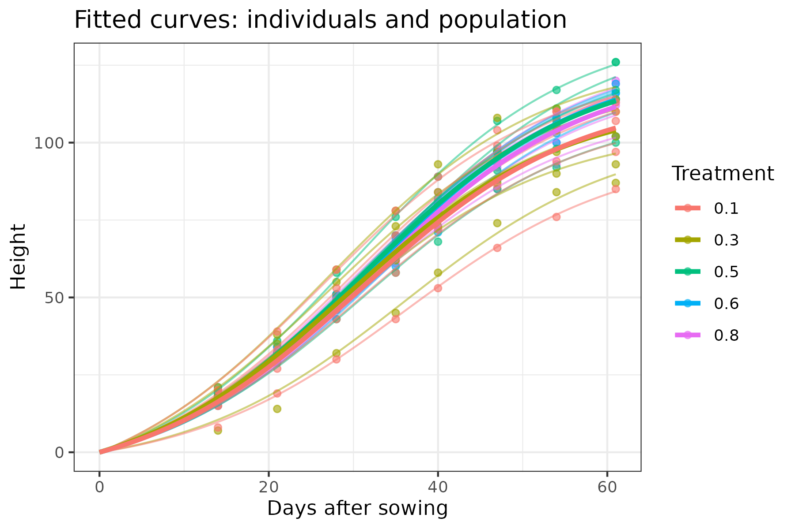

# Fixed and random effects

This vignette covers covariates (fixed effects) and random effects of
the parameters of the growth curves, and likelihood ratio tests of their
inclusion, for the heights of faba bean plants and for counts of pods.
The growth models and their parameters are introduced in the vignette
*Growth models and their parameters*.

The models without random effects of that vignette, a single logistic
curve and a curve for each treatment:

``` r

library(gcTMB)
library(ggplot2)
FabaHeights25$trt <- factor(FabaHeights25$Treatment)
fit <- gcTMB(height ~ DAS, data = FabaHeights25)
fittrt <- gcTMB(height ~ DAS, fform = b1 + b2 ~ trt, data = FabaHeights25)
```

## Covariates and random effects

Covariates on the parameters are given by `fform`, e.g. `b1 + b2 ~ trt`
for effects of the treatment on the asymptote and the time of the
maximum growth rate. Random effects are given by `rform`,
e.g. `b1 + b2 ~ 1 | plant_ID` for correlated random effects of each
plant on the asymptote and the time of the maximum growth rate, which
account for the repeated measurements of the plants. For the heights, we
use the logistic model with the defaults $`b_4 = 0`$ and $`b_5 = 1`$
fixed.

``` r

fitre <- gcTMB(height ~ DAS, fform = b1 + b2 ~ trt, rform = b1 + b2 ~ 1 | plant_ID, data = FabaHeights25)
summary(fitre)
#> Call:
#> gcTMB(form = height ~ DAS, fform = b1 + b2 ~ trt, rform = b1 + 
#>     b2 ~ 1 | plant_ID, data = FabaHeights25)
#> 
#> Model:  logistic, truncated at b4 = 0
#> Family: gaussian, identity link for all parameters
#> 
#> Number of observations: 200, groups: plant_ID 25
#> Log-likelihood: -508.2 (df = 15), AIC: 1046, BIC: 1096
#> 
#> Coefficients:
#>                Estimate Std. Error
#> b1:(Intercept) 115.7637      4.144
#> b1:trt0.3       -1.9226      5.743
#> b1:trt0.5        9.7398      5.754
#> b1:trt0.6       10.6189      5.758
#> b1:trt0.8        8.2848      5.759
#> b2:(Intercept)  30.8173      1.141
#> b2:trt0.3       -1.4951      1.610
#> b2:trt0.5        0.1777      1.605
#> b2:trt0.6        0.6744      1.605
#> b2:trt0.8        0.9027      1.606
#> b3:(Intercept)  12.8471      0.250
#> 
#> Random effects:
#>  Groups   Name Std.Dev. Corr 
#>  plant_ID b1   8.834         
#>           b2   2.395    -0.32
#> 
#> Residual standard deviation: 2.076
#> 
#> Optimiser: relative convergence (4), maximum absolute gradient 3.7e-05
```

### Testing the fixed effects

Likelihood ratio tests by
[`anova()`](https://rdrr.io/r/stats/anova.html) compare nested models,
here with and without the treatment effects.

``` r

fitre0 <- gcTMB(height ~ DAS, rform = b1 + b2 ~ 1 | plant_ID, data = FabaHeights25)
anova(fitre0, fitre)
#> Likelihood ratio tests of gcTMB models
#> 
#>        npar    AIC    BIC  logLik deviance     LR Df Pr(>LR)
#> fitre0    7 1041.3 1064.4 -513.67   1027.3                  
#> fitre    15 1046.3 1095.8 -508.17   1016.3 11.006  8  0.2014
```

For gaussian (and lognormal) models without random effects, `test = "F"`
gives F-tests as for [`nls()`](https://rdrr.io/r/stats/nls.html): the
reduction of the residual sum of squares per additional parameter,
divided by the residual mean square of the larger model. The F-test
accounts for the estimation of the residual variance, which the
likelihood ratio test does not, and is preferable for small experiments;
here for the models without random effects of the vignette *Growth
models and their parameters*:

``` r

anova(fit, fittrt, test = "F")
#> F-tests of gcTMB models
#> 
#>        npar    AIC    BIC  logLik Res.Df   RSS      F Df  Pr(>F)  
#> fit       4 1406.5 1419.7 -699.23    197 12744                    
#> fittrt   12 1401.8 1441.4 -688.90    189 11492 2.5725  8 0.01096 *
#> ---
#> Signif. codes:  0 '***' 0.001 '**' 0.01 '*' 0.05 '.' 0.1 ' ' 1
```

The two tests disagree, because the model without random effects treats
the 200 heights as independent, while they are eight repeated
measurements of each of 25 plants.

### Testing the random effects

The random effects are tested in the same way, by likelihood ratio tests
of the models with and without them: here without random effects, with a
random asymptote, and with random asymptotes and times of the maximum
growth rate.

``` r

fitre1 <- gcTMB(height ~ DAS, fform = b1 + b2 ~ trt, rform = b1 ~ 1 | plant_ID, data = FabaHeights25)
anova(fittrt, fitre1, fitre)
#> Likelihood ratio tests of gcTMB models
#> 
#>        npar    AIC    BIC  logLik deviance      LR Df   Pr(>LR)    
#> fittrt   12 1401.8 1441.4 -688.90   1377.8                         
#> fitre1   13 1120.5 1163.3 -547.22   1094.5 283.350  1 < 2.2e-16 ***
#> fitre    15 1046.3 1095.8 -508.17   1016.3  78.104  2 < 2.2e-16 ***
#> ---
#> Signif. codes:  0 '***' 0.001 '**' 0.01 '*' 0.05 '.' 0.1 ' ' 1
```

Under the smaller model, a standard deviation of the random effects is
zero, on the boundary of its range, so the chi-square distribution of
the likelihood ratio statistic is conservative: for a single standard
deviation, the p-value is about twice the correct one. Both random
effects are needed here anyway. `test = "boot"` gives a parametric
bootstrap likelihood ratio test, which simulates from the smaller model
and does not rely on the chi-square distribution; it fits both models to
each simulation and takes several minutes:

``` r

anova(fitre1, fitre, test = "boot", nsim = 100, seed = 1)
```

The random effects of `b1 + b2 ~ 1 | plant_ID` are correlated. With a
double bar, `b1 + b2 ~ 1 || plant_ID`, they are independent, the same as
`list(b1 ~ 1 | plant_ID, b2 ~ 1 | plant_ID)` and as
`random = pdDiag(b1 + b2 ~ 1)` in nlme. A list of formulas mixes the
two: `list(b1 + b2 ~ 1 | plant_ID, b3 ~ 1 | plant_ID)` gives correlated
random effects of $`b_1`$ and $`b_2`$, and a random effect of $`b_3`$
that is independent of both, a block-diagonal covariance matrix as
`pdBlocked` in nlme. The likelihood ratio test of the correlated and the
independent random effects tests their correlation:

``` r

fitred <- gcTMB(height ~ DAS, fform = b1 + b2 ~ trt, rform = b1 + b2 ~ 1 || plant_ID, data = FabaHeights25)
anova(fitred, fitre)
#> Likelihood ratio tests of gcTMB models
#> 
#>        npar    AIC    BIC  logLik deviance     LR Df Pr(>LR)
#> fitred   14 1046.5 1092.7 -509.25   1018.5                  
#> fitre    15 1046.3 1095.8 -508.17   1016.3 2.1507  1  0.1425
```

### Plotting the curves

[`plot()`](https://rdrr.io/r/graphics/plot.default.html) with
`type = "curves"` draws a plot directly: the data with the curve of each
plant, and the population curve of each treatment as a thick line. By
default the curves are drawn over the observed days; `times` gives the
times at which they are drawn, here from sowing. It returns the ggplot
object in a list, for changing the graph. Otherwise, it can be
constructed manually using
[`predict()`](https://rdrr.io/r/stats/predict.html).

``` r

p <- plot(fitre, type = "curves", times = seq(0, 61, by = 0.1), draw = FALSE)
p$curves + labs(x = "Days after sowing", y = "Height", colour = "Treatment")
```



## Non-normal responses

The `family` argument gives the distribution of the response:
“gaussian”, “lognormal”, “poisson”, “nbinom2”, “nbinom1”, “binomial”,
“betabinomial” or “beta”. The data set `FabaCounts23` contains the
numbers of pods of 22 faba bean plants of six genotypes, counted between
61 and 79 days after sowing. The plants have no pods at the first
counts, so the threshold $`b_4`$, the time of the first pods, is
identified by the zero counts and estimated; the asymmetry is fixed at
$`b_5 = 1`$. A Poisson model with an asymptote and a time of the maximum
growth rate for each genotype, and a random asymptote for each plant:

``` r

fitp <- gcTMB(pods ~ DAS, fform = b1 + b2 ~ Genotype, rform = b1 ~ 1 | Tube_ID, data = FabaCounts23,
              family = "poisson", fix = c(b4 = FALSE))
summary(fitp)
#> Call:
#> gcTMB(form = pods ~ DAS, fform = b1 + b2 ~ Genotype, rform = b1 ~ 
#>     1 | Tube_ID, data = FabaCounts23, fix = c(b4 = FALSE), family = "poisson")
#> 
#> Model:  logistic, truncated at the threshold b4
#> Family: poisson, identity link for all parameters
#> 
#> Number of observations: 263, groups: Tube_ID 22
#> Log-likelihood: -353.6 (df = 15), AIC: 737.1, BIC: 790.7
#> 
#> Coefficients:
#>                    Estimate Std. Error
#> b1:(Intercept)      14.5996      2.324
#> b1:GenotypeCapri    -3.4020      2.974
#> b1:GenotypeILB938   -5.4787      2.957
#> b1:GenotypeLynx      4.9819      3.233
#> b1:GenotypeMelodie  10.6976      3.676
#> b1:GenotypeNavara    3.1797      3.186
#> b2:(Intercept)      70.0533      0.469
#> b2:GenotypeCapri    -0.8504      0.640
#> b2:GenotypeILB938   -1.0084      0.702
#> b2:GenotypeLynx      2.7439      0.551
#> b2:GenotypeMelodie   3.2443      0.552
#> b2:GenotypeNavara    2.6005      0.558
#> b3:(Intercept)       1.3389      0.149
#> b4:(Intercept)      65.0000      0.024
#> 
#> Random effects:
#>  Groups  Name Std.Dev.
#>  Tube_ID b1   3.355   
#> 
#> Pearson dispersion: 0.5005 (chi-square 124.1 on 248 df)
#> 
#> Optimiser: converged, with the threshold b4 at an observation time (a kink of the likelihood), maximum absolute gradient 3.2
genotypes <- data.frame(Genotype = sort(unique(FabaCounts23$Genotype)))
cbind(genotypes, predict(fitp, newdata = genotypes, type = "parameters", random = FALSE))
#>   Genotype        b1       b2       b3 b4
#> 1   Aurora 14.599634 70.05332 1.338935 65
#> 2    Capri 11.197618 69.20292 1.338935 65
#> 3   ILB938  9.120981 69.04494 1.338935 65
#> 4     Lynx 19.581583 72.79718 1.338935 65
#> 5  Melodie 25.297268 73.29758 1.338935 65
#> 6   Navara 17.779358 72.65387 1.338935 65
```

All the counts with the fitted curve of each plant, with its predicted
random asymptote:

``` r

days <- seq(61, 79, by = 0.05)
ndp <- merge(unique(FabaCounts23[, c("Tube_ID", "Genotype")]), data.frame(DAS = days))
ndp$fit <- predict(fitp, newdata = ndp)
ggplot(FabaCounts23, aes(x = DAS, y = pods, colour = Genotype)) +
  geom_point() +
  geom_line(data = ndp, aes(y = fit, group = Tube_ID)) +
  labs(x = "Days after sowing", y = "Number of pods", colour = "Genotype") +
  theme_minimal()
```


By genotype, the curves of the plants together with the population
curves of the genotypes (`random = FALSE`), the fixed effects, with 95%
confidence intervals. For Poisson models, the confidence intervals of
the mean are computed on the log scale, so that they stay positive.

``` r

# the population curve of each genotype
ndg <- merge(genotypes, data.frame(DAS = days))
ndg <- cbind(ndg, predict(fitp, newdata = ndg, random = FALSE, interval = "confidence"))
ggplot(FabaCounts23, aes(x = DAS, y = pods)) +
  geom_ribbon(data = ndg, aes(x = DAS, ymin = lwr, ymax = upr), inherit.aes = FALSE, fill = "blue", alpha = 0.2) +
  geom_line(data = ndp, aes(y = fit, group = Tube_ID), colour = "grey50") +
  geom_line(data = ndg, aes(y = fit), colour = "blue", linewidth = 1) +
  geom_point(alpha = 0.6) +
  facet_wrap(~ Genotype) +
  labs(x = "Days after sowing", y = "Number of pods") +
  theme_minimal()
```


The estimated threshold improves the fit over the default threshold at
sowing:

``` r

fitp0 <- gcTMB(pods ~ DAS, fform = b1 + b2 ~ Genotype, rform = b1 ~ 1 | Tube_ID, data = FabaCounts23,
               family = "poisson")
AIC(fitp0, fitp)
#>       df      AIC
#> fitp0 14 745.3067
#> fitp  15 737.1423
```
