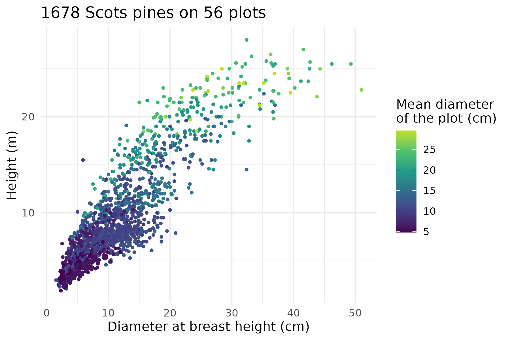
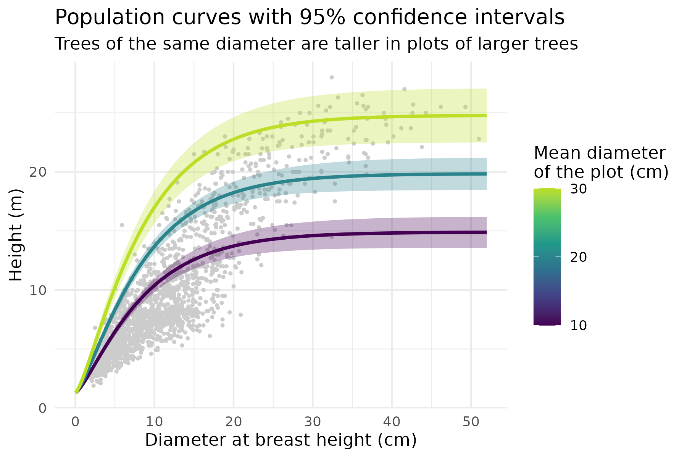
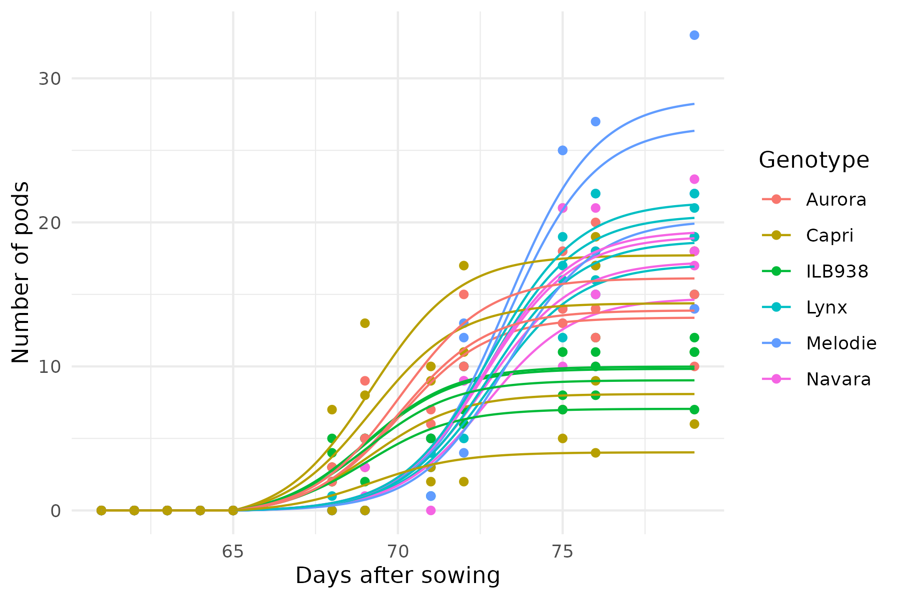
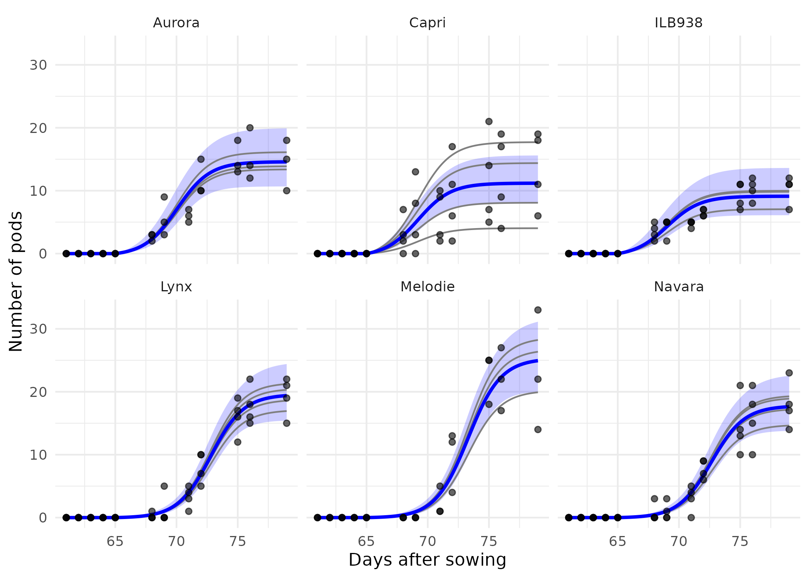
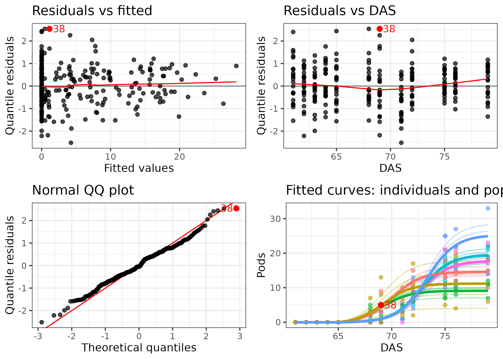

# Fixed and random effects

This vignette covers covariates (fixed effects) and random effects of
the parameters of the growth curves, and likelihood ratio tests of their
inclusion, for a height-diameter model of Scots pine trees and for
counts of pods of faba bean plants. The growth models and their
parameters are introduced in the vignette *Growth models and their
parameters*.

## The height-diameter model

The heights of the pines of `PineHeightDiameter` (see
[`?PineHeightDiameter`](https://emilskindersoe.github.io/gcTMB/reference/PineHeightDiameter.md))
grow with their diameter towards an asymptote, from the breast height of
1.3 m at which the diameter is measured. The Chapman-Richards curve with
the intercept $`b_4 = 1.3`$ fixed describes this (Kuželka and Marušák,
2015):

``` math
 h = 1.3 + b_1 \left(1 - \mathrm{e}^{-b_2 d}\right)^{b_3}, 
```

with the asymptote $`b_1`$ above breast height, the rate $`b_2`$ and the
shape $`b_3`$ (Richards, 1959).

``` r

library(gcTMB)
library(ggplot2)
fit <- gcTMB(Height ~ DBH, data = PineHeightDiameter, model = "chapmanrichards", start = c(b4 = 1.3))
summary(fit)
#> Call:
#> gcTMB(form = Height ~ DBH, data = PineHeightDiameter, start = c(b4 = 1.3), 
#>     model = "chapmanrichards")
#> 
#> Model:  chapmanrichards
#> Family: gaussian, identity link for all parameters
#> 
#> Number of observations: 1678
#> Log-likelihood: -3872 (df = 4), AIC: 7752, BIC: 7774
#> 
#> Coefficients:
#>                 Estimate Std. Error t value Pr(>|t|)    
#> b1:(Intercept) 45.718676   5.905109   7.742 1.68e-14 ***
#> b2:(Intercept)  0.019653   0.004045   4.859 1.29e-06 ***
#> b3:(Intercept)  1.059781   0.043127  24.574  < 2e-16 ***
#> ---
#> Signif. codes:  0 '***' 0.001 '**' 0.01 '*' 0.05 '.' 0.1 ' ' 1
#> Fixed: b4:(Intercept) = 1.3
#> 
#> Residual standard deviation: 2.434 on 1675 degrees of freedom
#> 
#> Optimiser: relative convergence (4), maximum absolute gradient 0.00028
ggplot(PineHeightDiameter, aes(x = DBH, y = Height, colour = Dmean)) +
  geom_point(size = 0.8) +
  scale_colour_viridis_c(end = 0.9) +
  labs(x = "Diameter at breast height (cm)", y = "Height (m)", colour = "Mean diameter\nof the plot (cm)",
       title = "1678 Scots pines on 56 plots") +
  theme_minimal()
```



## Covariates and random effects

Covariates on the parameters are given by `fform`, e.g. `b1 ~ Dmean` for
an asymptote that depends on the mean diameter of the plot: trees of the
same diameter are taller in plots of larger trees, a generalised
height-diameter model. Random effects are given by `rform`,
e.g. `b1 + b2 ~ 1 | Plot` for correlated random effects of each plot on
the asymptote and on the rate, which account for the trees of a plot
sharing their site and stand.

``` r

fitdm <- gcTMB(Height ~ DBH, fform = b1 ~ Dmean, data = PineHeightDiameter, model = "chapmanrichards",
               start = c(b4 = 1.3))
fitre <- gcTMB(Height ~ DBH, fform = b1 ~ Dmean, rform = b1 + b2 ~ 1 | Plot, data = PineHeightDiameter,
               model = "chapmanrichards", start = c(b4 = 1.3))
summary(fitre)
#> Call:
#> gcTMB(form = Height ~ DBH, fform = b1 ~ Dmean, rform = b1 + b2 ~ 
#>     1 | Plot, data = PineHeightDiameter, start = c(b4 = 1.3), 
#>     model = "chapmanrichards")
#> 
#> Model:  chapmanrichards
#> Family: gaussian, identity link for all parameters
#> 
#> Number of observations: 1678, groups: Plot 56
#> Log-likelihood: -2541 (df = 8), AIC: 5098, BIC: 5142
#> 
#> Coefficients:
#>                Estimate Std. Error z value Pr(>|z|)    
#> b1:(Intercept) 8.647053   1.117374   7.739 1.00e-14 ***
#> b1:Dmean       0.495045   0.064643   7.658 1.89e-14 ***
#> b2:(Intercept) 0.138444   0.009514  14.551  < 2e-16 ***
#> b3:(Intercept) 1.399270   0.060408  23.164  < 2e-16 ***
#> ---
#> Signif. codes:  0 '***' 0.001 '**' 0.01 '*' 0.05 '.' 0.1 ' ' 1
#> Unadjusted Wald tests; tests of the differences between curves adjusted for their number: partest().
#> Fixed: b4:(Intercept) = 1.3
#> 
#> Random effects:
#>  Groups Name Std.Dev. Corr 
#>  Plot   b1   4.31          
#>         b2   0.05     -0.90
#> 
#> Residual standard deviation: 0.9868
#> 
#> Optimiser: relative convergence (4), maximum absolute gradient 0.00046
```

### Testing the fixed effects

Likelihood ratio tests by
[`anova()`](https://rdrr.io/r/stats/anova.html) compare nested models,
here with and without the effect of the mean diameter.
[`refit()`](https://emilskindersoe.github.io/gcTMB/reference/refit.md)
fits a model again with some of its components changed and all its other
arguments reused, here without `fform`:

``` r

fitre0 <- refit(fitre, fform = NULL)
#> Warning in nlminb(start = obj$par, objective = obj$fn, gradient = obj$gr, :
#> NA/NaN function evaluation
anova(fitre0, fitre)
#> Likelihood ratio tests of gcTMB models
#> 
#>        npar    AIC    BIC  logLik deviance     LR Df   Pr(>LR)    
#> fitre0    7 5140.9 5178.9 -2563.5   5126.9                        
#> fitre     8 5098.3 5141.7 -2541.2   5082.3 44.594  1 2.424e-11 ***
#> ---
#> Signif. codes:  0 '***' 0.001 '**' 0.01 '*' 0.05 '.' 0.1 ' ' 1
```

For gaussian (and lognormal) models without random effects, `test = "F"`
gives F-tests as for [`nls()`](https://rdrr.io/r/stats/nls.html): the
reduction of the residual sum of squares per additional parameter,
divided by the residual mean square of the larger model. The F-test
accounts for the estimation of the residual variance, which the
likelihood ratio test does not, and is preferable for small data sets;
here for the models without random effects:

``` r

anova(fit, fitdm, test = "F")
#> F-tests of gcTMB models
#> 
#>       npar    AIC    BIC  logLik Res.Df    RSS      F Df    Pr(>F)    
#> fit      4 7752.3 7774.0 -3872.1   1675 9923.6                        
#> fitdm    5 7052.0 7079.1 -3521.0   1674 6530.0 869.99  1 < 2.2e-16 ***
#> ---
#> Signif. codes:  0 '***' 0.001 '**' 0.01 '*' 0.05 '.' 0.1 ' ' 1
```

The model without random effects treats the 1678 trees as independent,
while the trees of a plot are alike, so its tests are too optimistic;
the test with the random effects is the one to use.

### Testing the random effects

The random effects are tested in the same way, by likelihood ratio tests
of the models with and without them: here without random effects, with a
random asymptote, and with random asymptotes and rates. Some of these
fits need `control = list(restart = TRUE)` to converge (see the overview
[`vignette("gcTMB")`](https://emilskindersoe.github.io/gcTMB/articles/gcTMB.md)).

``` r

fitre1 <- refit(fitre, rform = b1 ~ 1 | Plot, control = list(restart = TRUE))
anova(fitdm, fitre1, fitre)
#> Likelihood ratio tests of gcTMB models
#> 
#>        npar    AIC    BIC  logLik deviance      LR Df   Pr(>LR)    
#> fitdm     5 7052.0 7079.1 -3521.0   7042.0                         
#> fitre1    6 5435.6 5468.2 -2711.8   5423.6 1618.38  1 < 2.2e-16 ***
#> fitre     8 5098.3 5141.7 -2541.2   5082.3  341.31  2 < 2.2e-16 ***
#> ---
#> Signif. codes:  0 '***' 0.001 '**' 0.01 '*' 0.05 '.' 0.1 ' ' 1
```

Under the smaller model, a standard deviation of the random effects is
zero, on the boundary of its range, so the chi-square distribution of
the likelihood ratio statistic is conservative: for a single standard
deviation, the p-value is about twice the correct one. Both random
effects are needed here anyway. `test = "boot"` gives a parametric
bootstrap likelihood ratio test, which simulates from the smaller model
and does not rely on the chi-square distribution; it fits both models to
each simulation and takes several minutes:

``` r

anova(fitre1, fitre, test = "boot", nsim = 100, seed = 1)
```

The random effects of `b1 + b2 ~ 1 | Plot` are correlated, and those of
`b1 + b2 ~ 1 || Plot` independent; the likelihood ratio test of the two
tests their correlation:

``` r

fitred <- refit(fitre, rform = b1 + b2 ~ 1 || Plot, control = list(restart = TRUE))
#> Warning in nlminb(start = obj$par, objective = obj$fn, gradient = obj$gr, :
#> NA/NaN function evaluation
anova(fitred, fitre)
#> Likelihood ratio tests of gcTMB models
#> 
#>        npar    AIC    BIC  logLik deviance     LR Df   Pr(>LR)    
#> fitred    7 5145.5 5183.4 -2565.7   5131.5                        
#> fitre     8 5098.3 5141.7 -2541.2   5082.3 49.134  1 2.391e-12 ***
#> ---
#> Signif. codes:  0 '***' 0.001 '**' 0.01 '*' 0.05 '.' 0.1 ' ' 1
VarCorr(fitre)
#> $Plot
#>            b1           b2
#> b1 18.5670869 -0.192100461
#> b2 -0.1921005  0.002467342
#> attr(,"stddev")
#>         b1         b2 
#> 4.30895427 0.04967235 
#> attr(,"correlation")
#>            b1         b2
#> b1  1.0000000 -0.8975152
#> b2 -0.8975152  1.0000000
#> 
#> attr(,"sc")
#> [1] 0.9867602
```

The Korf curve, $`h = 1.3 + b_1 \exp(b_2/((1 - b_3) d^{b_3 - 1}))`$
(Kuželka and Marušák, 2015), with the same fixed and random effects, is
an alternative height-diameter model, as flexible as Chapman-Richards
through its shape $`b_3`$. The shape must be larger than 1, and its
default link log$`(b_3 - 1)`$ keeps it there; on these data it is pulled
towards 1, where the curve becomes a power curve without an asymptote.
The Chapman-Richards and Korf models are not nested, and are compared by
their AIC:

``` r

fitk <- refit(fitre, model = "korf", control = list(restart = TRUE))
AIC(fitre, fitk)
#>       df      AIC
#> fitre  8 5098.322
#> fitk   8 5142.804
```

### Starting values

[`gcTMB()`](https://emilskindersoe.github.io/gcTMB/reference/gcTMB.md)
computes starting values from the data (see
[`?gcTMBstart`](https://emilskindersoe.github.io/gcTMB/reference/gcTMBstart.md)):
the curve fitted to the mean responses, the coefficients of the
covariates of `fform` from the same fit within each combination of the
covariates, and the variances of the random effects from a fit of each
group around that curve. `start` gives other values: a vector of the
coefficients, or a list with also the covariance matrices of the random
effects (`VarCorr`) and the residual standard deviation (`sigma`).
[`refit()`](https://emilskindersoe.github.io/gcTMB/reference/refit.md)
with `startfrom = "fit"` starts from the estimates of the fit it refits,
where they carry over: here the coefficients, the residual standard
deviation and the variance of the random asymptote of `fitre1`, while
the variance of the random rate and its correlation with the asymptote
start from the data. The call of the new fit shows the starting values
used:

``` r

fitre2 <- refit(fitre1, rform = b1 + b2 ~ 1 | Plot, startfrom = "fit")
fitre2$call$start$VarCorr
#> $Plot
#>          [,1] [,2]
#> [1,] 9.535284   NA
#> [2,]       NA   NA
c(logLik(fitre2), logLik(fitre))
#> [1] -2549.320 -2541.161
```

Both fits converge, but to different maxima: the refit from the
estimates of `fitre1` stops at a local maximum of the likelihood, below
that of `fitre`, whose starting values come from the data. A refit from
the estimates is often quicker and usually lands at the same maximum,
but not always; fits of the same model from different starting values,
here `fitre` and `fitre2`, are a simple check that the maximum is the
global one.

### Plotting the curves

[`plot()`](https://rdrr.io/r/graphics/plot.default.html) with
`type = "curves"` draws the curve of each plot and the population
curves; [`predict()`](https://rdrr.io/r/stats/predict.html) gives the
population curves with confidence intervals, here for plots with small,
medium and large trees:

``` r

p <- plot(fitre, type = "curves", times = seq(0, 52, by = 0.2), draw = FALSE)
p$curves + labs(x = "Diameter at breast height (cm)", y = "Height (m)", colour = "Mean diameter\nof the plot (cm)",
                title = "Curve of each plot (thin) and population curves (thick)",
                subtitle = "Population curves at the 10%, 50% and 90% quantiles of the mean diameter")
```


``` r

nd <- expand.grid(DBH = seq(0, 52, by = 0.2), Dmean = c(10, 20, 30))
nd <- cbind(nd, predict(fitre, newdata = nd, random = FALSE, interval = "confidence"))
ggplot(PineHeightDiameter, aes(x = DBH, y = Height)) +
  geom_point(colour = "grey80", size = 0.6) +
  geom_ribbon(data = nd, aes(x = DBH, ymin = lwr, ymax = upr, group = Dmean, fill = Dmean), inherit.aes = FALSE, alpha = 0.3) +
  geom_line(data = nd, aes(y = fit, group = Dmean, colour = Dmean), linewidth = 1) +
  scale_colour_viridis_c(end = 0.9, breaks = c(10, 20, 30), aesthetics = c("colour", "fill")) +
  labs(x = "Diameter at breast height (cm)", y = "Height (m)", colour = "Mean diameter\nof the plot (cm)",
       fill = "Mean diameter\nof the plot (cm)", title = "Population curves with 95% confidence intervals",
       subtitle = "Trees of the same diameter are taller in plots of larger trees") +
  theme_minimal()
```



## Non-normal responses

The `family` argument gives the distribution of the response:
“gaussian”, “lognormal”, “poisson”, “nbinom2”, “nbinom1”, “binomial”,
“betabinomial” or “beta”. The pods of `FabaCounts23` (see
[`?FabaCounts23`](https://emilskindersoe.github.io/gcTMB/reference/FabaCounts23.md))
are zero at the first counts, so the threshold $`b_4`$, the time of the
first pods, is identified by the zero counts and estimated. A Poisson
model with an asymptote and a time of the maximum growth rate for each
genotype, and a random asymptote for each plant:

``` r

fitp <- gcTMB(Pods ~ DAS, fform = b1 + b2 ~ Genotype, rform = b1 ~ 1 | Tube_ID, data = FabaCounts23,
              family = "poisson", fix = c(b4 = FALSE))
#> Warning: the optimiser did not converge: false convergence (8)
summary(fitp)
#> Call:
#> gcTMB(form = Pods ~ DAS, fform = b1 + b2 ~ Genotype, rform = b1 ~ 
#>     1 | Tube_ID, data = FabaCounts23, fix = c(b4 = FALSE), family = "poisson")
#> 
#> Model:  logistic, truncated at the threshold b4
#> Family: poisson, identity link for all parameters
#> 
#> Number of observations: 263, groups: Tube_ID 22
#> Log-likelihood: -353.6 (df = 15), AIC: 737.1, BIC: 790.7
#> 
#> Coefficients:
#>                    Estimate Std. Error  z value Pr(>|z|)    
#> b1:(Intercept)     14.59960    2.32393    6.282 3.34e-10 ***
#> b1:GenotypeCapri   -3.40197    2.97431   -1.144  0.25271    
#> b1:GenotypeILB938  -5.47869    2.95747   -1.852  0.06396 .  
#> b1:GenotypeLynx     4.98202    3.23315    1.541  0.12334    
#> b1:GenotypeMelodie 10.69765    3.67623    2.910  0.00361 ** 
#> b1:GenotypeNavara   3.17985    3.18562    0.998  0.31819    
#> b2:(Intercept)     70.05333    0.46892  149.393  < 2e-16 ***
#> b2:GenotypeCapri   -0.85040    0.64045   -1.328  0.18424    
#> b2:GenotypeILB938  -1.00839    0.70238   -1.436  0.15110    
#> b2:GenotypeLynx     2.74386    0.55116    4.978 6.41e-07 ***
#> b2:GenotypeMelodie  3.24425    0.55154    5.882 4.05e-09 ***
#> b2:GenotypeNavara   2.60055    0.55842    4.657 3.21e-06 ***
#> b3:(Intercept)      1.33894    0.14940    8.962  < 2e-16 ***
#> b4:(Intercept)     65.00000    0.02389 2720.329  < 2e-16 ***
#> ---
#> Signif. codes:  0 '***' 0.001 '**' 0.01 '*' 0.05 '.' 0.1 ' ' 1
#> Unadjusted Wald tests; tests of the differences between curves adjusted for their number: partest().
#> 
#> Random effects:
#>  Groups  Name Std.Dev.
#>  Tube_ID b1   3.36    
#> 
#> Optimiser: false convergence (8), maximum absolute gradient 0.27
#> Warning: the optimiser did not converge: false convergence (8)
genotypes <- data.frame(Genotype = sort(unique(FabaCounts23$Genotype)))
cbind(genotypes, predict(fitp, newdata = genotypes, type = "parameters", random = FALSE))
#>   Genotype        b1       b2       b3 b4
#> 1   Aurora 14.599599 70.05333 1.338936 65
#> 2    Capri 11.197633 69.20292 1.338936 65
#> 3   ILB938  9.120908 69.04494 1.338936 65
#> 4     Lynx 19.581618 72.79718 1.338936 65
#> 5  Melodie 25.297251 73.29758 1.338936 65
#> 6   Navara 17.779444 72.65387 1.338936 65
```

All the counts with the fitted curve of each plant, with its predicted
random asymptote:

``` r

days <- seq(61, 79, by = 0.05)
ndp <- merge(unique(FabaCounts23[, c("Tube_ID", "Genotype")]), data.frame(DAS = days))
ndp$fit <- predict(fitp, newdata = ndp)
ggplot(FabaCounts23, aes(x = DAS, y = Pods, colour = Genotype)) +
  geom_point() +
  geom_line(data = ndp, aes(y = fit, group = Tube_ID)) +
  labs(x = "Days after sowing", y = "Number of pods", colour = "Genotype") +
  theme_minimal()
```



By genotype, the curves of the plants together with the population
curves of the genotypes (`random = FALSE`), the fixed effects, with 95%
confidence intervals. For Poisson models, the confidence intervals of
the mean are computed on the log scale, so that they stay positive.

``` r

# the population curve of each genotype
ndg <- merge(genotypes, data.frame(DAS = days))
ndg <- cbind(ndg, predict(fitp, newdata = ndg, random = FALSE, interval = "confidence"))
ggplot(FabaCounts23, aes(x = DAS, y = Pods)) +
  geom_ribbon(data = ndg, aes(x = DAS, ymin = lwr, ymax = upr), inherit.aes = FALSE, fill = "blue", alpha = 0.2) +
  geom_line(data = ndp, aes(y = fit, group = Tube_ID), colour = "grey50") +
  geom_line(data = ndg, aes(y = fit), colour = "blue", linewidth = 1) +
  geom_point(alpha = 0.6) +
  facet_wrap(~ Genotype) +
  labs(x = "Days after sowing", y = "Number of pods") +
  theme_minimal()
```



The estimated threshold improves the fit over the default threshold at
sowing:

``` r

fitp0 <- gcTMB(Pods ~ DAS, fform = b1 + b2 ~ Genotype, rform = b1 ~ 1 | Tube_ID, data = FabaCounts23,
               family = "poisson")
AIC(fitp0, fitp)
#>       df      AIC
#> fitp0 14 745.3067
#> fitp  15 737.1423
```

### Checking a count model

For count data the Pearson residuals are not normal, even for a correct
model. [`plot()`](https://rdrr.io/r/graphics/plot.default.html)
therefore uses randomised quantile residuals by default (Dunn and Smyth,
1996). Each residual is the fitted distribution function at the
observation, $`F(y)`$, mapped to the normal scale with $`\Phi^{-1}`$.
For counts, $`F`$ jumps at each integer, so a value is drawn uniformly
between $`F(y - 1)`$ and $`F(y)`$. Under the model the residuals are
standard normal, so the QQ plot is compared with the identity line. The
draws are random, and `seed` makes the plots reproducible.

``` r

plot(fitp, seed = 1)
```



The simulations of [`simulate()`](https://rdrr.io/r/stats/simulate.html)
can also be used for simulation-based residuals, for example with the
package DHARMa (Hartig, 2026) and its function `createDHARMa()`. With
`random = FALSE`, the simulations are conditional on the predicted
random effects, like the residuals of
[`plot()`](https://rdrr.io/r/graphics/plot.default.html), and the
simulation-based residuals are then essentially the same as the quantile
residuals. With `random = TRUE`, new random effects are drawn for each
simulation. Note that `random` means the opposite in
[`fitted()`](https://rdrr.io/r/stats/fitted.values.html) and
[`residuals()`](https://rdrr.io/r/stats/residuals.html), where
`random = TRUE` includes the predicted random effects.

## References

Dunn, P.K. and Smyth, G.K. (1996). Randomized quantile residuals.
*Journal of Computational and Graphical Statistics* 5, 236–244.
<doi:10.1080/10618600.1996.10474708>.

Hartig, F. (2026). *DHARMa: Residual Diagnostics for Hierarchical
(Multi-Level / Mixed) Regression Models*. R package version 0.5.1,
<doi:10.32614/CRAN.package.DHARMa>.

Kuželka, K. and Marušák, R. (2015). KORFit: An efficient growth function
fitting tool. *Computers and Electronics in Agriculture* 116, 187–190.
<doi:10.1016/j.compag.2015.07.001>.

Richards, F.J. (1959). A flexible growth function for empirical use.
*Journal of Experimental Botany* 10, 290–300.
