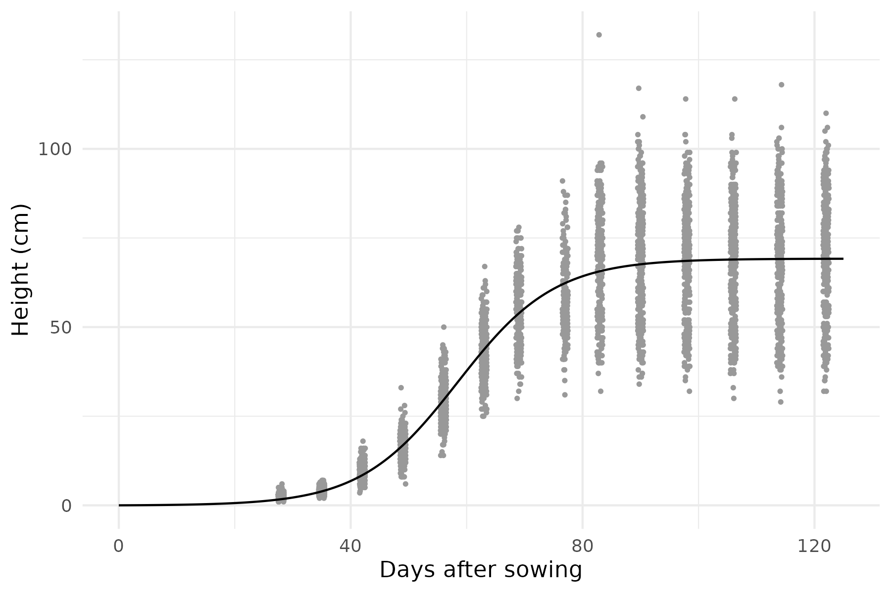
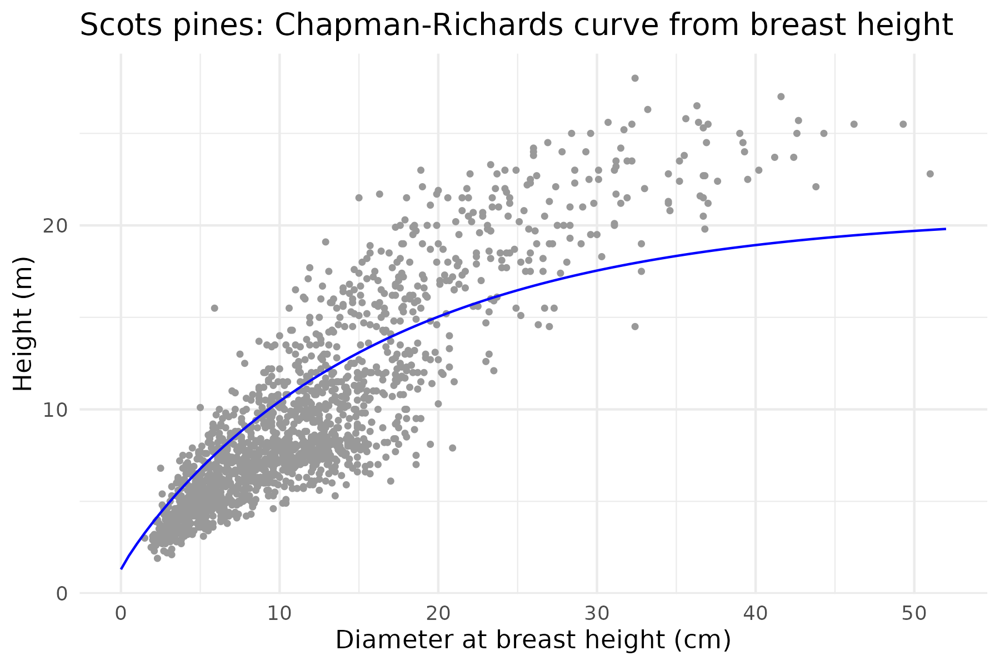
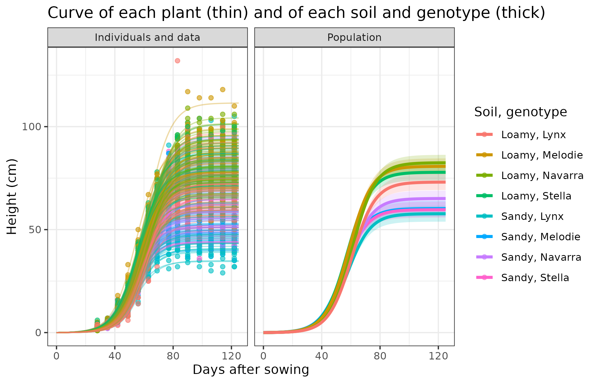
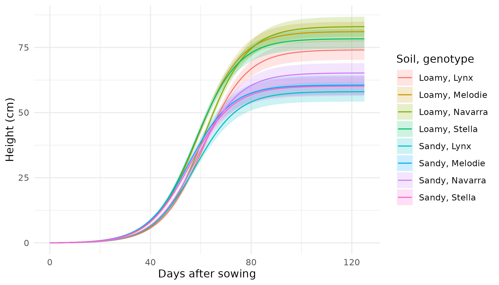

# gcTMB: an overview

The package gcTMB fits growth curves over time by maximum likelihood
with the Template Model Builder (TMB). The curves can depend on
covariates, have random effects for repeated measurements of the same
individuals, and have autocorrelated or heteroscedastic residuals, and
the response can follow a range of distributions. This overview shows
most of the features in one document, with short examples; six vignettes
go into each topic in depth:

1.  *Growth models and their parameters*
    ([`vignette("growth-models")`](https://emilskindersoe.github.io/gcTMB/articles/growth-models.md)):
    the formulas of the growth models, the meaning of their parameters,
    inflection points and maximum growth rates, fitting and comparing
    the models, confidence intervals and simple treatment effects;
2.  *Fixed and random effects*
    ([`vignette("fixed-random-effects")`](https://emilskindersoe.github.io/gcTMB/articles/fixed-random-effects.md)):
    covariates and random effects of the parameters, likelihood ratio
    and F-tests of their inclusion, and count data;
3.  *Timing and maximum growth rates*
    ([`vignette("timing-rates")`](https://emilskindersoe.github.io/gcTMB/articles/timing-rates.md)):
    [`timeto()`](https://emilskindersoe.github.io/gcTMB/reference/timeto.md)
    and
    [`maxrate()`](https://emilskindersoe.github.io/gcTMB/reference/maxrate.md)
    with treatment and genotype effects, the maximum growth rate as a
    parameter, and pairwise comparisons;
4.  *Correlation structures*
    ([`vignette("correlation")`](https://emilskindersoe.github.io/gcTMB/articles/correlation.md)):
    temporal correlation of the residuals within individuals over time,
    and spatial correlation between neighbouring trees, with a nugget
    for measurement error;
5.  *Variance functions*
    ([`vignette("variance")`](https://emilskindersoe.github.io/gcTMB/articles/variance.md)):
    a variance for each stratum, or a power, exponential or polynomial
    of the fitted curve, its growth rate or a covariate, products of
    these, and how variance functions trade off against random effects
    and autocorrelation;
6.  *Simulation*
    ([`vignette("simulation")`](https://emilskindersoe.github.io/gcTMB/articles/simulation.md)):
    simulation studies, including the recovery of the autocorrelation
    parameter and of a variance function.

## Growth models

The growth models are curves $`f(t)`$ that increase from 0, or from the
intercept $`b_4`$ for the Chapman-Richards and Korf curves, towards the
asymptote $`b_1`$. The logistic, Gompertz, Hill, Weibull, beta, normal
and gamma curves are sigmoid growth curves, often used in agronomy and
ecology; the Chapman-Richards and Korf curves are height-diameter
models, common in forestry; and the Preece-Baines curve is a model of
human growth in height. The explanatory variable $`t`$ is usually time,
but can be any variable along which the response grows towards an
asymptote, e.g. the diameter of trees in a height-diameter model:

| Model | $`f(t)`$ | $`b_2`$ | $`b_3`$ |
|:---|:---|:---|:---|
| logistic | $`b_1 / (1 + \exp(-(t - b_2)/b_3))`$ | inflection point, half the asymptote | scale |
| gompertz | $`b_1 \exp(-\exp(-(t - b_2)/b_3))`$ | inflection point | scale |
| hill | $`b_1 / (1 + (b_2/t)^{b_3})`$ | half the asymptote | slope on the log time axis |
| weibull | $`b_1 (1 - \exp(-\frac{b_3 - 1}{b_3} (t/b_2)^{b_3}))`$ | inflection point | shape |
| beta | $`b_1 (1 + \frac{b_3 - t}{b_3 - b_2}) (\frac{t - b_4}{b_3 - b_4})^{(b_3 - b_4)/(b_3 - b_2)}`$, zero again at $`2 b_3 - b_2`$ | inflection point | end of growth |
| beta_capped | the same up to $`b_3`$, and $`b_1`$ from $`b_3`$ on | inflection point | end of growth |
| normal | $`b_1 \Phi((t - b_2)/b_3)`$ | inflection point, half the asymptote | scale |
| gamma | $`b_1 F_\Gamma(t;\ b_3, b_2/(b_3 - 1))`$ | inflection point | shape |
| chapmanrichards | $`b_4 + b_1 (1 - \exp(-b_2 t))^{b_3}`$ | rate | shape |
| korf | $`b_4 + b_1 \exp(b_2/((1 - b_3) t^{b_3 - 1}))`$ | coefficient, $`> 0`$ | shape, $`> 1`$ |
| preecebaines | $`b_1 - \frac{2 (b_1 - b_3)}{\exp(b_4 (t - b_2)) + \exp(b_5 (t - b_2))}`$ | middle of puberty | height at $`b_2`$ |
| linear | $`b_1 t + b_2`$ | intercept | not used |

The threshold $`b_4`$ and the asymmetry $`b_5`$, the links of the
parameters, and the inflection points and maximum growth rates of the
models are described in the vignette *Growth models and their
parameters*.

## Fitting a growth curve

The examples use the faba bean heights of `FabaHeights26` (see
[`?FabaHeights26`](https://emilskindersoe.github.io/gcTMB/reference/FabaHeights26.md)).
[`gcTMB()`](https://emilskindersoe.github.io/gcTMB/reference/gcTMB.md)
takes the response and the time in the formula and the growth model in
`model`; starting values are found automatically
([`gcTMBstart()`](https://emilskindersoe.github.io/gcTMB/reference/gcTMBstart.md)).

``` r

library(gcTMB)
library(ggplot2)
fit <- gcTMB(Height ~ DAS, data = FabaHeights26, model = "logistic")
summary(fit)
#> Call:
#> gcTMB(form = Height ~ DAS, data = FabaHeights26, model = "logistic")
#> 
#> Model:  logistic, truncated at b4 = 0
#> Family: gaussian, identity link for all parameters
#> 
#> Number of observations: 4315
#> Log-likelihood: -16742 (df = 4), AIC: 33493, BIC: 33518
#> 
#> Coefficients:
#>                Estimate Std. Error t value Pr(>|t|)    
#> b1:(Intercept)  69.1973     0.2997  230.90   <2e-16 ***
#> b2:(Intercept)  58.4686     0.2051  285.13   <2e-16 ***
#> b3:(Intercept)   8.3831     0.1824   45.97   <2e-16 ***
#> ---
#> Signif. codes:  0 '***' 0.001 '**' 0.01 '*' 0.05 '.' 0.1 ' ' 1
#> 
#> Residual standard deviation: 11.72 on 4312 degrees of freedom
#> 
#> Optimiser: relative convergence (4), maximum absolute gradient 2.7e-06
```

The growth models are compared by information criteria, e.g. AIC or the
criteria of
[`criteria()`](https://emilskindersoe.github.io/gcTMB/reference/criteria.md):

``` r

fits <- lapply(c(logistic = "logistic", gompertz = "gompertz", hill = "hill", weibull = "weibull",
                 beta = "beta", beta_capped = "beta_capped", normal = "normal", gamma = "gamma",
                 chapmanrichards = "chapmanrichards", korf = "korf", preecebaines = "preecebaines",
                 linear = "linear"),
               # the forestry curves from zero at sowing, instead of their default breast height of 1.3
               function(m) gcTMB(Height ~ DAS, data = FabaHeights26, model = m,
                                 start = if (m %in% c("chapmanrichards", "korf")) c(b4 = 0)))
criteria(fits, which = c("AIC", "BIC"))
#>                      AIC      BIC
#> logistic        33492.78 33518.26
#> gompertz        33603.23 33628.71
#> hill            33551.00 33576.48
#> weibull         33486.91 33512.39
#> beta            34275.95 34301.43
#> beta_capped     33517.79 33543.27
#> normal          33493.81 33519.29
#> gamma           33535.44 33560.92
#> chapmanrichards 33606.41 33631.89
#> korf            33708.64 33734.12
#> preecebaines    33491.05 33529.27
#> linear          35753.14 35772.25
```

[`predict()`](https://rdrr.io/r/stats/predict.html) gives confidence
intervals of the mean by the delta method and prediction intervals of
new observations; [`confint()`](https://rdrr.io/r/stats/confint.html)
gives Wald (default), profile likelihood (`method = "profile"`) or
parametric bootstrap intervals of the parameters, and
[`bootstrap()`](https://emilskindersoe.github.io/gcTMB/reference/bootstrap.md)
a bootstrap sample to reuse.
[`plot()`](https://rdrr.io/r/graphics/plot.default.html) draws
validation plots of the residuals and the fitted curves.

``` r

nd <- data.frame(DAS = seq(0, 125, by = 0.5))
ggplot(FabaHeights26, aes(x = DAS, y = Height)) +
  geom_point(colour = "grey60", size = 0.6, position = position_jitter(width = 0.5, height = 0)) +
  geom_line(data = cbind(nd, Height = predict(fit, newdata = nd)), colour = "black") +
  labs(x = "Days after sowing", y = "Height (cm)") +
  theme_minimal()
```



``` r

confint(fit)
#>                    2.5 %    97.5 %
#> b1:(Intercept) 68.609783 69.784886
#> b2:(Intercept) 58.066586 58.870628
#> b3:(Intercept)  8.025585  8.740651
#> sigma          11.473127 11.967608
```

## Other explanatory variables

The x-axis need not be time: in a height-diameter model of
`PineHeightDiameter`, the height grows with the diameter, from the
breast height of 1.3 m, the intercept $`b_4`$ of the Chapman-Richards
curve:

``` r

fithd <- gcTMB(Height ~ DBH, rform = b1 ~ 1 | Plot, data = PineHeightDiameter,
               model = "chapmanrichards", start = c(b4 = 1.3))
nd <- data.frame(DBH = seq(0, 52, by = 0.5))
ggplot(PineHeightDiameter, aes(x = DBH, y = Height)) +
  geom_point(colour = "grey60", size = 0.8) +
  geom_line(data = cbind(nd, Height = predict(fithd, newdata = nd, random = FALSE)), colour = "blue") +
  labs(x = "Diameter at breast height (cm)", y = "Height (m)",
       title = "Scots pines: Chapman-Richards curve from breast height") +
  theme_minimal()
```



## Fixed and random effects

Covariates on the parameters are formulas in `fform`, and random effects
in `rform`. Here the soil type and the genotype, and their interaction,
act on the asymptote $`b_1`$ and the time of the maximum growth rate
$`b_2`$, and each plant has correlated random effects on both:

``` r

fitre <- gcTMB(Height ~ DAS, fform = b1 + b2 ~ Soil * Genotype, rform = b1 + b2 ~ 1 | Plant_ID,
               data = FabaHeights26)
fitre
#> Call:
#> gcTMB(form = Height ~ DAS, fform = b1 + b2 ~ Soil * Genotype, 
#>     rform = b1 + b2 ~ 1 | Plant_ID, data = FabaHeights26)
#> 
#> Model:  logistic, truncated at b4 = 0
#> Family: gaussian, identity link for all parameters
#> 
#> Coefficients:
#>               b1:(Intercept)                  b1:SoilSandy  
#>                      73.0877                      -15.3593  
#>           b1:GenotypeMelodie            b1:GenotypeNavarra  
#>                       7.6543                        9.3910  
#>            b1:GenotypeStella  b1:SoilSandy:GenotypeMelodie  
#>                       4.7615                       -5.1604  
#> b1:SoilSandy:GenotypeNavarra   b1:SoilSandy:GenotypeStella  
#>                      -2.0035                       -2.8333  
#>               b2:(Intercept)                  b2:SoilSandy  
#>                      60.6671                       -3.0798  
#>           b2:GenotypeMelodie            b2:GenotypeNavarra  
#>                      -2.1506                        0.3390  
#>            b2:GenotypeStella  b2:SoilSandy:GenotypeMelodie  
#>                      -3.0492                       -0.6607  
#> b2:SoilSandy:GenotypeNavarra   b2:SoilSandy:GenotypeStella  
#>                       0.4351                        0.7143  
#>               b3:(Intercept)  
#>                       7.9614  
#> 
#> Random effects:
#>  Groups   Name Std.Dev. Corr
#>  Plant_ID b1   12.37        
#>           b2   2.97     0.75
#> 
#> Residual standard deviation: 3.711
trts <- expand.grid(Soil = c("Loamy", "Sandy"), Genotype = c("Lynx", "Melodie", "Navarra", "Stella"))
```

[`anova()`](https://rdrr.io/r/stats/anova.html) gives likelihood ratio
tests of nested models, for the fixed effects and for the random
effects; `test = "boot"` a parametric bootstrap test, and `test = "F"`
F-tests for models without random effects.

``` r

fitre0 <- gcTMB(Height ~ DAS, fform = b1 + b2 ~ Soil + Genotype, rform = b1 + b2 ~ 1 | Plant_ID,
                data = FabaHeights26)
anova(fitre0, fitre)
#> Likelihood ratio tests of gcTMB models
#> 
#>        npar   AIC   BIC logLik deviance     LR Df Pr(>LR)
#> fitre0   15 25463 25559 -12716    25433                  
#> fitre    21 25470 25604 -12714    25428 5.3115  6  0.5045
```

`plot(type = "curves")` draws the curves of the plants and, next to
them, the population curves of each soil type and genotype with their
95% confidence intervals:

``` r

p <- plot(fitre, type = "curves", times = seq(0, 125, by = 0.5), draw = FALSE)
p$curves + labs(x = "Days after sowing", y = "Height (cm)", colour = "Soil, genotype",
                title = "Curve of each plant (thin) and of each soil and genotype (thick)")
```



[`fixef()`](https://emilskindersoe.github.io/gcTMB/reference/gcTMB-extract.md),
[`ranef()`](https://emilskindersoe.github.io/gcTMB/reference/gcTMB-extract.md)
and
[`VarCorr()`](https://emilskindersoe.github.io/gcTMB/reference/gcTMB-extract.md)
extract the fixed effects, the predicted random effects and their
covariance matrices. Random effects can have several terms, nested or
crossed grouping factors, and random slopes; see the vignette *Fixed and
random effects*.

## Count data and other distributions

The `family` argument gives the distribution of the response:
“gaussian”, “lognormal”, “poisson”, “nbinom2”, “nbinom1”, “binomial”,
“betabinomial” or “beta”. The pods of `FabaCounts23` are zero at the
first counts, so the threshold $`b_4`$, the time of the first pods, is
estimated.

``` r

fitp <- gcTMB(Pods ~ DAS, fform = b1 + b2 ~ Genotype, rform = b1 ~ 1 | Tube_ID, data = FabaCounts23,
              family = "poisson", fix = c(b4 = FALSE))
genotypes <- data.frame(Genotype = sort(unique(FabaCounts23$Genotype)))
cbind(genotypes, predict(fitp, newdata = genotypes, type = "parameters", random = FALSE))
#>   Genotype        b1       b2       b3 b4
#> 1   Aurora 14.599599 70.05333 1.338936 65
#> 2    Capri 11.197633 69.20292 1.338936 65
#> 3   ILB938  9.120908 69.04494 1.338936 65
#> 4     Lynx 19.581618 72.79718 1.338936 65
#> 5  Melodie 25.297251 73.29758 1.338936 65
#> 6   Navara 17.779444 72.65387 1.338936 65
```

[`plot()`](https://rdrr.io/r/graphics/plot.default.html) checks a count
model with randomised quantile residuals (Dunn and Smyth, 1996), which
are standard normal under the model. The simulations of
[`simulate()`](https://rdrr.io/r/stats/simulate.html) can also be used
for simulation-based residuals, e.g. with the package DHARMa; see the
vignette *Fixed and random effects*.

## Timing and maximum growth rates

[`timeto()`](https://emilskindersoe.github.io/gcTMB/reference/timeto.md)
gives the times at which the curves reach a percentage of their
asymptote (or a given response, `type = "absolute"`), and
[`maxrate()`](https://emilskindersoe.github.io/gcTMB/reference/maxrate.md)
the maximum growth rate, its timing and the fraction of the asymptote
reached then, with standard errors by automatic differentiation and the
delta method, and confidence intervals by
[`confint()`](https://rdrr.io/r/stats/confint.html):

``` r

timeto(fitre, level = 90, newdata = trts, random = FALSE)
#> Times to reach the percentages of the asymptote:
#> 
#>                                 Estimate Std.Error
#> 90%:Soil=Loamy,Genotype=Lynx        78.2     0.515
#> 90%:Soil=Sandy,Genotype=Lynx        75.1     0.534
#> 90%:Soil=Loamy,Genotype=Melodie     76.0     0.511
#> 90%:Soil=Sandy,Genotype=Melodie     72.3     0.527
#> 90%:Soil=Loamy,Genotype=Navarra     78.5     0.510
#> 90%:Soil=Sandy,Genotype=Navarra     75.9     0.523
#> 90%:Soil=Loamy,Genotype=Stella      75.1     0.511
#> 90%:Soil=Sandy,Genotype=Stella      72.8     0.526
maxrate(fitre, newdata = trts)
#> Time of the maximum growth rate (tmax), maximum growth rate (rate) and proportion of total growth at inflection (fraction):
#> 
#>                                      Estimate Std.Error
#> tmax:Soil=Loamy,Genotype=Lynx          60.667  4.99e-01
#> rate:Soil=Loamy,Genotype=Lynx           2.296  6.35e-02
#> fraction:Soil=Loamy,Genotype=Lynx       0.500  1.97e-05
#> tmax:Soil=Sandy,Genotype=Lynx          57.587  5.20e-01
#> rate:Soil=Sandy,Genotype=Lynx           1.814  6.28e-02
#> fraction:Soil=Sandy,Genotype=Lynx       0.500  2.94e-05
#> tmax:Soil=Loamy,Genotype=Melodie       58.517  4.95e-01
#> rate:Soil=Loamy,Genotype=Melodie        2.537  6.38e-02
#> fraction:Soil=Loamy,Genotype=Melodie    0.500  2.53e-05
#> tmax:Soil=Sandy,Genotype=Melodie       54.776  5.13e-01
#> rate:Soil=Sandy,Genotype=Melodie        1.893  6.29e-02
#> fraction:Soil=Sandy,Genotype=Melodie    0.499  4.07e-05
#> tmax:Soil=Loamy,Genotype=Navarra       61.006  4.93e-01
#> rate:Soil=Loamy,Genotype=Navarra        2.591  6.40e-02
#> fraction:Soil=Loamy,Genotype=Navarra    0.500  1.87e-05
#> tmax:Soil=Sandy,Genotype=Navarra       58.361  5.08e-01
#> rate:Soil=Sandy,Genotype=Navarra        2.046  6.31e-02
#> fraction:Soil=Sandy,Genotype=Navarra    0.500  2.63e-05
#> tmax:Soil=Loamy,Genotype=Stella        57.618  4.95e-01
#> rate:Soil=Loamy,Genotype=Stella         2.446  6.37e-02
#> fraction:Soil=Loamy,Genotype=Stella     0.500  2.82e-05
#> tmax:Soil=Sandy,Genotype=Stella        55.252  5.12e-01
#> rate:Soil=Sandy,Genotype=Stella         1.875  6.29e-02
#> fraction:Soil=Sandy,Genotype=Stella     0.500  3.85e-05
```

With `b1type = "rate"`, $`b_1`$ is the maximum growth rate, so that
covariates on $`b_1`$ are effects on the maximum growth rate:
[`anova()`](https://rdrr.io/r/stats/anova.html) tests whether they
differ, and
[`partest()`](https://emilskindersoe.github.io/gcTMB/reference/partest.md)
with `contrasts = "tukey"` compares all pairs of genotypes, by Tukey’s
method with simultaneous confidence intervals.

``` r

fitpr <- gcTMB(Pods ~ DAS, fform = b1 + b2 ~ Genotype, rform = b1 ~ 1 | Tube_ID, data = FabaCounts23,
               family = "poisson", fix = c(b4 = FALSE), b1type = "rate", link = c(b1 = "log"))
partest(fitpr, newdata = genotypes, contrasts = "tukey")
#> Pairwise differences of b1 (maximum growth rate) on the scale of its log link:
#> 
#>                                    Estimate Std.Error z value p.value  lower
#> Genotype=Aurora - Genotype=Capri     0.3002     0.232   1.296 0.78766 -0.360
#> Genotype=Aurora - Genotype=ILB938    0.4572     0.231   1.976 0.35581 -0.202
#> Genotype=Aurora - Genotype=Lynx     -0.2752     0.231  -1.192 0.84199 -0.933
#> Genotype=Aurora - Genotype=Melodie  -0.5368     0.245  -2.191 0.24141 -1.235
#> Genotype=Aurora - Genotype=Navara   -0.1767     0.232  -0.762 0.97485 -0.838
#> Genotype=Capri - Genotype=ILB938     0.1570     0.218   0.722 0.98021 -0.463
#> Genotype=Capri - Genotype=Lynx      -0.5755     0.217  -2.649 0.08514 -1.194
#> Genotype=Capri - Genotype=Melodie   -0.8370     0.232  -3.610 0.00444 -1.498
#> Genotype=Capri - Genotype=Navara    -0.4769     0.218  -2.186 0.24382 -1.099
#> Genotype=ILB938 - Genotype=Lynx     -0.7324     0.217  -3.376 0.00970 -1.351
#> Genotype=ILB938 - Genotype=Melodie  -0.9940     0.232  -4.288 0.00032 -1.655
#> Genotype=ILB938 - Genotype=Navara   -0.6339     0.218  -2.907 0.04186 -1.255
#> Genotype=Lynx - Genotype=Melodie    -0.2616     0.231  -1.130 0.87004 -0.921
#> Genotype=Lynx - Genotype=Navara      0.0985     0.218   0.453 0.99757 -0.521
#> Genotype=Melodie - Genotype=Navara   0.3601     0.232   1.549 0.63192 -0.302
#>                                      upper ratio ratio.lower ratio.upper
#> Genotype=Aurora - Genotype=Capri    0.9601 1.350       0.698       2.612
#> Genotype=Aurora - Genotype=ILB938   1.1165 1.580       0.817       3.054
#> Genotype=Aurora - Genotype=Lynx     0.3829 0.759       0.393       1.467
#> Genotype=Aurora - Genotype=Melodie  0.1613 0.585       0.291       1.175
#> Genotype=Aurora - Genotype=Navara   0.4842 0.838       0.433       1.623
#> Genotype=Capri - Genotype=ILB938    0.7769 1.170       0.629       2.175
#> Genotype=Capri - Genotype=Lynx      0.0434 0.562       0.303       1.044
#> Genotype=Capri - Genotype=Melodie  -0.1763 0.433       0.224       0.838
#> Genotype=Capri - Genotype=Navara    0.1448 0.621       0.333       1.156
#> Genotype=ILB938 - Genotype=Lynx    -0.1142 0.481       0.259       0.892
#> Genotype=ILB938 - Genotype=Melodie -0.3335 0.370       0.191       0.716
#> Genotype=ILB938 - Genotype=Navara  -0.0126 0.531       0.285       0.987
#> Genotype=Lynx - Genotype=Melodie    0.3978 0.770       0.398       1.489
#> Genotype=Lynx - Genotype=Navara     0.7185 1.104       0.594       2.051
#> Genotype=Melodie - Genotype=Navara  1.0223 1.433       0.739       2.780
#> 
#> Wald z tests; p-values and confidence limits adjusted by the single-step (Tukey) method, 95% confidence limits, and ratios.
```

## Correlation structures

The residuals of the gaussian and lognormal families can be correlated
within individuals. Over time,
[`corAR1()`](https://emilskindersoe.github.io/gcTMB/reference/corStruct.md)
for integer times and
[`corCAR1()`](https://emilskindersoe.github.io/gcTMB/reference/corStruct.md)
for continuous times have the correlation $`\rho^{|t - s|}`$ of
residuals at times $`s`$ and $`t`$.
[`refit()`](https://emilskindersoe.github.io/gcTMB/reference/refit.md)
fits a model again with a component changed and its other arguments
reused, here `fitre` with a correlation structure
([`update()`](https://rdrr.io/r/stats/update.html), in contrast, sets
parameters without fitting again, see the vignette *Simulation*):

``` r

fitrec <- refit(fitre, correlation = corCAR1(value = 0.9, form = ~ DAS | Plant_ID))
corpars(fitrec)
#>       rho 
#> 0.8507641
anova(fitre, fitrec)
#> Likelihood ratio tests of gcTMB models
#> 
#>        npar   AIC   BIC logLik deviance     LR Df   Pr(>LR)    
#> fitre    21 25470 25604 -12714    25428                        
#> fitrec   22 25252 25392 -12604    25208 219.34  1 < 2.2e-16 ***
#> ---
#> Signif. codes:  0 '***' 0.001 '**' 0.01 '*' 0.05 '.' 0.1 ' ' 1
```

In space,
[`corExp()`](https://emilskindersoe.github.io/gcTMB/reference/corStruct.md)
and
[`corGaus()`](https://emilskindersoe.github.io/gcTMB/reference/corStruct.md)
have the correlation $`(1 - n) \exp(-d/r)`$ and
$`(1 - n) \exp(-(d/r)^2)`$ of residuals a distance $`d`$ apart, with a
range $`r`$ and, with `nugget = TRUE`, a nugget $`n`$: the share of the
residual variance that is independent between observations, such as
measurement error. With the positions of trees in their plots,
e.g. `corExp(form = ~ X + Y | Plot, nugget = TRUE)`, the residuals of
neighbouring trees are correlated. `residuals(type = "normalized")`
gives residuals that are independent under the model. The vignette
*Correlation structures* describes the models and their likelihood, with
an example of spatial correlation.

## Variance functions

The residual variance of the gaussian and lognormal families can change
over the course of growth, with a variance function in the argument
`variance`:
[`varIdent()`](https://emilskindersoe.github.io/gcTMB/reference/varFunc.md)
gives each stratum its own variance,
[`varPower()`](https://emilskindersoe.github.io/gcTMB/reference/varFunc.md)
and
[`varConstPower()`](https://emilskindersoe.github.io/gcTMB/reference/varFunc.md)
a power,
[`varExp()`](https://emilskindersoe.github.io/gcTMB/reference/varFunc.md)
an exponential and
[`varPoly()`](https://emilskindersoe.github.io/gcTMB/reference/varFunc.md)
a polynomial of a covariate, the fitted curve `fitted(.)` (the default),
its growth rate `rate(.)`, largest at the inflection point, or a
variable of the data;
[`varComb()`](https://emilskindersoe.github.io/gcTMB/reference/varFunc.md)
multiplies several of them, e.g. `varComb(varPower(), varExp())` for a
standard deviation largest in the middle of growth. Here the residual
standard deviation is a constant plus a power of the fitted curve,
$`\sigma (c + |\hat y|^{\delta})`$, besides the random effects of the
plants; `restart = TRUE` optimises once more from the estimates, as the
first optimisation stops just short of convergence:

``` r

fitrev <- refit(fitre, variance = varConstPower(), control = gcTMBcontrol(restart = TRUE))
varpars(fitrev)
#>     const     power 
#> 19.576472  1.094568
anova(fitre, fitrev)
#> Likelihood ratio tests of gcTMB models
#> 
#>        npar   AIC   BIC logLik deviance     LR Df   Pr(>LR)    
#> fitre    21 25470 25604 -12714    25428                        
#> fitrev   23 23577 23724 -11766    23531 1896.3  2 < 2.2e-16 ***
#> ---
#> Signif. codes:  0 '***' 0.001 '**' 0.01 '*' 0.05 '.' 0.1 ' ' 1
```

[`predict()`](https://rdrr.io/r/stats/predict.html) gives confidence
intervals of the population curves by the delta method, here of the soil
types and genotypes:

``` r

nd <- merge(trts, data.frame(DAS = seq(0, 125, by = 0.5)))
ci <- cbind(nd, predict(fitrev, newdata = nd, random = FALSE, interval = "confidence"))
ci$trt <- paste(ci$Soil, ci$Genotype, sep = ", ")
ggplot(ci, aes(x = DAS, y = fit, colour = trt, fill = trt)) +
  geom_ribbon(aes(ymin = lwr, ymax = upr), alpha = 0.2, colour = NA) +
  geom_line() +
  labs(x = "Days after sowing", y = "Height (cm)", colour = "Soil, genotype", fill = "Soil, genotype") +
  theme_minimal()
```



The vignette *Variance functions* shows how variance functions change
the confidence intervals of a curve, and how they trade off against
random effects and autocorrelation.

## Simulation

[`simulate()`](https://rdrr.io/r/stats/simulate.html) draws new
responses from a fitted model, at the observed times or for new times
and individuals in `newdata`, with new random effects (`re = "new"`;
`re = "fitted"` keeps those of the fitted individuals) and
autocorrelated residuals;
[`update()`](https://rdrr.io/r/stats/update.html) sets the parameters of
a true model. Refitting the model to simulated data recovers its
parameters, e.g. the autocorrelation:

``` r

design <- expand.grid(DAS = seq(28, 122, by = 7), Plant_ID = paste0("p", 1:30), Soil = "Loamy",
                      Genotype = "Lynx")
design$Height <- simulate(fitrec, nsim = 1, seed = 1, newdata = design)[[1]]
fitsim <- gcTMB(Height ~ DAS, rform = b1 + b2 ~ 1 | Plant_ID, data = design,
                correlation = corCAR1(value = 0.9, form = ~ DAS | Plant_ID))
c(true = corpars(fitrec), estimate = corpars(fitsim))
#>     true.rho estimate.rho 
#>    0.8507641    0.8181344
```

The vignette *Simulation* repeats this for many data sets.

## Convergence

[`converged()`](https://emilskindersoe.github.io/gcTMB/reference/converged.md)
checks that the log-likelihood is finite, that the optimiser reports
convergence with a largest absolute gradient below $`10^{-3}`$, and that
the Hessian is positive definite. With few groups and several correlated
random effects, the likelihood is often so flat in some directions that
`nlminb` reports “singular convergence” or “false convergence”, or stops
with a gradient slightly above $`10^{-3}`$, although it is at the
maximum. With `control = list(restart = TRUE)`, such a fit is optimised
once more from its estimates; the fit keeps the better optimum, and
`fit$restart$improvement` holds the improvement of the log-likelihood.
[`converged()`](https://emilskindersoe.github.io/gcTMB/reference/converged.md)
accepts a fit that the restart improved by less than `lltol`
($`10^{-6}`$ by default), since its maximum is stable. In a simulation
study that does not need standard errors, `sdreport = FALSE` saves about
a quarter of the time of each fit, but then the Hessian is not checked.
The other vignettes use `restart = TRUE` for the fits with several
random effects.

## References

Dunn, P.K. and Smyth, G.K. (1996). Randomized quantile residuals.
*Journal of Computational and Graphical Statistics* 5, 236–244.
<doi:10.1080/10618600.1996.10474708>.
