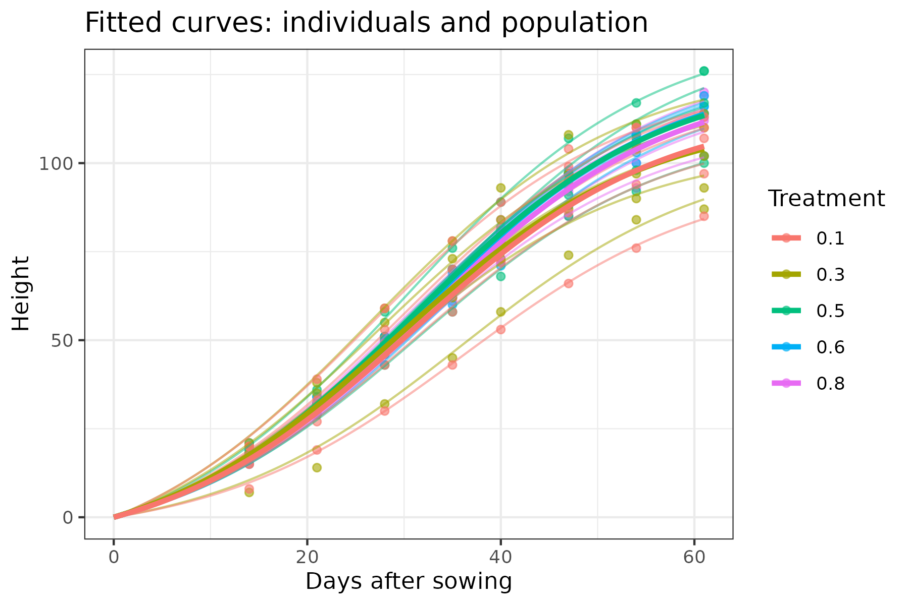

# gcTMB: an overview

The package gcTMB fits growth curves over time by maximum likelihood
with the Template Model Builder (TMB). The curves can depend on
covariates, have random effects for repeated measurements of the same
individuals, and have autocorrelated residuals, and the response can
follow a range of distributions. This overview shows most of the
features in one document, with short examples; four vignettes go into
each topic in depth:

1.  *Growth models and their parameters*
    ([`vignette("growth-models")`](https://emilskindersoe.github.io/gcTMB/articles/growth-models.md)):
    the formulas of the growth models, the meaning of their parameters,
    inflection points and maximum growth rates, fitting and comparing
    the models, confidence intervals and simple treatment effects;
2.  *Fixed and random effects*
    ([`vignette("fixed-random-effects")`](https://emilskindersoe.github.io/gcTMB/articles/fixed-random-effects.md)):
    covariates and random effects of the parameters, likelihood ratio
    and F-tests of their inclusion, and count data;
3.  *Timing and maximum growth rates*
    ([`vignette("timing-rates")`](https://emilskindersoe.github.io/gcTMB/articles/timing-rates.md)):
    [`timeto()`](https://emilskindersoe.github.io/gcTMB/reference/timeto.md)
    and
    [`maxrate()`](https://emilskindersoe.github.io/gcTMB/reference/maxrate.md)
    with treatment and genotype effects, the maximum growth rate as a
    parameter, and pairwise comparisons;
4.  *Autocorrelation and simulation*
    ([`vignette("autocorrelation-simulation")`](https://emilskindersoe.github.io/gcTMB/articles/autocorrelation-simulation.md)):
    autocorrelated residuals within individuals, and simulation studies,
    including the recovery of the autocorrelation parameter.

## Growth models

The growth models are curves $`f(t) = b_1 F(z(t))`$ that increase from 0
towards the asymptote $`b_1`$, with a function $`F`$ increasing from 0
to 1 and a transformed time $`z(t)`$:

| Model | $`f(t)`$ | $`b_2`$ | $`b_3`$ |
|:---|:---|:---|:---|
| logistic | $`b_1 / (1 + \exp(-(t - b_2)/b_3))`$ | inflection point, half the asymptote | scale |
| gompertz | $`b_1 \exp(-\exp(-(t - b_2)/b_3))`$ | inflection point | scale |
| hill | $`b_1 / (1 + (b_2/t)^{b_3})`$ | half the asymptote | slope on the log time axis |
| weibull | $`b_1 (1 - \exp(-\frac{b_3 - 1}{b_3} (t/b_2)^{b_3}))`$ | inflection point | shape |
| normal | $`b_1 \Phi((t - b_2)/b_3)`$ | inflection point, half the asymptote | scale |
| gamma | $`b_1 F_\Gamma(t;\ b_3, b_2/(b_3 - 1))`$ | inflection point | shape |
| linear | $`b_1 t + b_2`$ | intercept | not used |

Two further parameters complete the curves: the threshold $`b_4`$,
before which a truncated curve is zero (by default fixed at 0, the time
of sowing; `fix = c(b4 = FALSE)` estimates it), and the asymmetry
$`b_5`$ (by default fixed at 1, the curves above; `fix = c(b5 = FALSE)`
estimates it, e.g. the Richards curve for the logistic model). With
`b1type = "rate"`, $`b_1`$ is the maximum growth rate instead of the
asymptote. Each parameter can have a link,
e.g. `link = c(b3 = "inverse")` for the rate $`1/b_3`$ or
`link = c(b1 = "log")` for effects as ratios. The vignette *Growth
models and their parameters* gives all the formulas, the inflection
points and maximum growth rates of each model, and the asymmetric
curves.

## Fitting a growth curve

The data set `FabaHeights25` contains the heights of 25 faba bean plants
at five treatment levels, measured on eight days after sowing (`DAS`).
[`gcTMB()`](https://emilskindersoe.github.io/gcTMB/reference/gcTMB.md)
takes the response and the time in the formula and the growth model in
`model`; starting values are found automatically
([`gcTMBstart()`](https://emilskindersoe.github.io/gcTMB/reference/gcTMBstart.md)).

``` r

library(gcTMB)
library(ggplot2)
fit <- gcTMB(height ~ DAS, data = FabaHeights25, model = "logistic")
summary(fit)
#> Call:
#> gcTMB(form = height ~ DAS, data = FabaHeights25, model = "logistic")
#> 
#> Model:  logistic, truncated at b4 = 0
#> Family: gaussian, identity link for all parameters
#> 
#> Number of observations: 200
#> Log-likelihood: -699.2 (df = 4), AIC: 1406, BIC: 1420
#> 
#> Coefficients:
#>                Estimate Std. Error
#> b1:(Intercept)   120.79      3.652
#> b2:(Intercept)    30.73      0.682
#> b3:(Intercept)    12.88      0.977
#> 
#> Residual standard deviation: 8.043 on 197 degrees of freedom
#> 
#> Optimiser: relative convergence (4), maximum absolute gradient 3.4e-08
```

The growth models are compared by information criteria, e.g. AIC or the
criteria of
[`criteria()`](https://emilskindersoe.github.io/gcTMB/reference/criteria.md):

``` r

fits <- lapply(c(logistic = "logistic", gompertz = "gompertz", hill = "hill", weibull = "weibull",
                 normal = "normal", gamma = "gamma"),
               function(m) gcTMB(height ~ DAS, data = FabaHeights25, model = m))
criteria(fits, which = c("AIC", "BIC"))
#>               AIC      BIC
#> logistic 1406.470 1419.663
#> gompertz 1407.658 1420.851
#> hill     1409.892 1423.085
#> weibull  1407.757 1420.950
#> normal   1406.412 1419.605
#> gamma    1409.685 1422.878
```

[`predict()`](https://rdrr.io/r/stats/predict.html) gives confidence
intervals of the mean by the delta method and prediction intervals of
new observations; [`confint()`](https://rdrr.io/r/stats/confint.html)
gives profile likelihood (default), Wald or parametric bootstrap
intervals of the parameters, and
[`bootstrap()`](https://emilskindersoe.github.io/gcTMB/reference/bootstrap.md)
a bootstrap sample to reuse.
[`plot()`](https://rdrr.io/r/graphics/plot.default.html) draws
validation plots of the residuals and the fitted curves.

``` r

nd <- data.frame(DAS = seq(0, 80, by = 0.5))
ci <- cbind(nd, predict(fit, newdata = nd, interval = "confidence"))
ggplot(FabaHeights25, aes(x = DAS, y = height)) +
  geom_ribbon(data = ci, aes(x = DAS, ymin = lwr, ymax = upr), inherit.aes = FALSE, fill = "blue", alpha = 0.25) +
  geom_line(data = ci, aes(y = fit), colour = "blue") +
  geom_point() +
  labs(x = "Days after sowing", y = "Height") +
  theme_minimal()
```


``` r

confint(fit, method = "wald")
#>                    2.5 %     97.5 %
#> b1:(Intercept) 113.58225 127.987982
#> b2:(Intercept)  29.38463  32.075332
#> b3:(Intercept)  10.95416  14.807390
#> sigma            7.23722   8.804241
```

## Fixed and random effects

Covariates on the parameters are formulas in `fform`, and random effects
in `rform`, as in
[`nlme::nlme`](https://rdrr.io/pkg/nlme/man/nlme.html). Here the
treatment acts on the asymptote $`b_1`$ and the time of the maximum
growth rate $`b_2`$, and each plant has correlated random effects on
both:

``` r

FabaHeights25$trt <- factor(FabaHeights25$Treatment)
trts <- data.frame(trt = levels(FabaHeights25$trt))
fitre <- gcTMB(height ~ DAS, fform = b1 + b2 ~ trt, rform = b1 + b2 ~ 1 | plant_ID, data = FabaHeights25)
fitre
#> Call:
#> gcTMB(form = height ~ DAS, fform = b1 + b2 ~ trt, rform = b1 + 
#>     b2 ~ 1 | plant_ID, data = FabaHeights25)
#> 
#> Model:  logistic, truncated at b4 = 0
#> Family: gaussian, identity link for all parameters
#> 
#> Coefficients:
#> b1:(Intercept)       b1:trt0.3       b1:trt0.5       b1:trt0.6       b1:trt0.8  
#>       115.7637         -1.9226          9.7398         10.6189          8.2848  
#> b2:(Intercept)       b2:trt0.3       b2:trt0.5       b2:trt0.6       b2:trt0.8  
#>        30.8173         -1.4951          0.1777          0.6744          0.9027  
#> b3:(Intercept)  
#>        12.8471  
#> 
#> Random effects:
#>  Groups   Name Std.Dev. Corr 
#>  plant_ID b1   8.834         
#>           b2   2.395    -0.32
#> 
#> Residual standard deviation: 2.076
```

[`anova()`](https://rdrr.io/r/stats/anova.html) gives likelihood ratio
tests of nested models, for the fixed effects and for the random
effects; `test = "boot"` a parametric bootstrap test, and `test = "F"`
F-tests for models without random effects.

``` r

fitre0 <- gcTMB(height ~ DAS, rform = b1 + b2 ~ 1 | plant_ID, data = FabaHeights25)
anova(fitre0, fitre)
#> Likelihood ratio tests of gcTMB models
#> 
#>        npar    AIC    BIC  logLik deviance     LR Df Pr(>LR)
#> fitre0    7 1041.3 1064.4 -513.67   1027.3                  
#> fitre    15 1046.3 1095.8 -508.17   1016.3 11.006  8  0.2014
```

`plot(type = "curves")` draws the curves of the plants and the
population curves of the treatments:

``` r

p <- plot(fitre, type = "curves", times = seq(0, 61, by = 0.1), draw = FALSE)
p$curves + labs(x = "Days after sowing", y = "Height", colour = "Treatment")
```



[`fixef()`](https://emilskindersoe.github.io/gcTMB/reference/gcTMB-extract.md),
[`ranef()`](https://emilskindersoe.github.io/gcTMB/reference/gcTMB-extract.md)
and
[`VarCorr()`](https://emilskindersoe.github.io/gcTMB/reference/gcTMB-extract.md)
extract the fixed effects, the predicted random effects and their
covariance matrices. Random effects can have several terms, nested or
crossed grouping factors, and random slopes; see the vignette *Fixed and
random effects*.

## Count data and other distributions

The `family` argument gives the distribution of the response:
“gaussian”, “lognormal”, “poisson”, “nbinom2”, “nbinom1”, “binomial”,
“betabinomial” or “beta”. The data set `FabaCounts23` contains the
numbers of pods of 22 plants of six genotypes; the plants have no pods
at the first counts, so the threshold $`b_4`$, the time of the first
pods, is estimated.

``` r

fitp <- gcTMB(pods ~ DAS, fform = b1 + b2 ~ Genotype, rform = b1 ~ 1 | Tube_ID, data = FabaCounts23,
              family = "poisson", fix = c(b4 = FALSE))
genotypes <- data.frame(Genotype = sort(unique(FabaCounts23$Genotype)))
cbind(genotypes, predict(fitp, newdata = genotypes, type = "parameters", random = FALSE))
#>   Genotype        b1       b2       b3 b4
#> 1   Aurora 14.599634 70.05332 1.338935 65
#> 2    Capri 11.197618 69.20292 1.338935 65
#> 3   ILB938  9.120981 69.04494 1.338935 65
#> 4     Lynx 19.581583 72.79718 1.338935 65
#> 5  Melodie 25.297268 73.29758 1.338935 65
#> 6   Navara 17.779358 72.65387 1.338935 65
```

## Timing and maximum growth rates

[`timeto()`](https://emilskindersoe.github.io/gcTMB/reference/timeto.md)
gives the times at which the curves reach a percentage of their
asymptote (or a given response, `type = "absolute"`), and
[`maxrate()`](https://emilskindersoe.github.io/gcTMB/reference/maxrate.md)
the maximum growth rate, its timing and the fraction of the asymptote
reached then, with standard errors by automatic differentiation and the
delta method, and confidence intervals by
[`confint()`](https://rdrr.io/r/stats/confint.html):

``` r

timeto(fitre, level = 90, newdata = trts, random = FALSE)
#> Times to reach the percentages of the asymptote:
#> 
#>             Estimate Std.Error
#> 90%:trt=0.1     60.3      1.24
#> 90%:trt=0.3     58.9      1.21
#> 90%:trt=0.5     60.4      1.24
#> 90%:trt=0.6     60.9      1.25
#> 90%:trt=0.8     61.1      1.25
maxrate(fitp, newdata = genotypes)
#> Time of the maximum growth rate (tmax), maximum growth rate (rate) and proportion of total growth at inflection (fraction):
#> 
#>                           Estimate Std.Error
#> tmax:Genotype=Aurora        70.053  0.468918
#> rate:Genotype=Aurora         2.789  0.488091
#> fraction:Genotype=Aurora     0.489  0.005257
#> tmax:Genotype=Capri         69.203  0.464850
#> rate:Genotype=Capri          2.181  0.400919
#> fraction:Genotype=Capri      0.478  0.009656
#> tmax:Genotype=ILB938        69.045  0.553914
#> rate:Genotype=ILB938         1.786  0.382493
#> fraction:Genotype=ILB938     0.476  0.011629
#> tmax:Genotype=Lynx          72.797  0.391550
#> rate:Genotype=Lynx           3.667  0.506615
#> fraction:Genotype=Lynx       0.499  0.000776
#> tmax:Genotype=Melodie       73.298  0.388664
#> rate:Genotype=Melodie        4.733  0.639974
#> fraction:Genotype=Melodie    0.499  0.000580
#> tmax:Genotype=Navara        72.654  0.399801
#> rate:Genotype=Navara         3.331  0.485199
#> fraction:Genotype=Navara     0.498  0.000860
```

With `b1type = "rate"`, $`b_1`$ is the maximum growth rate, so that
covariates on $`b_1`$ are effects on the maximum growth rate:
[`anova()`](https://rdrr.io/r/stats/anova.html) tests whether they
differ, and
[`pairwise()`](https://emilskindersoe.github.io/gcTMB/reference/pairwise.md)
compares all pairs of genotypes, with simultaneous confidence intervals.

``` r

fitpr <- gcTMB(pods ~ DAS, fform = b1 + b2 ~ Genotype, rform = b1 ~ 1 | Tube_ID, data = FabaCounts23,
               family = "poisson", fix = c(b4 = FALSE), b1type = "rate", link = c(b1 = "log"))
pairwise(fitpr, newdata = genotypes)
#> Pairwise differences of b1 (maximum growth rate) on the scale of its log link:
#> 
#>                                    Estimate Std.Error z value p.value  lower
#> Genotype=Aurora - Genotype=Capri     0.3002     0.232   1.296 0.78771 -0.360
#> Genotype=Aurora - Genotype=ILB938    0.4572     0.231   1.976 0.35585 -0.202
#> Genotype=Aurora - Genotype=Lynx     -0.2753     0.231  -1.192 0.84196 -0.933
#> Genotype=Aurora - Genotype=Melodie  -0.5368     0.245  -2.191 0.24139 -1.235
#> Genotype=Aurora - Genotype=Navara   -0.1767     0.232  -0.762 0.97484 -0.838
#> Genotype=Capri - Genotype=ILB938     0.1570     0.218   0.722 0.98021 -0.463
#> Genotype=Capri - Genotype=Lynx      -0.5754     0.217  -2.649 0.08514 -1.194
#> Genotype=Capri - Genotype=Melodie   -0.8370     0.232  -3.610 0.00443 -1.498
#> Genotype=Capri - Genotype=Navara    -0.4769     0.218  -2.186 0.24385 -1.099
#> Genotype=ILB938 - Genotype=Lynx     -0.7324     0.217  -3.376 0.00970 -1.351
#> Genotype=ILB938 - Genotype=Melodie  -0.9940     0.232  -4.288 0.00032 -1.655
#> Genotype=ILB938 - Genotype=Navara   -0.6339     0.218  -2.907 0.04186 -1.255
#> Genotype=Lynx - Genotype=Melodie    -0.2616     0.231  -1.130 0.87004 -0.921
#> Genotype=Lynx - Genotype=Navara      0.0985     0.218   0.453 0.99757 -0.521
#> Genotype=Melodie - Genotype=Navara   0.3601     0.232   1.549 0.63192 -0.302
#>                                      upper ratio ratio.lower ratio.upper
#> Genotype=Aurora - Genotype=Capri    0.9600 1.350       0.698       2.612
#> Genotype=Aurora - Genotype=ILB938   1.1165 1.580       0.817       3.054
#> Genotype=Aurora - Genotype=Lynx     0.3828 0.759       0.393       1.466
#> Genotype=Aurora - Genotype=Melodie  0.1613 0.585       0.291       1.175
#> Genotype=Aurora - Genotype=Navara   0.4842 0.838       0.433       1.623
#> Genotype=Capri - Genotype=ILB938    0.7769 1.170       0.629       2.175
#> Genotype=Capri - Genotype=Lynx      0.0434 0.562       0.303       1.044
#> Genotype=Capri - Genotype=Melodie  -0.1763 0.433       0.224       0.838
#> Genotype=Capri - Genotype=Navara    0.1448 0.621       0.333       1.156
#> Genotype=ILB938 - Genotype=Lynx    -0.1142 0.481       0.259       0.892
#> Genotype=ILB938 - Genotype=Melodie -0.3335 0.370       0.191       0.716
#> Genotype=ILB938 - Genotype=Navara  -0.0127 0.531       0.285       0.987
#> Genotype=Lynx - Genotype=Melodie    0.3978 0.770       0.398       1.489
#> Genotype=Lynx - Genotype=Navara     0.7185 1.104       0.594       2.051
#> Genotype=Melodie - Genotype=Navara  1.0223 1.433       0.739       2.780
#> 
#> Wald z tests; p-values and confidence limits adjusted by the single-step (Tukey) method, 95% confidence limits, and ratios.
```

## Autocorrelation

The residuals of the gaussian and lognormal families can be
autocorrelated within individuals over time, with the correlation
structures of nlme:
[`corAR1()`](https://emilskindersoe.github.io/gcTMB/reference/corStruct.md)
for integer times and
[`corCAR1()`](https://emilskindersoe.github.io/gcTMB/reference/corStruct.md)
for continuous times, with the correlation $`\rho^{|t - s|}`$ of
residuals at times $`s`$ and $`t`$.

``` r

fitrec <- update(fitre, correlation = corCAR1(form = ~ DAS | plant_ID))
corpars(fitrec)
#>       rho 
#> 0.9593852
anova(fitre, fitrec)
#> Likelihood ratio tests of gcTMB models
#> 
#>        npar     AIC    BIC  logLik deviance     LR Df   Pr(>LR)    
#> fitre    15 1046.34 1095.8 -508.17  1016.34                        
#> fitrec   16  993.54 1046.3 -480.77   961.54 54.799  1 1.335e-13 ***
#> ---
#> Signif. codes:  0 '***' 0.001 '**' 0.01 '*' 0.05 '.' 0.1 ' ' 1
```

`residuals(type = "normalized")` gives residuals that are independent
under the model. The vignette *Autocorrelation and simulation* describes
the model and its likelihood.

## Simulation

[`simulate()`](https://rdrr.io/r/stats/simulate.html) draws new
responses from a fitted model, at the observed times or for new times
and individuals in `newdata`, with new random effects and autocorrelated
residuals; [`update()`](https://rdrr.io/r/stats/update.html) sets the
parameters of a true model. Refitting the model to simulated data
recovers its parameters, e.g. the autocorrelation:

``` r

design <- expand.grid(DAS = seq(10, 70, by = 5), plant_ID = paste0("p", 1:30), trt = "0.1")
design$height <- simulate(fitrec, nsim = 1, seed = 1, newdata = design)[[1]]
fitsim <- gcTMB(height ~ DAS, rform = b1 + b2 ~ 1 | plant_ID, data = design,
                correlation = corCAR1(form = ~ DAS | plant_ID))
c(true = corpars(fitrec), estimate = corpars(fitsim))
#>     true.rho estimate.rho 
#>    0.9593852    0.9572968
```

The vignette *Autocorrelation and simulation* repeats this for many data
sets. In simulation studies,
`control = list(sdreport = FALSE, restart = TRUE)` skips the standard
errors and optimises a fit that does not converge once more from its
estimates, and
[`converged()`](https://emilskindersoe.github.io/gcTMB/reference/converged.md)
checks the fits.

## References

Pinheiro, J.C. and Bates, D.M. (2000). *Mixed-Effects Models in S and
S-PLUS*. Springer, New York.

Zuur, A.F., Ieno, E.N., Walker, N.J., Saveliev, A.A. and Smith, G.M.
(2009). *Mixed Effects Models and Extensions in Ecology with R*.
Springer, New York.
