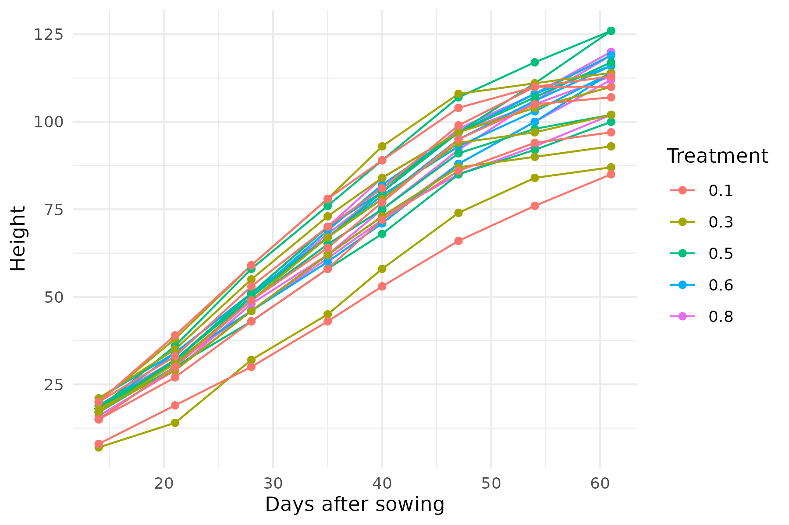
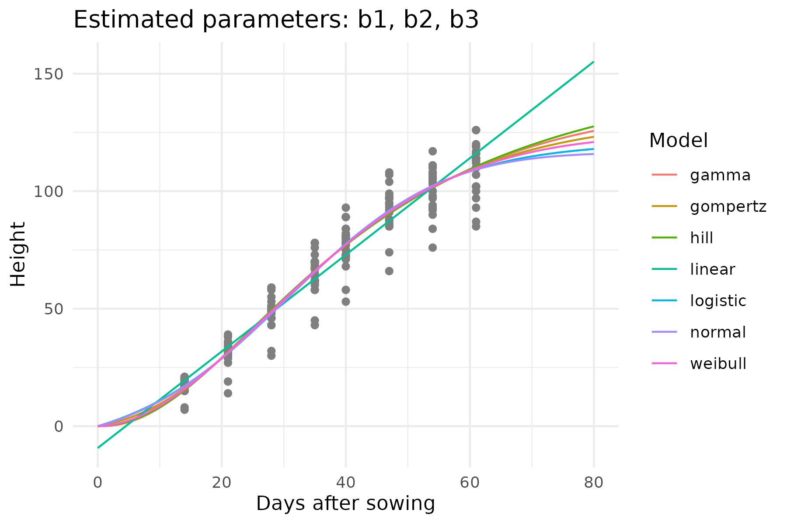
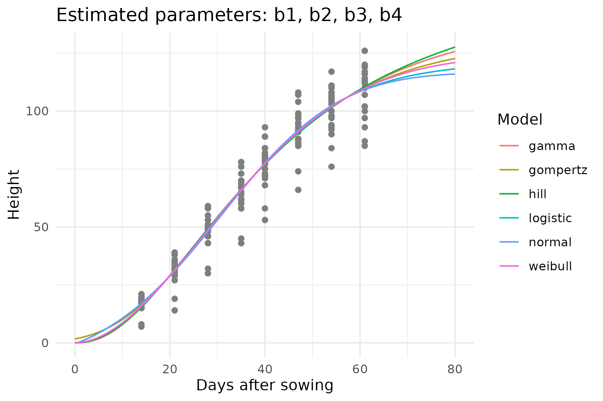
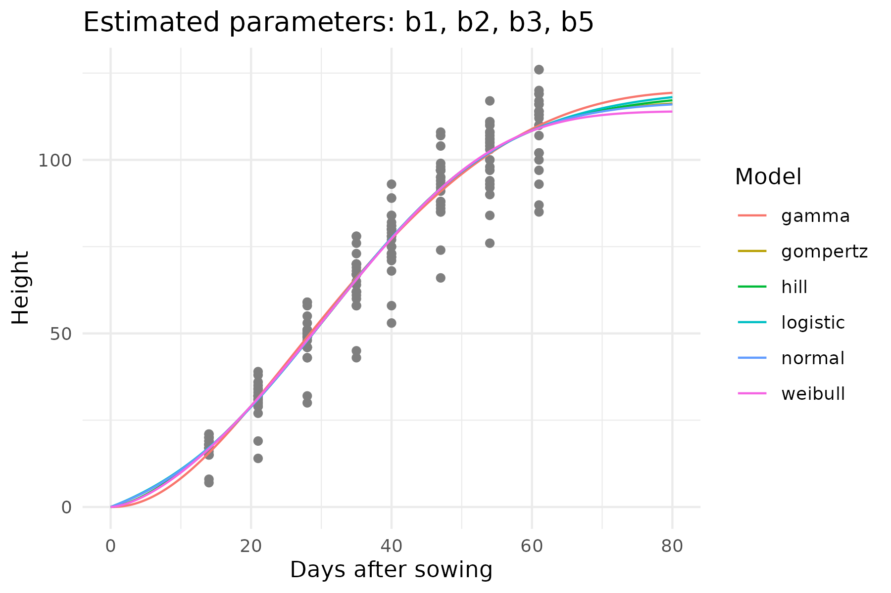
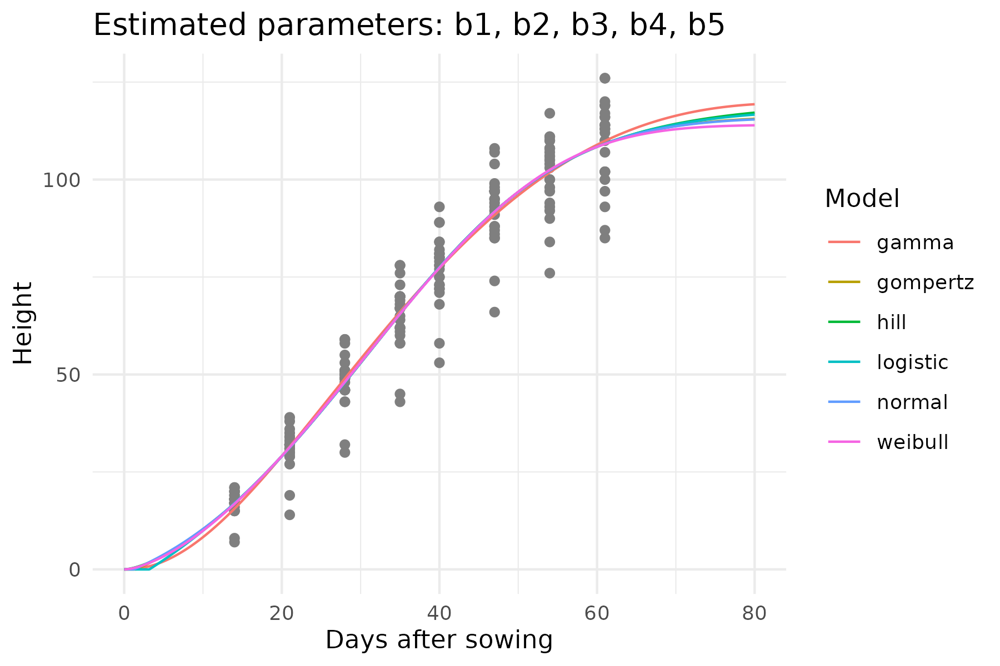
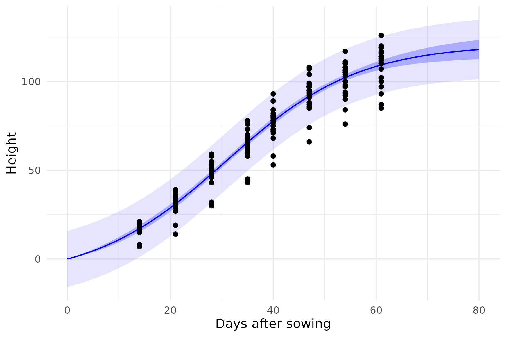
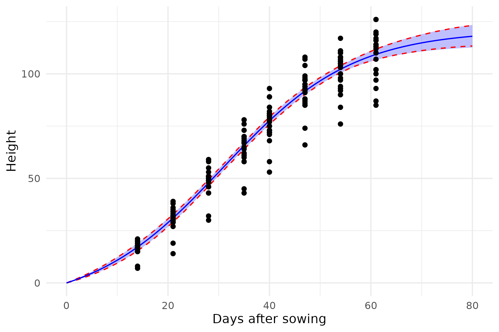
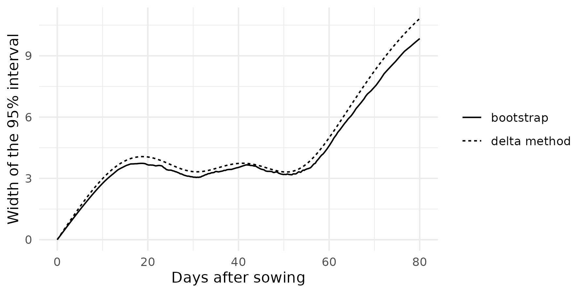
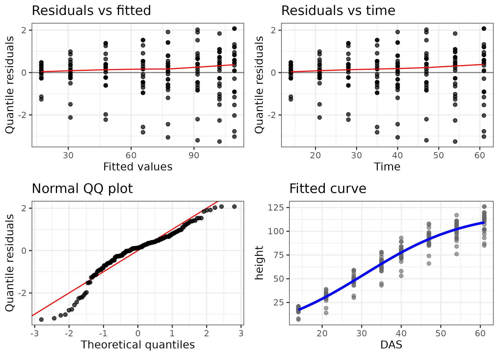
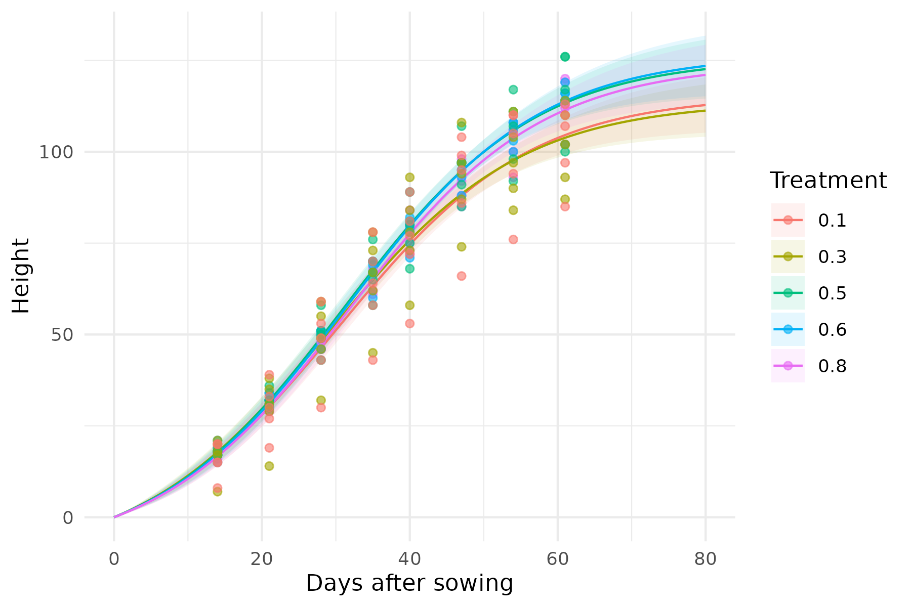

# Growth models and their parameters

The package gcTMB fits growth curves over time using the Template Model
Builder (TMB) framework. The curves can depend on covariates, have
random effects (e.g. for repeated measurements of the same individuals),
and the response can follow a range of distributions.

This vignette introduces the growth models and the meaning of their
parameters, fits them to the heights of faba bean plants with confidence
intervals, and adds treatment effects. The other vignettes cover fixed
and random effects, the timing and maximum growth rates, and
autocorrelation and simulation; the guide
[`vignette("gcTMB")`](https://emilskindersoe.github.io/gcTMB/articles/gcTMB.md)
gives a short overview of all the features.

## Growth models

All models but the linear one are functions $`f(t)`$ of time, increasing
from 0 towards the asymptote $`b_1`$, e.g. the logistic curve
$`f(t) = b_1/(1 + \exp(-(t - b_2)/b_3))`$:

- $`b_1`$ is the asymptote, the response approached at late times,
- $`b_2`$ is the time of the maximum growth rate, the inflection point
  of the curve (logistic, Gompertz, Weibull, normal, gamma), or the time
  of half the asymptote (Hill),
- $`b_3`$ is the scale of the curve on the time axis (logistic,
  Gompertz, normal), its slope on the log time axis (Hill), or its shape
  (Weibull, gamma).

The parameter $`b_4`$ is the threshold of truncated curves, and $`b_5`$
the asymmetry of the curve (both below).

#### Scale, slope and shape

The parameter $`b_3`$ sets how long the growth takes, but in three
different ways:

- A **scale** (logistic, Gompertz, normal) is in units of time. The
  curve depends on time only through $`(t - b_2)/b_3`$, so $`b_3`$
  stretches the curve along the time axis around $`b_2`$ without
  changing its form: doubling $`b_3`$ doubles the duration of the growth
  and halves the maximum growth rate. A larger scale means slower
  growth. The time from 10% to 90% of the asymptote is a fixed multiple
  of $`b_3`$.
- A **slope** (Hill) has no units. The Hill curve is a logistic curve in
  $`\log t`$ with the scale $`1/b_3`$ on the log time axis, so $`b_3`$
  sets the *ratio* of the times at which the curve reaches given
  fractions of its asymptote, not their difference. A larger slope means
  steeper, faster growth, the opposite direction of a scale.
- A **shape** (Weibull, gamma) has no units. It sets the form of the
  curve: how wide the growth period is relative to its timing $`b_2`$,
  and how asymmetric the curve is, e.g. the proportion of total growth
  at inflection in the table below. With $`b_2`$ fixed, a larger shape
  gives a shorter growth period, and the gamma curve tends to the normal
  curve. The time scale of these curves is carried by $`b_2`$ together
  with the shape.

Changing the unit of time, e.g. from days to weeks, changes $`b_2`$ and
a scale $`b_3`$, but not a slope or a shape.

#### logistic

``` math
 f(t) = \frac{b_1}{1 + \exp\left(-\frac{t - b_2}{b_3}\right)} 
```

The curve is symmetric around $`b_2`$, where it reaches half of its
asymptote and grows fastest.

#### gompertz

``` math
 f(t) = b_1 \exp\left(-\exp\left(-\frac{t - b_2}{b_3}\right)\right) 
```

The curve reaches $`\mathrm{e}^{-1} \approx 37\%`$ of its asymptote at
$`b_2`$, and approaches the asymptote more slowly than it leaves zero.
The maximum growth rate is $`b_1 / (\mathrm{e}^1 b_3)`$.

#### hill

``` math
 f(t) = \frac{b_1}{1 + (b_2 / t)^{b_3}} 
```

A logistic curve in $`\log t`$,
$`f(t) = b_1/(1 + \exp(-b_3 (\log t - \log b_2)))`$, for positive times;
it reaches half of its asymptote at $`b_2`$.

#### weibull

``` math
 f(t) = b_1 \left(1 - \exp\left(-\frac{b_3 - 1}{b_3} \left(\frac{t}{b_2}\right)^{b_3}\right)\right) 
```

For positive times, with the shape $`b_3 > 1`$; parameterised so that
$`b_2`$ is the inflection point, the time of the maximum growth rate.

#### normal

``` math
 f(t) = b_1 \Phi\left(\frac{t - b_2}{b_3}\right) 
```

with the standard normal distribution function $`\Phi`$. The curve is
symmetric around $`b_2`$, where it reaches half of its asymptote and
grows fastest; $`b_3`$ is the standard deviation of the times of growth.

#### gamma

``` math
 f(t) = b_1 F_\Gamma\left(t;\ b_3, \frac{b_2}{b_3 - 1}\right) 
```

where $`F_\Gamma(t;\ k, \theta)`$ is the cumulative distribution
function (CDF) of the gamma distribution with shape $`k`$ and scale
$`\theta`$, here the shape $`b_3 > 1`$ and the scale $`b_2/(b_3 - 1)`$.
For positive times; parameterised so that $`b_2`$, the mode of the gamma
density, is the inflection point. The curve approaches the asymptote
more slowly than it leaves zero, the more so for a small shape $`b_3`$,
and tends to the normal curve for a large shape.

#### linear

``` math
 f(t) = b_1 t + b_2 
```

A straight line with slope $`b_1`$ and intercept $`b_2`$, for comparison
with the growth curves. It has no asymptote, does not use $`b_3`$ to
$`b_5`$, and is not truncated.
[`timeto()`](https://emilskindersoe.github.io/gcTMB/reference/timeto.md)
gives the times at which it reaches given responses
(`type = "absolute"`), and
[`maxrate()`](https://emilskindersoe.github.io/gcTMB/reference/maxrate.md)
its constant growth rate $`b_1`$.

#### Truncation at a threshold

By default, a curve $`f(t)`$ above is truncated at a threshold time
$`b_4`$, shifted down to zero at $`b_4`$ and rescaled to keep the
asymptote $`b_1`$:

``` math
 f_{b_4}(t) = b_1 \frac{f(t) - f(b_4)}{b_1 - f(b_4)} \quad \text{for } t > b_4, 
```

and $`f_{b_4}(t) = 0`$ up to $`b_4`$, e.g. before the emergence of the
plants or the first pods. $`b_2`$ and $`b_3`$ keep their meaning for the
curve without truncation. By default $`b_4`$ is fixed at 0, so that the
curve starts at zero at $`t = 0`$, e.g. at sowing; `fix = c(b4 = FALSE)`
estimates it, and `truncated = FALSE` gives the curves without
truncation. The Hill and Weibull curves are zero up to $`t = 0`$ anyway,
so a threshold at or below 0 does not change them.

#### Maximum growth rate and inflection point

For the curves without truncation and without asymmetry ($`b_5 = 1`$),
the inflection point $`t_m`$, the proportion of total growth at
inflection $`f(t_m)/b_1`$, and the maximum growth rate $`r_{\max}`$, the
slope of the curve at $`t_m`$, are:

| Model | Inflection point $`t_m`$ | Proportion of total growth at inflection $`f(t_m)/b_1`$ | Maximum growth rate $`r_{\max}`$ |
|:---|:---|:---|:---|
| logistic | $`b_2`$ | $`1/2`$ | $`\dfrac{b_1}{4 b_3}`$ |
| gompertz | $`b_2`$ | $`\mathrm{e}^{-1} \approx 0.37`$ | $`\dfrac{b_1}{\mathrm{e}^1 b_3}`$ |
| hill | $`b_2 \left(\dfrac{b_3 - 1}{b_3 + 1}\right)^{1/b_3}`$ | $`\dfrac{b_3 - 1}{2 b_3}`$ | $`\dfrac{b_1}{b_2} \dfrac{(b_3 - 1)^{1 - 1/b_3} (b_3 + 1)^{1 + 1/b_3}}{4 b_3}`$ |
| weibull | $`b_2`$ | $`1 - \mathrm{e}^{-(b_3 - 1)/b_3}`$ | $`\dfrac{b_1}{b_2} (b_3 - 1) \mathrm{e}^{-(b_3 - 1)/b_3}`$ |
| normal | $`b_2`$ | $`1/2`$ | $`\dfrac{b_1}{\sqrt{2\pi}\, b_3}`$ |
| gamma | $`b_2`$ | $`F_\Gamma\left(b_2;\ b_3, \dfrac{b_2}{b_3 - 1}\right)`$ | $`\dfrac{b_1}{b_2} \dfrac{(b_3 - 1)^{b_3} \mathrm{e}^{-(b_3 - 1)}}{\Gamma(b_3)}`$ |
| linear | none | none | $`b_1`$ at all times |

The proportion of total growth at inflection tells how much of the
growth has occurred when the growth is fastest. The Hill curve has an
inflection point at a positive time only for $`b_3 > 1`$.
[`maxrate()`](https://emilskindersoe.github.io/gcTMB/reference/maxrate.md)
computes $`t_m`$, $`r_{\max}`$ and $`f(t_m)/b_1`$ for all curves, also
truncated and asymmetric ones.

#### The maximum growth rate as a parameter

With `b1type = "rate"`, $`b_1`$ is the maximum growth rate $`r_{\max}`$
of the curve instead of its asymptote, and the asymptote is
$`b_1 / r_1`$, where $`r_1`$ is the maximum growth rate of the curve
with asymptote 1, from the table above; for a truncated curve, $`r_1`$
is that of the truncated curve. The curves and the likelihood are the
same as with the asymptote, but covariates and random effects on $`b_1`$
are now effects on the maximum growth rate, so that
[`anova()`](https://rdrr.io/r/stats/anova.html) tests whether the
treatments have the same maximum growth rate, and
[`pairwise()`](https://emilskindersoe.github.io/gcTMB/reference/pairwise.md)
compares it between pairs of treatments. The maximum growth rate has a
closed form for all curves with $`b_5 = 1`$, and for the logistic
(Richards) and Hill curves also with an estimated asymmetry; the
Gompertz, Weibull, normal and gamma curves need $`b_5`$ fixed at 1 with
`b1type = "rate"`.

#### Asymmetry

Each model has an asymmetry parameter $`b_5 > 0`$, with $`b_5 = 1`$ the
curves above. By default $`b_5`$ is fixed at 1; `fix = c(b5 = FALSE)`
estimates it, and the log link, `link = c(b5 = "log")`, keeps it
positive. The truncation applies to the asymmetric curves in the same
way.

- logistic, the Richards curve:
  ``` math
   f(t) = \frac{b_1}{\left(1 + b_5 \exp\left(-\frac{t - b_2}{b_3}\right)\right)^{1/b_5}} 
  ```
  which tends to the Gompertz curve as $`b_5 \to 0`$;
- gompertz, a power of the survival function $`1 - F`$:
  ``` math
   f(t) = b_1 \left(1 - \left(1 - \exp\left(-\exp\left(-\frac{t - b_2}{b_3}\right)\right)\right)^{b_5}\right) 
  ```
  as a power of the Gompertz $`F`$ itself would only shift the curve in
  time;
- hill, the five-parameter log-logistic curve:
  ``` math
   f(t) = \frac{b_1}{\left(1 + (b_2 / t)^{b_3}\right)^{b_5}} 
  ```
- weibull, the exponentiated Weibull curve:
  ``` math
   f(t) = b_1 \left(1 - \exp\left(-\frac{b_3 - 1}{b_3} \left(\frac{t}{b_2}\right)^{b_3}\right)\right)^{b_5} 
  ```
- normal and gamma, a power of the curve relative to its asymptote:
  ``` math
   f(t) = b_1 \Phi\left(\frac{t - b_2}{b_3}\right)^{b_5}, \qquad f(t) = b_1 F_\Gamma\left(t;\ b_3, \frac{b_2}{b_3 - 1}\right)^{b_5}. 
  ```

For the Richards curve, $`b_2`$ remains the inflection point for all
$`b_5`$: $`t_m = b_2`$, where the proportion of total growth at
inflection is $`f(t_m)/b_1 = (1 + b_5)^{-1/b_5}`$, with the maximum
growth rate $`r_{\max} = \dfrac{b_1}{b_3} (1 + b_5)^{-(1 + b_5)/b_5}`$.
$`f(t_m)/b_1`$ goes from $`\mathrm{e}^{-1}`$ (Gompertz, $`b_5 \to 0`$)
through $`1/2`$ (logistic, $`b_5 = 1`$) towards 1 as $`b_5`$ grows. For
the other models with $`b_5 \neq 1`$, $`b_2`$ is the location of the
curve rather than its inflection point or the time of half the
asymptote.

## The faba bean data

The data set `FabaHeights25` contains the heights of 25 faba bean
plants, five at each of five treatment levels, measured on eight days
between 14 and 61 days after sowing (`DAS`).

``` r

library(gcTMB)
library(ggplot2)
head(FabaHeights25)
#>   Tube_ID Treatment       Date DAS height DASfact plant_ID
#> 1       6       0.8 2025-09-24  14     19      14        6
#> 2       7       0.8 2025-09-24  14     18      14        7
#> 3       8       0.8 2025-09-24  14     18      14        8
#> 4       9       0.8 2025-09-24  14     16      14        9
#> 5      10       0.8 2025-09-24  14     17      14       10
#> 6      11       0.6 2025-09-24  14     17      14       11
ggplot(FabaHeights25, aes(x = DAS, y = height, group = plant_ID, colour = factor(Treatment))) +
  geom_line() +
  geom_point() +
  labs(x = "Days after sowing", y = "Height", colour = "Treatment") +
  theme_minimal()
```



## Fitting a growth curve

The main function is
[`gcTMB()`](https://emilskindersoe.github.io/gcTMB/reference/gcTMB.md),
with the response and the time in the formula, and the growth model in
`model`.

``` r

fit <- gcTMB(height ~ DAS, data = FabaHeights25, model = "logistic")
summary(fit)
#> Call:
#> gcTMB(form = height ~ DAS, data = FabaHeights25, model = "logistic")
#> 
#> Model:  logistic, truncated at b4 = 0
#> Family: gaussian, identity link for all parameters
#> 
#> Number of observations: 200
#> Log-likelihood: -699.2 (df = 4), AIC: 1406, BIC: 1420
#> 
#> Coefficients:
#>                Estimate Std. Error
#> b1:(Intercept)   120.79      3.652
#> b2:(Intercept)    30.73      0.682
#> b3:(Intercept)    12.88      0.977
#> 
#> Residual standard deviation: 8.043 on 197 degrees of freedom
#> 
#> Optimiser: relative convergence (4), maximum absolute gradient 3.4e-08
```

Starting values are found from the data by a linearisation of the curve:
for a given asymptote $`b_1`$, $`F^{-1}(y / b_1) = (t - b_2)/b_3`$ is
linear in time, so a linear regression of the transformed mean responses
on time gives $`b_2`$ and $`b_3`$. The asymptote is profiled, as the
observations often do not reach it yet.
[`gcTMBstart()`](https://emilskindersoe.github.io/gcTMB/reference/gcTMBstart.md)
shows the starting values; the `start` argument provides starting values
for some or all of the parameters, and the `fix` argument fixes
parameters at these values.

``` r

gcTMBstart(height ~ DAS, data = FabaHeights25, model = "logistic")
#> b1:(Intercept) b2:(Intercept) b3:(Intercept) b4:(Intercept) b5:(Intercept) 
#>      118.82055       33.02562       11.24957        0.00000        1.00000
```

The model is fitted by maximum likelihood. For gaussian (and lognormal)
models without random effects, the inference follows
[`nls()`](https://rdrr.io/r/stats/nls.html) by default: the residual
standard deviation is the square root of the unbiased residual variance
with n - p residual degrees of freedom, and confidence and prediction
intervals use t quantiles.

### Model comparison

All the growth models are fitted to the height data with four sets of
estimated parameters:

- $`b_1`$, $`b_2`$ and $`b_3`$, the default: $`b_4 = 0`$ and $`b_5 = 1`$
  are fixed;
- $`b_1`$ to $`b_4`$, with an estimated threshold,
  `fix = c(b4 = FALSE)`;
- $`b_1`$, $`b_2`$, $`b_3`$ and $`b_5`$, with an estimated asymmetry,
  `fix = c(b5 = FALSE)`, on the log scale;
- all five parameters, `fix = c(b4 = FALSE, b5 = FALSE)`.

The straight line, which has only $`b_1`$ and $`b_2`$, is shown with the
first set. The coefficients are printed for the logistic model only.

``` r

growth <- c(logistic = "logistic", gompertz = "gompertz", hill = "hill", weibull = "weibull", normal = "normal", gamma = "gamma")
sets <- list("b1, b2, b3" = list(),
             "b1, b2, b3, b4" = list(fix = c(b4 = FALSE)),
             "b1, b2, b3, b5" = list(fix = c(b5 = FALSE), link = c(b5 = "log")),
             "b1, b2, b3, b4, b5" = list(fix = c(b4 = FALSE, b5 = FALSE), link = c(b5 = "log")))
# the models of each set; non-converged fits are reported below instead of warning here
allfits <- lapply(sets, function(s) lapply(growth, function(m)
  suppressWarnings(do.call(gcTMB, c(list(height ~ DAS, data = FabaHeights25, model = m), s)))))
allfits[["b1, b2, b3"]]$linear <- gcTMB(height ~ DAS, data = FabaHeights25, model = "linear")
lapply(allfits, function(f) coef(f$logistic))
#> $`b1, b2, b3`
#> b1:(Intercept) b2:(Intercept) b3:(Intercept)      log_sigma 
#>     120.785118      30.729981      12.880774       2.077235 
#> 
#> $`b1, b2, b3, b4`
#> b1:(Intercept) b2:(Intercept) b3:(Intercept) b4:(Intercept)      log_sigma 
#>     121.180638      30.548021      13.067656       0.673159       2.077208 
#> 
#> $`b1, b2, b3, b5`
#> b1:(Intercept) b2:(Intercept) b3:(Intercept) b5:(Intercept)      log_sigma 
#>   120.95254567    30.66574706    12.98441981    -0.02752325     2.07723410 
#> 
#> $`b1, b2, b3, b4, b5`
#> b1:(Intercept) b2:(Intercept) b3:(Intercept) b4:(Intercept) b5:(Intercept) 
#>    118.4713146     31.4087010     11.0248875      3.1840730      0.7784895 
#>      log_sigma 
#>      2.0770683
```

The models are not nested, but can be compared by their AIC; fits where
the optimiser did not converge are marked with an asterisk.

``` r

aictab <- sapply(allfits, function(fs) sapply(names(growth), function(m)
  paste0(format(round(AIC(fs[[m]]), 1), nsmall = 1), if (fs[[m]]$opt$convergence != 0) "*" else "")))
noquote(aictab)
#>          b1, b2, b3 b1, b2, b3, b4 b1, b2, b3, b5 b1, b2, b3, b4, b5
#> logistic 1406.5     1408.5         1408.5         1410.4            
#> gompertz 1407.7     1409.3         1408.4         1410.4            
#> hill     1409.9     1411.9         1408.4         1410.4*           
#> weibull  1407.8     1409.8*        1408.4         1410.4*           
#> normal   1406.4     1408.4         1408.4         1410.4            
#> gamma    1409.7     1411.7         1410.2*        1412.2*
AIC(allfits[["b1, b2, b3"]]$linear)
#> [1] 1443.592
```

``` r

ndm <- data.frame(DAS = seq(0, 80, by = 0.1))
curveplot <- function(set){
  fs <- allfits[[set]]
  curves <- do.call(rbind, lapply(names(fs), function(m)
    data.frame(ndm, height = predict(fs[[m]], newdata = ndm), model = m)))
  ggplot(FabaHeights25, aes(x = DAS, y = height)) +
    geom_point(colour = "grey50") +
    geom_line(data = curves, aes(colour = model)) +
    labs(x = "Days after sowing", y = "Height", colour = "Model", title = paste("Estimated parameters:", set)) +
    theme_minimal()
}
for (set in names(sets)) print(curveplot(set))
```



The curves of the six growth models are close to each other within the
observed days, and differ mostly in their extrapolation. The estimated
threshold $`b_4`$ is only identified by observations near it, such as
zero responses before the growth starts. The heights are positive at all
observation times, from day 14, so the threshold of the logistic curve
stays near zero, and that of the Gompertz curve moves far below zero,
where the curve is no longer truncated. For the Hill, Weibull and gamma
curves, which are zero up to $`t = 0`$ anyway, a threshold below zero
has no effect at all; the optimiser may then stop with the threshold at
zero and report no convergence, with the same curve as without the
threshold. The asymmetry of the gamma curve is not identified on these
data either: its shape grows without bound, towards the normal curve. An
estimated threshold is more useful for counts with zeros before the
growth starts, as for the pods in the vignette *Fixed and random
effects*.

### Predictions

With `interval = "confidence"`,
[`predict()`](https://rdrr.io/r/stats/predict.html) adds standard errors
and confidence intervals for the mean response by the delta method; with
`interval = "prediction"`, the intervals are for a new observation.

``` r

nd <- data.frame(DAS = seq(0, 80, by = 0.1))
ci <- predict(fit, newdata = nd, interval = "confidence")
pi <- predict(fit, newdata = nd, interval = "prediction")
ggplot(FabaHeights25, aes(x = DAS, y = height)) +
  geom_ribbon(data = cbind(nd, pi), aes(x = DAS, ymin = lwr, ymax = upr), inherit.aes = FALSE, fill = "blue", alpha = 0.1) +
  geom_ribbon(data = cbind(nd, ci), aes(x = DAS, ymin = lwr, ymax = upr), inherit.aes = FALSE, fill = "blue", alpha = 0.25) +
  geom_line(data = cbind(nd, ci), aes(x = DAS, y = fit), colour = "blue") +
  geom_point() +
  labs(x = "Days after sowing", y = "Height") +
  theme_minimal()
```



#### Bootstrap confidence intervals

The delta method relies on the curve being close to linear in its
parameters near the estimates. A parametric bootstrap avoids this:
[`bootstrap()`](https://emilskindersoe.github.io/gcTMB/reference/bootstrap.md)
simulates new responses from the fitted model and fits the model again
to each of them. Passed to
[`predict()`](https://rdrr.io/r/stats/predict.html) by the `boot`
argument, the confidence intervals are the percentile intervals of the
bootstrap curves, and `se.fit` is their standard deviation. The same
bootstrap sample can be reused for the confidence intervals of the
coefficients and of
[`timeto()`](https://emilskindersoe.github.io/gcTMB/reference/timeto.md),
without fitting the models again.

``` r

bt <- bootstrap(fit, nsim = 500, seed = 1, progress = FALSE)
cib <- predict(fit, newdata = nd, interval = "confidence", boot = bt)
# delta method: shaded; bootstrap: dashed limits
ggplot(FabaHeights25, aes(x = DAS, y = height)) +
  geom_ribbon(data = cbind(nd, ci), aes(x = DAS, ymin = lwr, ymax = upr), inherit.aes = FALSE, fill = "blue", alpha = 0.25) +
  geom_line(data = cbind(nd, cib), aes(x = DAS, y = lwr), linetype = "dashed", colour = "red") +
  geom_line(data = cbind(nd, cib), aes(x = DAS, y = upr), linetype = "dashed", colour = "red") +
  geom_line(data = cbind(nd, ci), aes(x = DAS, y = fit), colour = "blue") +
  geom_point() +
  labs(x = "Days after sowing", y = "Height") +
  theme_minimal()
```



The two intervals nearly coincide here, as the curve is well determined
by 200 observations. Their widths show the differences, which are
largest beyond the observed days, where the curve depends on the
extrapolated asymptote:

``` r

widths <- rbind(data.frame(nd, width = ci$upr - ci$lwr, method = "delta method"),
                data.frame(nd, width = cib$upr - cib$lwr, method = "bootstrap"))
ggplot(widths, aes(x = DAS, y = width, linetype = method)) +
  geom_line() +
  labs(x = "Days after sowing", y = "Width of the 95% interval", linetype = NULL) +
  theme_minimal()
```



``` r

confint(fit, boot = bt)
#>                     2.5 %     97.5 %
#> b1:(Intercept) 114.964247 128.191830
#> b2:(Intercept)  29.439121  32.101261
#> b3:(Intercept)  11.249579  14.907878
#> sigma            7.222271   8.758511
```

### Scale or rate

With the inverse link for $`b_3`$, `link = c(b3 = "inverse")`, the
coefficient of $`b_3`$ is the rate $`1/b_3`$. Without covariates and
random effects on $`b_3`$ the fit is the same; with them, covariates and
random effects act additively on the rate instead of the scale.

``` r

fitr <- gcTMB(height ~ DAS, data = FabaHeights25, link = c(b3 = "inverse"))
coef(fitr)
#> b1:(Intercept) b2:(Intercept) b3:(Intercept)      log_sigma 
#>   120.78511756    30.72998092     0.07763509     2.07723531
coef(fit)[["b3:(Intercept)"]]
#> [1] 12.88077
```

### Diagnostics

[`plot()`](https://rdrr.io/r/graphics/plot.default.html) draws
validation plots: residuals against the fitted values and against time,
and a normal QQ plot of the randomised quantile residuals. With
`type = c("validation", "curves")`, the data with the fitted curve are
added as the last graph. The repeated measurements of the same plants
are not independent; the random effects of the plants (vignette *Fixed
and random effects*) account for that.

``` r

plot(fit, type = c("validation", "curves"))
```



### Treatment effects

The parameters can depend on covariates through `fform`. Here the
treatment acts on the asymptote $`b_1`$ and the time of the maximum
growth rate $`b_2`$, with treatment contrasts: the coefficients
`b1:(Intercept)` and `b2:(Intercept)` are those of the first treatment
level, and `b1:trt0.3` etc. the differences of the other levels from it.
Without random effects, the repeated measurements of the plants are
treated as independent; the next vignette, *Fixed and random effects*,
accounts for them.

``` r

FabaHeights25$trt <- factor(FabaHeights25$Treatment)
trts <- data.frame(trt = levels(FabaHeights25$trt))
fittrt <- gcTMB(height ~ DAS, fform = b1 + b2 ~ trt, data = FabaHeights25)
coef(fittrt)
#> b1:(Intercept)      b1:trt0.3      b1:trt0.5      b1:trt0.6      b1:trt0.8 
#>    115.4809437     -1.7965772     10.1843921     11.1921913      8.7152228 
#> b2:(Intercept)      b2:trt0.3      b2:trt0.5      b2:trt0.6      b2:trt0.8 
#>     30.4324020     -1.3524743      0.5712569      1.0744934      1.2993753 
#> b3:(Intercept)      log_sigma 
#>     12.9539667      2.0255569
```

[`predict()`](https://rdrr.io/r/stats/predict.html) with
`type = "parameters"` gives the parameters of the curve of each
treatment, and `newdata` with the treatment and the time the curves with
their confidence intervals:

``` r

cbind(trts, predict(fittrt, newdata = trts, type = "parameters"))
#>   trt       b1       b2       b3
#> 1 0.1 115.4809 30.43240 12.95397
#> 2 0.3 113.6844 29.07993 12.95397
#> 3 0.5 125.6653 31.00366 12.95397
#> 4 0.6 126.6731 31.50690 12.95397
#> 5 0.8 124.1962 31.73178 12.95397
ndt <- merge(trts, data.frame(DAS = seq(0, 80, by = 0.5)))
ndt <- cbind(ndt, predict(fittrt, newdata = ndt, interval = "confidence"))
ggplot(FabaHeights25, aes(x = DAS, y = height, colour = trt)) +
  geom_ribbon(data = ndt, aes(x = DAS, ymin = lwr, ymax = upr, fill = trt), inherit.aes = FALSE, alpha = 0.1) +
  geom_line(data = ndt, aes(y = fit)) +
  geom_point(alpha = 0.6) +
  labs(x = "Days after sowing", y = "Height", colour = "Treatment", fill = "Treatment") +
  theme_minimal()
```


