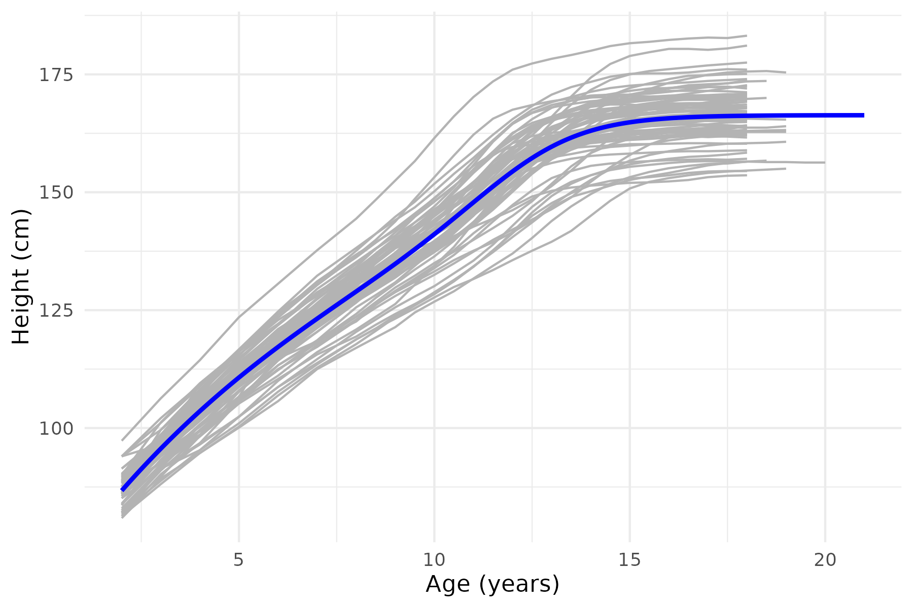
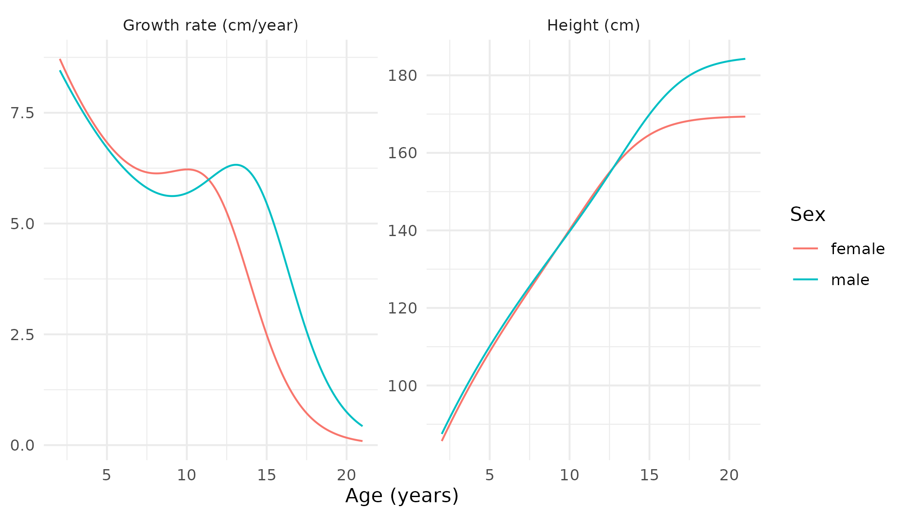

# Timing and maximum growth rates

This vignette covers the times at which growth curves reach a level of
their asymptote,
[`timeto()`](https://emilskindersoe.github.io/gcTMB/reference/timeto.md),
and the maximum growth rates and their timing,
[`maxrate()`](https://emilskindersoe.github.io/gcTMB/reference/maxrate.md),
for the heights of children of the Berkeley Child Guidance Study. The
table of the inflection points and maximum growth rates of the growth
models is in the vignette *Growth models and their parameters*.

## The Preece-Baines model

The heights of the children of `BerkeleyGrowth` (see
[`?BerkeleyGrowth`](https://emilskindersoe.github.io/gcTMB/reference/BerkeleyGrowth.md))
are not a single sigmoid curve: their growth slows down through
childhood, speeds up in the pubertal growth spurt, and stops at the
adult height. Model 1 of Preece and Baines (1978) describes this with
five parameters,

``` math
 h(t) = b_1 - \frac{2 (b_1 - b_3)}{\exp(b_4 (t - b_2)) + \exp(b_5 (t - b_2))}, 
```

the adult height $`b_1`$, the age $`b_2`$ in the middle of puberty, the
height $`b_3`$ at that age, and the rates $`b_4`$ and $`b_5`$ of growth
before and during puberty. The heights were measured from 1.75 years on;
the model is fitted from 2 years, first for the girls:

``` r

library(gcTMB)
library(ggplot2)
berkeley <- subset(BerkeleyGrowth, Age >= 2 & !is.na(Height))
girls <- subset(berkeley, Sex == "female")
fitg <- gcTMB(Height ~ Age, data = girls, model = "preecebaines")
summary(fitg)
#> Call:
#> gcTMB(form = Height ~ Age, data = girls, model = "preecebaines")
#> 
#> Model:  preecebaines
#> Family: gaussian, identity link for all parameters
#> 
#> Number of observations: 1911
#> Log-likelihood: -6089 (df = 6), AIC: 12190, BIC: 12223
#> 
#> Coefficients:
#>                 Estimate Std. Error t value Pr(>|t|)    
#> b1:(Intercept) 1.663e+02  3.242e-01  513.05   <2e-16 ***
#> b2:(Intercept) 1.193e+01  1.068e-01  111.72   <2e-16 ***
#> b3:(Intercept) 1.540e+02  4.734e-01  325.37   <2e-16 ***
#> b4:(Intercept) 1.181e-01  3.554e-03   33.22   <2e-16 ***
#> b5:(Intercept) 8.819e-01  5.776e-02   15.27   <2e-16 ***
#> ---
#> Signif. codes:  0 '***' 0.001 '**' 0.01 '*' 0.05 '.' 0.1 ' ' 1
#> 
#> Residual standard deviation: 5.863 on 1906 degrees of freedom
#> 
#> Optimiser: relative convergence (4), maximum absolute gradient 6.9e-06
ages <- data.frame(Age = seq(2, 21, by = 0.05))
ggplot(girls, aes(x = Age, y = Height)) +
  geom_line(aes(group = ID), colour = "grey70") +
  geom_line(data = cbind(ages, Height = predict(fitg, newdata = ages)), colour = "blue", linewidth = 1) +
  labs(x = "Age (years)", y = "Height (cm)") +
  theme_minimal()
```



## Time to reach a level of the asymptote

[`timeto()`](https://emilskindersoe.github.io/gcTMB/reference/timeto.md)
gives the times at which a curve reaches a percentage of its asymptote,
here the ages at which the girls reach 90%, 95% and 99% of their adult
height, with standard errors by automatic differentiation. With
`type = "absolute"`, the times at which the curve reaches given
responses, here a height of 150 cm.

``` r

tt <- timeto(fitg, level = c(90, 95, 99))
tt
#> Times to reach the percentages of the asymptote:
#> 
#>     Estimate Std.Error
#> 90%     11.3    0.0627
#> 95%     12.6    0.1002
#> 99%     14.9    0.2183
timeto(fitg, level = 150, type = "absolute")
#> Times to reach the responses:
#> 
#>       Estimate Std.Error
#> y=150     11.3    0.0439
```

[`confint()`](https://rdrr.io/r/stats/confint.html) gives profile
likelihood intervals by default, `method = "wald"` Wald intervals and
`method = "boot"` parametric bootstrap intervals.

``` r

confint(tt)
#>        2.5 %   97.5 %
#> 90% 11.15086 11.39731
#> 95% 12.46196 12.85775
#> 99% 14.47672 15.33976
confint(tt, method = "wald")
#>        2.5 %   97.5 %
#> 90% 11.14867 11.39441
#> 95% 12.45152 12.84439
#> 99% 14.44944 15.30572
```

## Maximum growth rate

[`maxrate()`](https://emilskindersoe.github.io/gcTMB/reference/maxrate.md)
gives the time of the maximum growth rate (`tmax`), the maximum growth
rate there (`rate`), and the proportion of total growth at that time,
$`f(t_m)/b_1`$ (`fraction`). The standard errors are by the delta
method. [`confint()`](https://rdrr.io/r/stats/confint.html) gives
profile likelihood intervals for `tmax` and `rate` by default, and Wald
intervals for `fraction`; `method = "wald"` and `method = "boot"` as for
[`timeto()`](https://emilskindersoe.github.io/gcTMB/reference/timeto.md).
The growth rate of the Preece-Baines curve is highest in early childhood
and falls until the take-off of the pubertal growth spurt;
[`maxrate()`](https://emilskindersoe.github.io/gcTMB/reference/maxrate.md)
gives the peak of the spurt, the peak height velocity, and the age at
which it is reached. It is close to, but not the same as, the middle of
puberty $`b_2`$.

``` r

mr <- maxrate(fitg)
mr
#> Time of the maximum growth rate (tmax), maximum growth rate (rate) and proportion of total growth at inflection (fraction):
#> 
#>          Estimate Std.Error
#> tmax       10.866   0.19993
#> rate        6.830   0.18381
#> fraction    0.883   0.00762
confint(mr)
#>               2.5 %     97.5 %
#> tmax     10.4171679 11.2174743
#> rate      6.4965849  7.2257125
#> fraction  0.8684475  0.8983488
```

## Timing and maximum growth rates of boys and girls

Covariates on all five parameters give a curve for each sex, and random
effects of the children on the adult height, the middle of puberty and
the rate during puberty a curve for each child. The default starting
values pool the boys and the girls, and are far from the curve of either
sex when all five parameters differ between the sexes; the fits of each
sex give better starting values, the coefficients of the boys and the
differences of the girls from them:

``` r

fitb <- gcTMB(Height ~ Age, data = subset(berkeley, Sex == "male"), model = "preecebaines")
cb <- coef(fitb)[1:5]
cg <- coef(fitg)[1:5]
```

A starting vector has one entry for each coefficient, in the order of
the coefficients of the model, which
[`gcTMBstart()`](https://emilskindersoe.github.io/gcTMB/reference/gcTMBstart.md)
gives with their names: for each parameter the intercept, here the boys,
and the contrast of the girls. The default starting values are those of
the pooled data, with the contrasts zero; the custom ones are the
coefficients of the boys and the differences of the girls from them:

``` r

default <- gcTMBstart(Height ~ Age, fform = b1 + b2 + b3 + b4 + b5 ~ Sex, data = berkeley, model = "preecebaines")
custom <- setNames(as.vector(rbind(cb, cg - cb)), names(default))
round(cbind(default, custom), 3)
#>                   default  custom
#> b1:(Intercept)    190.906 180.572
#> b1:Sexfemale        0.000 -14.235
#> b2:(Intercept)     20.000  14.123
#> b2:Sexfemale        0.000  -2.189
#> b3:(Intercept)    183.243 166.584
#> b3:Sexfemale        0.000 -12.572
#> b4:(Intercept)      0.109   0.099
#> b4:Sexfemale        0.000   0.019
#> b5:(Intercept) 113206.324   0.790
#> b5:Sexfemale        0.000   0.092
```

Here the default values do not even describe the pooled data: with the
boys and the girls together, the least squares fit of the starting
values runs off to a step at the oldest age, $`b_2 = 20`$, with a huge
rate $`b_5`$.

The custom vector is given to `start` without its names (an unnamed
vector in the order of the coefficients; a vector named by parameter,
e.g. `c(b4 = 0.1)`, gives the value to all the coefficients of that
parameter):

``` r

fitre <- gcTMB(Height ~ Age, fform = b1 + b2 + b3 + b4 + b5 ~ Sex, rform = b1 + b2 + b5 ~ 1 | ID,
               data = berkeley, model = "preecebaines", start = unname(custom),
               control = list(restart = TRUE))
#> Warning: the optimiser did not converge: false convergence (8)
summary(fitre)
#> Call:
#> gcTMB(form = Height ~ Age, fform = b1 + b2 + b3 + b4 + b5 ~ Sex, 
#>     rform = b1 + b2 + b5 ~ 1 | ID, data = berkeley, start = unname(custom), 
#>     model = "preecebaines", control = list(restart = TRUE))
#> 
#> Model:  preecebaines
#> Family: gaussian, identity link for all parameters
#> 
#> Number of observations: 3801, groups: ID 136
#> Log-likelihood: -8820 (df = 17), AIC: 17674, BIC: 17780
#> 
#> Coefficients:
#>                  Estimate Std. Error z value Pr(>|z|)    
#> b1:(Intercept)  1.850e+02  3.829e-01 483.093  < 2e-16 ***
#> b1:Sexfemale   -1.548e+01  4.962e-01 -31.186  < 2e-16 ***
#> b2:(Intercept)  1.480e+01  2.108e-01  70.203  < 2e-16 ***
#> b2:Sexfemale   -2.268e+00  2.958e-01  -7.666 1.77e-14 ***
#> b3:(Intercept)  1.688e+02  2.262e-01 746.169  < 2e-16 ***
#> b3:Sexfemale   -1.368e+01  3.335e-01 -41.014  < 2e-16 ***
#> b4:(Intercept)  8.631e-02  9.322e-04  92.585  < 2e-16 ***
#> b4:Sexfemale    1.575e-02  1.584e-03   9.940  < 2e-16 ***
#> b5:(Intercept)  6.079e-01  2.041e-02  29.786  < 2e-16 ***
#> b5:Sexfemale    1.405e-02  2.826e-02   0.497    0.619    
#> ---
#> Signif. codes:  0 '***' 0.001 '**' 0.01 '*' 0.05 '.' 0.1 ' ' 1
#> Unadjusted Wald tests; tests of the differences between curves adjusted for their number: partest().
#> 
#> Random effects:
#>  Groups Name Std.Dev. Corr       
#>  ID     b1   2.2010              
#>         b2   1.6534   -0.96      
#>         b5   0.1216    0.43 -0.52
#> 
#> Residual standard deviation: 2.087
#> 
#> Optimiser: false convergence (8), maximum absolute gradient 0.0065
#> Warning: the optimiser did not converge: false convergence (8)
converged(fitre)
#> [1] TRUE
```

With 17 parameters and strongly correlated random effects, the fit needs
`control = list(restart = TRUE)` to converge (see the overview
[`vignette("gcTMB")`](https://emilskindersoe.github.io/gcTMB/articles/gcTMB.md)).

[`timeto()`](https://emilskindersoe.github.io/gcTMB/reference/timeto.md)
and
[`maxrate()`](https://emilskindersoe.github.io/gcTMB/reference/maxrate.md)
with `newdata` give the times and rates of the curves of each row, here
the population curves of the sexes (`random = FALSE`):

``` r

sexes <- data.frame(Sex = c("male", "female"))
timeto(fitre, level = c(90, 99), newdata = sexes, random = FALSE)
#> Times to reach the percentages of the asymptote:
#> 
#>                Estimate Std.Error
#> 90%:Sex=male       14.4     0.162
#> 90%:Sex=female     12.1     0.150
#> 99%:Sex=male       19.4     0.290
#> 99%:Sex=female     16.9     0.268
maxrate(fitre, newdata = sexes)
#> Time of the maximum growth rate (tmax), maximum growth rate (rate) and proportion of total growth at inflection (fraction):
#> 
#>                     Estimate Std.Error
#> tmax:Sex=male         13.050    0.1991
#> rate:Sex=male          6.326    0.1717
#> fraction:Sex=male      0.855    0.0047
#> tmax:Sex=female       10.019    0.3102
#> rate:Sex=female        6.221    0.1468
#> fraction:Sex=female    0.828    0.0107
```

The girls reach the middle of puberty, the peak of their growth spurt
and their adult height about two years earlier than the boys.
[`partest()`](https://emilskindersoe.github.io/gcTMB/reference/partest.md)
compares a parameter between the rows of `newdata` by Wald tests, here
the middle of puberty $`b_2`$:

``` r

partest(fitre, newdata = sexes, parm = "b2", adjust = "none")
#> Differences to the reference of b2 (location in time):
#> 
#>                       Estimate Std.Error z value  p.value lower upper
#> Sex=female - Sex=male    -2.27     0.296   -7.67 1.77e-14 -2.85 -1.69
#> 
#> Wald z tests; unadjusted p-values and 95% confidence limits.
```

The height and the growth rate of the population curves of the sexes,
the growth rate by the differences of the predicted heights:

``` r

nd <- merge(sexes, ages)
nd$Height <- predict(fitre, newdata = nd, random = FALSE)
nd$rate <- ave(nd$Height, nd$Sex, FUN = function(h) c(NA, diff(h)) / 0.05)
curves <- rbind(data.frame(nd[, c("Sex", "Age")], value = nd$Height, panel = "Height (cm)"),
                data.frame(nd[, c("Sex", "Age")], value = nd$rate, panel = "Growth rate (cm/year)"))
ggplot(curves, aes(x = Age, y = value, colour = Sex)) +
  geom_line(na.rm = TRUE) +
  facet_wrap(~ panel, scales = "free_y") +
  labs(x = "Age (years)", y = NULL, colour = "Sex") +
  theme_minimal()
```



### Effects on the maximum growth rate

With `b1type = "rate"`, $`b_1`$ is the maximum growth rate of the curve
instead of its asymptote (see *The maximum growth rate as a parameter*
in the vignette *Growth models and their parameters*), so that
covariates on $`b_1`$ are effects on the maximum growth rate. This needs
a curve whose maximum growth rate is proportional to $`b_1`$, which is
not the case for the Preece-Baines curve. The growth spurt alone, from 8
years on, is a sigmoid curve above the height reached before it, as the
Chapman-Richards curve with the intercept $`b_4`$ estimated; with
`b1type = "rate"` and the log link, $`b_1`$ is the peak height velocity,
and the effect of the sex a ratio of the rates. Each child has random
effects on the peak height velocity, on the rate $`b_2`$, which together
with the shape $`b_3`$ sets the timing of the spurt, $`\log(b_3)/b_2`$,
and on the height before the spurt. The spurt is close to a Gompertz
curve, the limit of a large shape $`b_3`$, here about 90; the log link
of $`b_3`$ and a restart of the optimiser from the estimates
(`control = list(restart = TRUE)`) let the optimiser converge there:

``` r

spurt <- subset(BerkeleyGrowth, Age >= 8 & !is.na(Height))
fitrr <- gcTMB(Height ~ Age, fform = b1 + b2 + b4 ~ Sex, rform = b1 + b2 + b4 ~ 1 | ID, data = spurt,
               model = "chapmanrichards", start = c(b4 = 120), fix = c(b4 = FALSE), b1type = "rate",
               link = c(b1 = "log", b3 = "log"), control = list(restart = TRUE))
summary(fitrr)
#> Call:
#> gcTMB(form = Height ~ Age, fform = b1 + b2 + b4 ~ Sex, rform = b1 + 
#>     b2 + b4 ~ 1 | ID, data = spurt, start = c(b4 = 120), fix = c(b4 = FALSE), 
#>     model = "chapmanrichards", link = c(b1 = "log", b3 = "log"), 
#>     b1type = "rate", control = list(restart = TRUE))
#> 
#> Model:  chapmanrichards; b1 is the maximum growth rate
#> Family: gaussian, log link for b1, log link for b3, identity link for the other parameters
#> 
#> Number of observations: 2985, groups: ID 136
#> Log-likelihood: -6298 (df = 14), AIC: 12625, BIC: 12709
#> 
#> Coefficients:
#>                  Estimate Std. Error z value Pr(>|z|)    
#> b1:(Intercept)   2.007188   0.014296 140.404   <2e-16 ***
#> b1:Sexfemale    -0.002929   0.020022  -0.146    0.884    
#> b2:(Intercept)   0.381010   0.005656  67.360   <2e-16 ***
#> b2:Sexfemale     0.072460   0.005456  13.281   <2e-16 ***
#> b3:(Intercept)   4.477682   0.052745  84.893   <2e-16 ***
#> b4:(Intercept) 131.815382   0.598139 220.376   <2e-16 ***
#> b4:Sexfemale    -7.368548   0.835743  -8.817   <2e-16 ***
#> ---
#> Signif. codes:  0 '***' 0.001 '**' 0.01 '*' 0.05 '.' 0.1 ' ' 1
#> Unadjusted Wald tests; tests of the differences between curves adjusted for their number: partest().
#> The coefficients of b1, b3 are on the log scale.
#> 
#> Random effects:
#>  Groups Name Std.Dev. Corr         
#>  ID     b1   0.1071                
#>         b2   0.0309   0.78         
#>         b4   4.5736    0.034 -0.170
#> 
#> Residual standard deviation: 1.57
#> 
#> Optimiser: relative convergence (4), maximum absolute gradient 0.0087
maxrate(fitrr, newdata = sexes)
#> Time of the maximum growth rate (tmax), maximum growth rate (rate) and proportion of total growth at inflection (fraction):
#> 
#>                     Estimate Std.Error
#> tmax:Sex=male         11.752  0.119576
#> rate:Sex=male          7.442  0.106394
#> fraction:Sex=male      0.366  0.000111
#> tmax:Sex=female        9.874  0.088034
#> rate:Sex=female        7.421  0.107249
#> fraction:Sex=female    0.366  0.000111
```

Whether boys and girls have the same peak height velocity is a
likelihood ratio test of the models with and without the sex effect on
$`b_1`$, keeping those on $`b_2`$ and $`b_4`$:

``` r

fitrr0 <- gcTMB(Height ~ Age, fform = b2 + b4 ~ Sex, rform = b1 + b2 + b4 ~ 1 | ID, data = spurt,
                model = "chapmanrichards", start = c(b4 = 120), fix = c(b4 = FALSE), b1type = "rate",
                link = c(b1 = "log", b3 = "log"), control = list(restart = TRUE))
anova(fitrr0, fitrr)
#> Likelihood ratio tests of gcTMB models
#> 
#>        npar   AIC   BIC  logLik deviance       LR Df Pr(>LR)
#> fitrr0   13 12623 12701 -6298.3    12597                    
#> fitrr    14 12625 12709 -6298.3    12597 0.021342  1  0.8839
```

[`partest()`](https://emilskindersoe.github.io/gcTMB/reference/partest.md)
compares the maximum growth rates between the rows of `newdata` by Wald
tests (see
[`?partest`](https://emilskindersoe.github.io/gcTMB/reference/partest.md)
for the contrasts and the adjustment for multiple comparisons). With two
sexes there is a single difference, girls against boys, shown here
without adjustment; with the log link, the differences are log ratios of
the rates, and the ratios are given as well.

``` r

partest(fitrr, newdata = sexes, adjust = "none")
#> Differences to the reference of b1 (maximum growth rate) on the scale of its log link:
#> 
#>                       Estimate Std.Error z value p.value   lower  upper ratio
#> Sex=female - Sex=male -0.00293      0.02  -0.146   0.884 -0.0422 0.0363 0.997
#>                       ratio.lower ratio.upper
#> Sex=female - Sex=male       0.959        1.04
#> 
#> Wald z tests; unadjusted p-values and 95% confidence limits, and ratios.
```

[`predict()`](https://rdrr.io/r/stats/predict.html) with
`type = "parameters"` gives the asymptote of the population curves as
well. For the Chapman-Richards curve with an intercept, the asymptote is
the growth above the intercept $`b_4`$, here the growth during the spurt
above the height before it, about 50 cm, so that the adult height is
$`b_4`$ plus the asymptote:

``` r

pars <- predict(fitrr, newdata = sexes, type = "parameters", random = FALSE)
data.frame(Sex = sexes$Sex, peak_rate = pars[, "b1"], height_before_spurt = pars[, "b4"],
           growth_in_spurt = pars[, "asymptote"], adult_height = pars[, "b4"] + pars[, "asymptote"])
#>      Sex peak_rate height_before_spurt growth_in_spurt adult_height
#> 1   male  7.442358            131.8154        52.79491     184.6103
#> 2 female  7.420593            124.4468        44.22908     168.6759
```

The adult heights agree with the asymptotes $`b_1`$ of the Preece-Baines
curves of the sexes above.

## References

Preece, M.A. and Baines, M.J. (1978). A new family of mathematical
models describing the human growth curve. *Annals of Human Biology* 5,
1–24.
