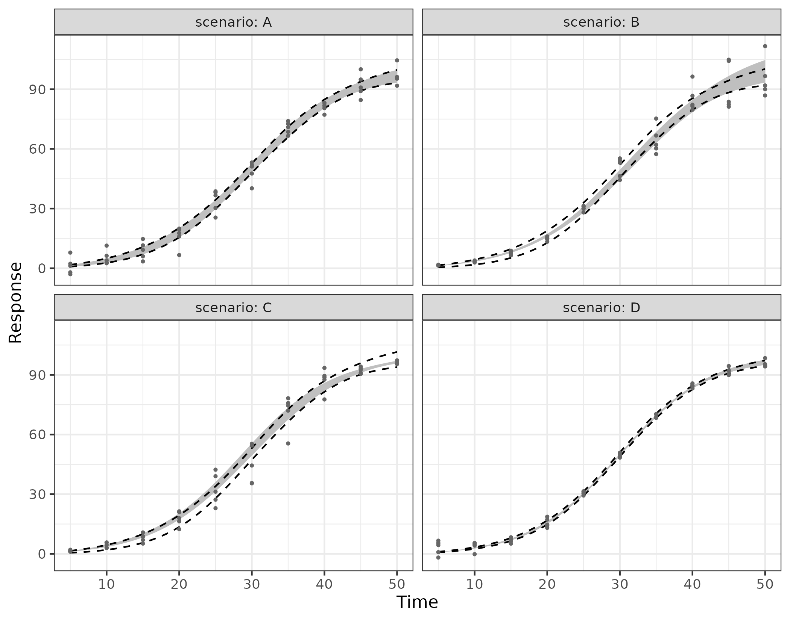

# Variance functions

This vignette covers variance functions: residuals whose variance
changes over the course of growth. It shows what they do to the
confidence intervals of a single curve, and how they trade off against
random effects and autocorrelation. The vignette *Simulation* checks
that a variance function is recovered by simulation.

## Variance functions

With a variance function, the residual standard deviation of an
observation is $`\sigma g`$, with a function $`g`$ of a covariate $`v`$
(for the gaussian family, and for $`\log(y)`$ of the lognormal family).
The argument `variance` of
[`gcTMB()`](https://emilskindersoe.github.io/gcTMB/reference/gcTMB.md)
takes:

- `varIdent(form = ~ 1 | s)`: $`g = \delta_s`$, a ratio for each stratum
  $`s`$, e.g. each treatment or each day of measurement;
- `varPower(form = ~ v)`: $`g = |v|^\delta`$;
- `varConstPower(form = ~ v)`: $`g = c + |v|^\delta`$, at least $`c`$
  where $`v`$ is zero.

The covariate $`v`$ is a variable of the data, the fitted curve
`fitted(.)`, or its growth rate `rate(.)`, the slope $`f'(t)`$ of the
curve. A variance that follows the growth rate is largest at the
inflection point.
[`?varFunc`](https://emilskindersoe.github.io/gcTMB/reference/varFunc.md)
has the details.

## Confidence intervals of a single curve

We simulate a logistic curve, $`b_1 = 100`$, $`b_2 = 30`$ and
$`b_3 = 6`$, with five replicates at ten times, under four variance
structures:

- A, a constant standard deviation of 4;
- B, $`0.08 f(t)`$, increasing with the curve:
  `varPower(form = ~ fitted(.))` with $`\delta = 1`$;
- C, $`2 f'(t)`$, largest at the inflection point:
  `varPower(form = ~ rate(.))` with $`\delta = 1`$;
- D, $`2 / \sqrt{f'(t)}`$, smallest at the inflection point:
  `varPower(form = ~ rate(.))` with $`\delta = -0.5`$.

``` r

library(gcTMB)
library(ggplot2)
b <- c(100, 30, 6)
Time <- rep(seq(5, 50, by = 5), each = 5)
f <- b[1]/(1 + exp(-(Time - b[2])/b[3]))
rate <- f*(1 - f/b[1])/b[3]
sds <- list(A = rep(4, length(Time)), B = 0.08*f, C = 2*rate, D = 2/sqrt(rate))
set.seed(2)
scen <- do.call(rbind, lapply(names(sds), function(s)
  data.frame(scenario = s, Time = Time, y = f + rnorm(length(Time), 0, sds[[s]]))))
```

Each data set is fitted with a constant variance and with the two power
functions; the AIC picks the true one in each scenario:

``` r

candidates <- list(constant = NULL, fitted = varPower(form = ~ fitted(.)),
                   rate = varPower(form = ~ rate(.)))
scenfits <- lapply(split(scen, scen$scenario), function(d)
  lapply(candidates, function(v) gcTMB(y ~ Time, data = d, variance = v)))
t(sapply(scenfits, function(fl) sapply(fl, AIC)))
#>   constant   fitted     rate
#> A 296.7242 298.5887 298.3681
#> B 322.8103 252.1230 324.6215
#> C 317.7054 290.5471 255.0336
#> D 212.1640 200.5685 196.4342
```

The 95% Wald confidence bands of the curve,
`predict(interval = "confidence")`, with the true variance function
(shaded) and with a constant variance (dashed):

``` r

grid <- data.frame(Time = seq(5, 50, by = 0.5))
true <- c(A = "constant", B = "fitted", C = "rate", D = "rate")
bands <- do.call(rbind, lapply(names(true), function(s){
  ci <- predict(scenfits[[s]][[true[s]]], newdata = grid, interval = "confidence")
  c0 <- predict(scenfits[[s]]$constant, newdata = grid, interval = "confidence")
  data.frame(scenario = s, Time = grid$Time, fit = ci$fit, lwr = ci$lwr, upr = ci$upr,
             lwr0 = c0$lwr, upr0 = c0$upr)
}))
ggplot(bands, aes(Time)) +
  geom_ribbon(aes(ymin = lwr, ymax = upr), fill = "grey75") +
  geom_line(aes(y = lwr0), linetype = "dashed") +
  geom_line(aes(y = upr0), linetype = "dashed") +
  geom_point(data = scen, aes(y = y), size = 0.6, colour = "grey40") +
  facet_wrap(~ scenario, labeller = label_both) +
  labs(x = "Time", y = "Response") +
  theme_bw()
```



The variance function gives the observations where they vary little more
weight, so the curve is estimated more precisely there: early on in B,
before and after growth in C, and around the inflection point in D. A
constant variance spreads the uncertainty evenly over the curve, too
narrow where the observations vary most and too wide where they vary
least.

## Random effects, autocorrelation and a variance function

With repeated measurements of the same plants, random effects,
autocorrelation and a variance function all change the variance of the
observations around the curve. Random effects of the plants make the
spread around the population curve grow as the plants grow, even when
the residuals have a constant variance; a variance function changes the
variance of the residuals themselves. We fit a single curve to the
heights of 20 plants of `FabaHeights26`:

``` r

fh <- droplevels(subset(FabaHeights26, Genotype == "Navarra" & Soil == "Loamy" &
                          Treatment == "Irrigated"))
re <- b1 + b2 ~ 1 | Plant_ID
car <- corCAR1(form = ~ DAS | Plant_ID)
power <- varPower(form = ~ fitted(.))
day <- varIdent(form = ~ 1 | DAS)
specs <- list(
  "constant"              = list(),
  "power"                 = list(variance = power),
  "random"                = list(rform = re),
  "random + power"        = list(rform = re, variance = power),
  "random + rate"         = list(rform = re, variance = varPower(form = ~ rate(.))),
  "random + day"          = list(rform = re, variance = day),
  "random + CAR(1)"       = list(rform = re, correlation = car),
  "random + CAR(1) + day" = list(rform = re, correlation = car, variance = day))
fits <- lapply(specs, function(s) do.call(gcTMB, c(list(Height ~ DAS, data = fh), s)))
tab <- t(sapply(fits, function(f)
  c(df = attr(logLik(f), "df"), AIC = AIC(f), coef(f)[1:3], se = sqrt(diag(vcov(f)))[1:3])))
colnames(tab) <- c("df", "AIC", "b1", "b2", "b3", "se b1", "se b2", "se b3")
round(tab, 2)
#>                       df     AIC    b1    b2   b3 se b1 se b2 se b3
#> constant               4 1799.11 89.30 62.77 8.24  0.82  0.42  0.38
#> power                  5 1610.32 90.76 63.60 9.39  1.09  0.45  0.22
#> random                 7 1543.06 89.36 62.81 8.23  2.01  0.42  0.19
#> random + power         8 1453.54 89.92 63.05 8.80  2.02  0.40  0.17
#> random + rate          8 1539.90 89.03 62.73 8.16  2.07  0.43  0.21
#> random + day          19 1340.38 89.04 63.02 8.77  2.15  0.40  0.11
#> random + CAR(1)        8 1538.14 89.35 62.82 8.24  2.01  0.43  0.23
#> random + CAR(1) + day 20 1309.54 89.65 63.22 8.96  2.21  0.45  0.15
```

Without random effects, the power of the fitted curve lowers the AIC a
lot, as the heights spread out as the plants grow. But it treats the 260
heights as independent: with random effects, the 20 plants are the
replicates, the AIC is lower still, and the standard error of the
asymptote $`b_1`$ is about twice as large. The random effects come
first; a variance function then describes the residuals around the curve
of each plant. These still grow with the height, and are not largest at
the inflection point (the power of the growth rate is close to 0):

``` r

sapply(fits[c("random + power", "random + rate")], varpars)
#> random + power.power  random + rate.power 
#>            0.3815162            0.0868291
```

A variance for each day lowers the AIC the most, with or without the
autocorrelation of the residuals of a plant. Its ratios show a single
day, 83, with much larger residuals than the others, which no smooth
function of the curve can follow:

``` r

round(rbind(day = varpars(fits[["random + day"]]),
            "CAR(1) + day" = varpars(fits[["random + CAR(1) + day"]])), 2)
#>              28   35   42   49   56   63   69   83   90   98  106  114  122
#> day           1 0.48 0.56 1.37 1.50 1.56 2.65 7.29 3.24 1.31 1.74 1.10 2.07
#> CAR(1) + day  1 0.37 0.84 2.29 2.64 3.03 3.86 9.42 4.31 1.99 2.44 0.05 2.10
```

With the autocorrelation, but not without it, day 114 gets a ratio close
to 0, probably because its residuals hardly differ from those of the
previous day, so that given them almost no variance is left. Such a
ratio makes the AIC of the model optimistic, and a variance for each day
needs many observations per day.
