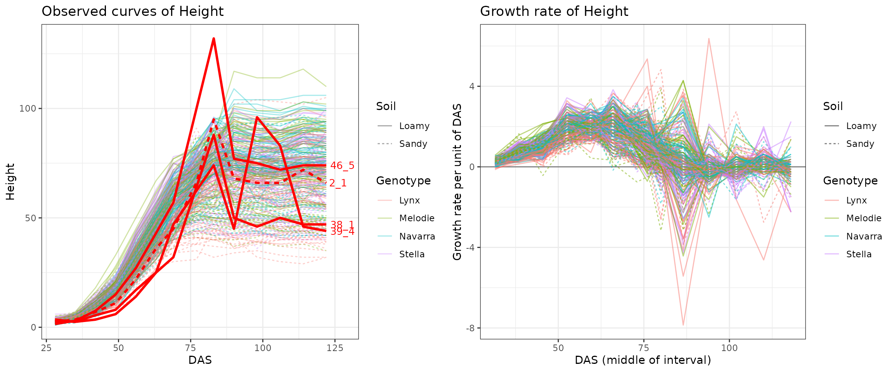
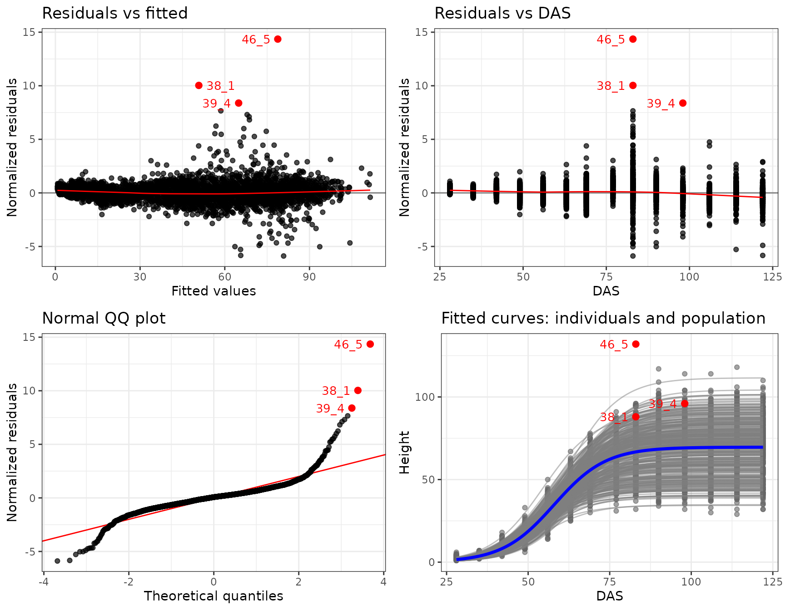

# Exploring observed curves

[`viewcurves()`](https://emilskindersoe.github.io/gcTMB/reference/viewcurves.md)
opens an app to step through the observed curves of the individuals of a
data set:

``` r

library(gcTMB)
viewcurves(FabaHeights26, x = "DAS", y = "Height", id = "Plant_ID", covariates = c("Genotype", "Soil"),
           output = "html")
```

The app below is that call, running in your browser. It can take half a
minute to start the first time, and it responds more slowly than the app
does when
[`viewcurves()`](https://emilskindersoe.github.io/gcTMB/reference/viewcurves.md)
is run in R on your own computer.

## Outliers in the data

With `output = "jpeg"`,
[`viewcurves()`](https://emilskindersoe.github.io/gcTMB/reference/viewcurves.md)
draws the curves and growth rates of all plants. The plants with the
steepest increases and the plants with the steepest decreases between
two measurements, `outliers` of each, are drawn in red and reported:

``` r

library(gcTMB)
vc <- viewcurves(FabaHeights26, x = "DAS", y = "Height", id = "Plant_ID", covariates = c("Genotype", "Soil"),
                 output = "jpeg", outliers = 3)
#> Largest increase between successive observations: Plant_ID 39_4 (growth rate 6.38 from DAS 90 to 98)
#> Largest increase between successive observations: Plant_ID 46_5 (growth rate 5.36 from DAS 69 to 83)
#> Largest increase between successive observations: Plant_ID 2_1 (growth rate 4.83 from DAS 77 to 83)
#> Largest decrease between successive observations: Plant_ID 46_5 (growth rate -7.86 from DAS 83 to 90)
#> Largest decrease between successive observations: Plant_ID 38_1 (growth rate -5.43 from DAS 83 to 90)
#> Largest decrease between successive observations: Plant_ID 39_4 (growth rate -4.62 from DAS 106 to 114)
```



## Outliers in the residuals

The validation plots of a fitted model draw the `outliers` observations
with the largest absolute residuals in red, labelled by their plant,
here for a logistic curve with random effects of the plants on the
asymptote b1 and the inflection point b2:

``` r

fit <- gcTMB(Height ~ DAS, rform = b1 + b2 ~ 1 | Plant_ID, truncated = FALSE, data = FabaHeights26)
plot(fit, outliers = 3)
```



The two kinds of outliers are not the same. A steep rise or fall in the
data is not unusual for a plant whose own fitted curve rises or falls
steeply there, while a residual measures how far an observation is from
the curve of its plant. Both methods flag 39_4, 46_5 and 38_1. Only the
data flag 2_1.
